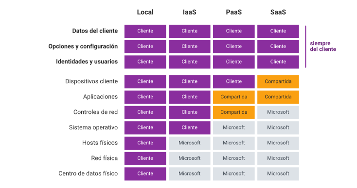
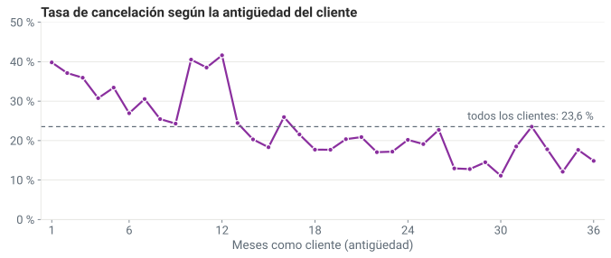
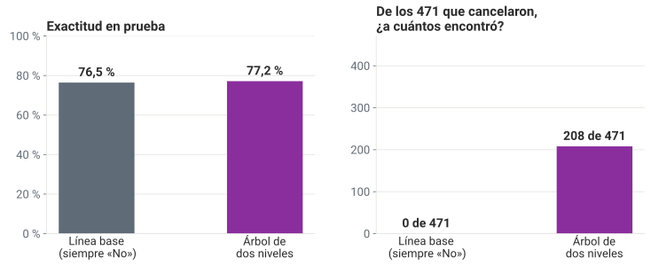

<!--
  Sesión 1 (4 h, viernes 6 de noviembre de 2026, 18:00–22:00): bienvenida 15 min ·
  diagnóstico 20 · nube 60 · pausa 10 · aprender de datos 75 · práctica en Colab 50 ·
  cierre 10. Las diapositivas de código corresponden a las celdas del notebook (mismo
  identificador entre corchetes); las salidas son las de precalculo/salidas_sesion1.json,
  ejecutadas en la réplica de Colab (Python 3.13, pandas 2.2.3, scikit-learn 1.6.1).
  Las cifras del texto salen de la celda [cifras] (precalculo). Las afirmaciones de nube, de
  ML y de normas se apoyan en fuentes/FUENTES.md: el ID va al final de cada nota.
  Hitos de reloj en la nota de «Hoy, en cuatro horas…». Control de calidad del 6 de
  noviembre: AUDITORIA_sesion1_2026-11-06.md.
-->

# Bienvenida {icono=fa-door-open}

> Dos materias, cinco sesiones y un caso: llevar un modelo a la nube sin poner en riesgo a los clientes.

???
Saludar y presentarse. Pegar en el chat el enlace de la portada del curso (https://jotamao1985.github.io/Machine-Learning-cloud-computing_Ucompensar/) y pedir que guarden desde ya una copia del notebook de hoy en su Drive: lo usaremos a las 21:00. No hace falta ejecutarlo todavía.

## Dos materias, un hilo: aprendizaje automático en la nube

::: tarjetas
### Machine Learning
Aprender de datos: con etiqueta, sin etiqueta, con redes neuronales y por refuerzo.
### Seguridad en la nube
Azure: modelos de servicio, identidades y roles, directivas, almacenamiento y monitoreo.
### El hilo
Las dos materias avanzan juntas, sesión a sesión, sobre **el mismo caso**.
:::

???
Contar el hilo con una pregunta real de las empresas: ya tengo un modelo en mi computador, ¿cómo lo llevo a la nube sin exponer los datos de las personas? El curso junta dos syllabus de la Especialización en Big Data, «Machine Learning» y «Seguridad en Cloud Computing». Cada uno prevé 32 horas con el docente y 64 de trabajo independiente; el horario da 24 horas sincrónicas y el resto pasa al trabajo independiente.

## Cinco sesiones en tres semanas: tres viernes por la noche y dos sábados por la mañana

| Sesión | Cuándo | Machine Learning | Nube y seguridad |
|---|---|---|---|
| **S1** · hoy | vie 6 nov · 18:00⁠–⁠22:00 | Qué es aprender de datos; la línea base | NIST, modelos de servicio, responsabilidad compartida |
| **S2** | sáb 7 nov · 7:00⁠–⁠13:00 | Regresión y clasificación | Identidades, control de acceso basado en roles (RBAC) y Azure Policy |
| **S3** | vie 13 nov · 18:00⁠–⁠22:00 | Grupos sin etiqueta | Riesgos, regulación y privacidad |
| **S4** | sáb 14 nov · 7:00⁠–⁠13:00 | Redes neuronales | Almacenamiento, monitoreo y Defender |
| **S5** | vie 20 nov · 18:00⁠–⁠22:00 | Aprendizaje por refuerzo | Sustentación del proyecto |

???
Insistir: la S2 es mañana a las 7:00 y hoy salimos a las 22:00. Por eso el trabajo independiente de esta noche es corto (la cuenta de Azure, si se puede, y terminar la práctica); la lectura queda para la semana. En la S3 también se compara IaaS con PaaS, y en la S4 hay un laboratorio opcional en la capa gratuita de Azure para quien tenga cuenta.

## Hoy, en cuatro horas: del diagnóstico a la primera línea base

::: flujo
1. **Bienvenida** — 18:00 · 15 min
2. **Diagnóstico** — 18:15 · 20 min
3. **La nube** — 18:35 · 60 min
4. **Pausa** — 19:35 · 10 min
5. **Aprender de datos** — 19:45 · 75 min
6. **Colab** — 21:00 · 50 min
7. **Cierre** — 21:50 · 10 min
:::

???
Hitos de reloj (número de diapositiva en la esquina): la 3 a las 18:00 (bienvenida); la 11 a las 18:15 (diagnóstico); la 23 a las 18:35 (nube); la 38 a las 19:35 (pausa); la 39 a las 19:45 (aprender de datos); la 59 a las 21:00 (Colab); la 71 a las 21:50 (cierre). Si a las 19:20 no se ha llegado a «Migrar no es solo copiar», recortar en este orden: (1) «¿Es nube en el sentido del NIST?», responderla en voz alta sin pausa (−2 min); (2) en «¿Qué estrategia sigue Yarumo?», comentar solo la 2 y la 4 (−2 min); (3) «Clasifica estos servicios» se deja para el chat, con la respuesta proyectada (−3 min). En aprender de datos, si a las 20:10 no se ha llegado a «Tres tipos de aprendizaje», saltar «¿Tarea, medida o experiencia?» y la historia breve (−4 min); y si a las 20:35 no se ha llegado a «Antes de entrenar», saltar «¿Acierta la gerente?» y decir su respuesta en una frase (−2 min). La práctica no se recorta: el ejercicio 3 es el puente con la S2.

## Se evalúa con un proyecto final en parejas, que se sustenta el 20 de noviembre

- **Proyecto en parejas** (trío solo si el grupo es impar): un plan de adopción segura de Azure para el modelo de Yarumo
- Tres partes: un cuaderno (*notebook*) con un modelo y sus métricas, un **plan de nube** y la **sustentación** en la S5
- **El enunciado y la rúbrica se presentan en la S2**, mañana
- Los ejercicios de cada sesión son **formativos**: sirven para aprender y para avanzar el proyecto

Tres miradas: **autoevaluación**, **coevaluación** y **heteroevaluación**.

???
No adelantar pesos ni porcentajes: el enunciado y la rúbrica (con los criterios CR1 a CR3 de los dos syllabus) se presentan al final de la S2. El plan de nube incluirá el modelo de servicio, la responsabilidad compartida, los roles con privilegio mínimo, las directivas, el almacenamiento y el monitoreo, la privacidad y el costo en la capa gratuita: casi todo empieza hoy. Las tres miradas de la evaluación son las de la metodología de los dos syllabus.

## Yarumo Fibra S.A.S.: un operador de internet que nos acompaña las cinco sesiones

::: tarjetas
### 8000 clientes
Activos el 30 de junio de 2026, en Bogotá, Medellín, Cali, Barranquilla y Pereira.
### 21 columnas
Del contrato y la antigüedad a la velocidad medida y las caídas del servicio.
### Una etiqueta
`cancelo`: si el cliente canceló entre el 1 de julio y el 30 de septiembre.
:::

Yarumo es una empresa **ficticia**, con sede en Pereira: sus datos se generaron con una semilla fija y no corresponden a personas ni a empresas reales.

???
Decirlo en voz alta: es ficticia. Yarumo corre hoy todo en un centro de datos pequeño propio, en Pereira. En la historia aparecen la gerente de experiencia del cliente, el jefe de TI, el oficial de protección de datos y el equipo de analítica, que somos nosotros. El yarumo es un árbol andino; el nombre no alude a ninguna empresa.

## La gerencia tiene dos preguntas, y cada una es una mitad del curso

1. ¿Podemos **anticipar qué clientes van a cancelar** (*churn*), para ofrecerles retención a tiempo? → *aprendizaje automático*
2. ¿Llevamos los datos y el modelo a **Azure**, y cómo, sin poner en riesgo los datos personales de los clientes? → *seguridad en la nube*

???
Hoy empezamos por la segunda (la nube) y terminamos con la primera (la línea base): avisarlo. Arco del curso: hoy planteamos el problema (qué predecir, con qué datos y contra qué línea base) y pensamos qué modelo de servicio conviene; en la S2 se entrenan y comparan modelos y se define quién puede ver qué en Azure; en la S3, segmentos, riesgos y regulación; en la S4, una red neuronal, el almacenamiento y el monitoreo; en la S5, una política de retención por refuerzo y la sustentación.

## Recibes una tabla seudonimizada: sin nombre ni cédula, pero todavía con datos personales

::: tarjetas
### Se quedaron en el CRM
Nombre, cédula, dirección y teléfono, en el sistema de gestión de clientes.
### Viajan en clientes.csv
Un seudónimo, `id_cliente`, y veinte columnas más: edad, ciudad, estrato, contrato, consumo…
:::

La edad, la ciudad y el estrato siguen siendo **datos personales**: Yarumo puede volver a unirlos con la persona a través de `id_cliente`.

???
Decir: seudonimizar no es anonimizar; quien tiene la tabla de equivalencias puede volver a identificar a cada cliente. La Ley 1581 de 2012 define dato personal como cualquier información vinculada o que pueda asociarse a personas determinadas o determinables (art. 3, lit. c; F-LEY-01), y por eso sigue siendo aplicable. La SIC dijo en 2026 que cifrar o seudonimizar no vuelve anónimo un dato si todavía se puede individualizar a la persona; lo dijo de datos biométricos, así que aplicarlo al seudónimo de Yarumo es una extensión razonable del criterio (F-LEY-09). El estrato es el de la dirección del servicio: lo asigna el municipio a la vivienda, no mide el ingreso. Transición: ya conocen a Yarumo y sus dos preguntas; antes de responderlas, ¿desde dónde arrancamos?

# Diagnóstico {icono=fa-stethoscope}

> Sin nota: sirve para saber desde dónde arrancamos, no para calificar.

???
Es la Etapa 0 (reconocimiento) de los dos syllabus. El de Seguridad en Cloud Computing pide una lluvia de ideas: palabras clave, frases y un relato corto, que se socializan en grupos pequeños con una discusión guiada. El de Machine Learning pide un instrumento individual, de carácter diagnóstico, sobre dato, información y conocimiento y sobre las posturas éticas frente a la información. Hacemos las dos cosas, en ese orden: primero las ideas propias, antes de que el cuestionario les ponga palabras.

## Dos instrumentos: una lluvia de ideas en grupo y un cuestionario individual

::: flujo
1. **Lluvia de ideas** — sola o solo, en salas y por el chat · 10 min
2. **Cuestionario** — ocho preguntas de opción múltiple, unos 45 segundos cada una · 7 min
3. **Respuestas** — cuentas tus aciertos · 2 min
:::

Nada de buscar en internet: el diagnóstico solo sirve si es honesto.

???
Abrir ya las salas pequeñas (de cuatro) para no perder tiempo en la transición. El cuestionario se recoge por la encuesta de la plataforma si está disponible (da los aciertos por pregunta); si no, por el chat: las ocho letras seguidas, al final.

## Lluvia de ideas: ¿qué es para ti la nube, y qué es aprender de datos?

::: flujo
1. **Sola o solo** — cinco palabras clave y un relato de cinco líneas · 3 min
2. **En salas de cuatro** — juntan las palabras, eligen las tres que más se repiten y su mayor duda · 4 min
3. **Por el chat** — cada sala escribe sus tres palabras y su duda · 3 min
:::

El relato: **«Cómo usaría Yarumo la nube y sus datos para no perder clientes»**.

???
El syllabus pide media hoja; en virtual, cinco líneas en un documento o en papel. Leer en voz alta lo que llegue al chat y anotar aparte las dudas: se responden a lo largo del curso y conviene volver a ellas en la S5. Cerrar con una o dos conclusiones generales (por ejemplo, si casi nadie mencionó seguridad o privacidad, decirlo). Las expectativas del grupo se contrastan con el mapa que ya vimos.

## ¿Quién debía cerrarle el acceso? {.pregunta etiqueta="Diagnóstico · 1 de 8"}

Una exempleada sigue entrando al correo corporativo, que es un servicio en la nube.

- **A.** El proveedor del correo
- **B.** Su antiguo empleador
- **C.** Nadie: es un riesgo propio de la nube
- **D.** Ella misma, al irse

???
Unos 45 segundos. Respuesta: B. Mide la idea de responsabilidad compartida: las cuentas y el acceso son siempre del cliente, también en SaaS. No comentar todavía.

## ¿Es bueno un modelo que acierta en tres de cada cuatro clientes? {.pregunta etiqueta="Diagnóstico · 2 de 8"}

Es un modelo para anticipar qué clientes cancelarán.

- **A.** No se sabe: falta saber cuántos clientes cancelan en realidad
- **B.** Sí: acierta en la mayoría de los casos
- **C.** No: un buen modelo pasa del 90 %
- **D.** No se sabe: falta saber cuántas columnas usa

???
Unos 45 segundos. Respuesta: A. Mide la idea de línea base, que es el remate de la noche: no explicarla ahora.

## ¿Cuál de estas frases es conocimiento, y no solo un dato o información? {.pregunta etiqueta="Diagnóstico · 3 de 8"}

- **A.** «C00002 · Mes a mes · 6 meses · Sí»
- **B.** «La tabla tiene 8000 filas: una por cliente activo el 30 de junio»
- **C.** «El 23,6 % de los clientes canceló en el trimestre, casi uno de cada cuatro»
- **D.** «Los clientes mes a mes cancelan más: conviene ofrecerles permanencia»

???
Unos 45 segundos. Respuesta: D. Es la distinción que pide la Etapa 0 del syllabus de Machine Learning. A es un dato (un registro sin interpretar); B y C son información (datos organizados, con contexto); D es conocimiento: una relación entendida que orienta una decisión. Lo típico es definir la información a partir de los datos y el conocimiento a partir de la información, pero no hay consenso sobre cómo se pasa de un nivel al otro (Rowley, 2007, sobre la jerarquía de Ackoff; F-ML-65). Ni el glosario del NIST usa una sola definición (F-NUBE-04): la frontera se discute, y vale discutirla.

## Yarumo alquila una máquina virtual en la nube: ¿qué modelo de servicio usa? {.pregunta etiqueta="Diagnóstico · 4 de 8"}

Su equipo elige el sistema operativo, instala la base de datos y les aplica los parches.

- **A.** SaaS
- **B.** PaaS
- **C.** IaaS
- **D.** Nube privada

???
Unos 45 segundos. Respuesta: C. La D confunde modelo de servicio con modelo de implementación: lo veremos en un cuarto de hora.

## ¿Qué tipo de aprendizaje usa este programa? {.pregunta etiqueta="Diagnóstico · 5 de 8"}

Con los clientes del año pasado, de los que ya se sabe quién canceló, se entrena un programa que estima quién cancelará este trimestre.

- **A.** No supervisado
- **B.** Supervisado
- **C.** Por refuerzo
- **D.** Ninguno: eso es estadística

???
Unos 45 segundos. Respuesta: B: hay una etiqueta (si canceló). La D es una buena discusión para después: el aprendizaje automático y la estadística comparten muchas herramientas.

## ¿Qué opinas de este uso del modelo? {.pregunta etiqueta="Diagnóstico · 6 de 8"}

La gerencia quiere usar el modelo de cancelación para subirles la tarifa a los clientes que probablemente no se irán.

- **A.** Adelante: los datos y el modelo son de Yarumo
- **B.** Adelante, si el modelo tiene buena exactitud
- **C.** Con reparos: no es para lo que se recogieron los datos
- **D.** No: ningún modelo debe usar datos de clientes

???
Unos 45 segundos. Respuesta: C. Mide la postura ética frente a los datos, que también pide la Etapa 0 del syllabus de Machine Learning. La Ley 1581 de 2012 exige que el tratamiento obedezca a una finalidad legítima, informada al titular (art. 4, lit. b, principio de finalidad; F-LEY-01). La A es la más tentadora: que los datos estén en manos de Yarumo no le da libertad para cualquier uso. Lo retomamos en la S3.

## ¿Qué dos características de la nube describe este caso? {.pregunta etiqueta="Diagnóstico · 7 de 8"}

Una tienda en línea pasa de dos a veinte servidores la noche del *Black Friday*, vuelve a dos el lunes y paga solo las horas que usó.

- **A.** Autoservicio bajo demanda y acceso amplio por la red
- **B.** Agrupación de recursos y nube híbrida
- **C.** Alta disponibilidad y SaaS
- **D.** Elasticidad rápida y servicio medido

???
Unos 45 segundos. Respuesta: D. Son dos de las cinco características esenciales del NIST. La A tiene algo de cierto (pedir servidores es autoservicio), pero no explica ni la vuelta a dos ni el cobro por horas. «Alta disponibilidad» suena bien, pero no es una de las cinco; y «nube híbrida» es un modelo de implementación.

## En pandas, ¿qué devuelve `(clientes["cancelo"] == "Sí").mean()`? {.pregunta etiqueta="Diagnóstico · 8 de 8"}

- **A.** Qué proporción de los clientes canceló
- **B.** Cuántos clientes cancelaron
- **C.** Un error: no se puede promediar un texto
- **D.** El promedio de la factura de los que cancelaron

???
Unos 45 segundos. Respuesta: A. Mide el nivel de Python. Si muchos fallan, ir despacio en el repaso exprés de la práctica (diapositiva «Una comparación da True o False…»).

## Respuestas del diagnóstico: cuenta tus aciertos {.denso}

| Pregunta | Respuesta | Lo vemos |
|---|---|---|
| 1 · El acceso al correo | **B** · el empleador: las cuentas son siempre del cliente | Hoy, responsabilidad compartida |
| 2 · Tres de cada cuatro | **A** · falta un dato: lo vemos al final de la noche | Hoy, al final |
| 3 · Conocimiento | **D** · una relación que orienta una decisión | Hoy y todo el curso |
| 4 · La máquina virtual | **C** · IaaS | Hoy, modelos de servicio |
| 5 · Los del año pasado | **B** · supervisado: hay etiqueta | Hoy y en la S2 |
| 6 · Subir la tarifa | **C** · ese uso cambia la finalidad de los datos | Hoy y en la S3 |
| 7 · *Black Friday* | **D** · elasticidad y servicio medido | Hoy, el NIST |
| 8 · `.mean()` | **A** · la proporción | Hoy, en Colab |

???
Es su primera autoevaluación. Recoger el número de aciertos y las ocho letras (encuesta de la plataforma o chat). Si muchos fallan la 8, el repaso de pandas de la práctica va despacio. Guardar los resultados: el cierre de la S5 puede repetir el diagnóstico para comparar. No explicar ahora cada pregunta: casi todas se responden hoy mismo. Transición: empezamos por la segunda pregunta de la gerencia, la nube.

# La nube {icono=fa-cloud}

> Hoy todo es de Yarumo: el edificio, los servidores y los parches. ¿Qué cambia si lo alquila?

???
Bloque de 60 minutos: definición del NIST, modelos de servicio y de implementación, responsabilidad compartida y migración, con cuatro ejercicios cortos y la pregunta de Yarumo al final.

## En su centro de datos, todo es de Yarumo, también lo que falla

- Compra los servidores **por adelantado**, pensando en el día de más tráfico
- Su equipo de TI instala, actualiza y vigila **cada capa**, del edificio a la aplicación
- Si se va la luz en su centro de datos de Pereira o se daña un disco, **el problema es suyo**

Así trabaja hoy: **local** (*on-premises*, en sus propias instalaciones).

???
Preguntar: ¿qué parte de esto le gustaría a Yarumo dejar de hacer? Dejar la respuesta en el aire. Sigue: qué es la nube, con la definición del NIST. Fuente: en un centro de datos propio, el cliente es dueño de toda la pila; al pasar a la nube, parte de esas responsabilidades se transfiere al proveedor según el tipo de servicio (Microsoft Learn, «Responsabilidad compartida en la nube», sección *Division of responsibility*; F-AZ-01).

## El NIST define la nube como un modelo de acceso, no como un lugar

::: definicion Computación en la nube (NIST)
Un modelo que permite el acceso ubicuo, cómodo y bajo demanda, por la red, a un conjunto compartido de recursos configurables (redes, servidores, almacenamiento, aplicaciones y servicios) que se pueden aprovisionar y liberar rápidamente, con un mínimo esfuerzo de gestión o de interacción con el proveedor.
:::

Se compone de **cinco características esenciales**, **tres modelos de servicio** y **cuatro modelos de implementación**. El NIST es el Instituto Nacional de Estándares y Tecnología de los Estados Unidos.

???
Leer la definición en voz alta y preguntar qué palabra de ella no es «un lugar». Que la nube sea «un modelo, no un lugar» es nuestra lectura: la definición habla de un modelo de acceso. Sigue: las cinco características. Fuente: Mell, P. y Grance, T. (2011), *The NIST definition of cloud computing*, NIST SP 800-145, sección 2, p. 2 (F-NUBE-01). La traducción es nuestra; el original empieza «Cloud computing is a model for enabling ubiquitous, convenient, on-demand network access». La publicación es de 2011 y sigue vigente: su ficha no indica retiro ni sustituto. Es la lectura de esta semana.

## Cinco características esenciales: si falta una, no es nube en el sentido del NIST {.denso}

| Característica | Qué significa | En Yarumo |
|---|---|---|
| **Autoservicio bajo demanda** | Pides recursos tú mismo, sin hablar con nadie del proveedor | El analista crea una máquina desde el portal |
| **Acceso amplio por la red** | Se usa por la red, con mecanismos estándar, desde distintos dispositivos | El tablero se abre en el portátil o en el celular |
| **Agrupación de recursos** (*resource pooling*) | El proveedor atiende a muchos clientes con los mismos equipos | Yarumo no sabe en qué servidor corre, solo en qué región |
| **Elasticidad rápida** | Crece y decrece con la demanda, a veces sola | Veinte máquinas para entrenar un modelo esta noche; mañana, ninguna |
| **Servicio medido** | El uso se mide, se controla y se reporta | La factura llega por horas de máquina y por GB guardados |

???
Recorrer la columna de Yarumo, no la definición. Sigue: un caso para ver si de verdad faltan. Fuente: NIST SP 800-145, sección 2, p. 2 (F-NUBE-01). En la agrupación de recursos el modelo es multiinquilino: el cliente en general no controla la ubicación exacta, salvo a alto nivel (país, región o centro de datos). La nota al pie del NIST asocia el servicio medido con el pago por uso, «típicamente».

## ¿Es nube en el sentido del NIST? {.pregunta}

Un proveedor ofrece por internet máquinas virtuales que comparte entre muchos clientes, que crecen y se reducen solas según la carga y que cobra por hora de uso. Pero para crear una máquina nueva hay que llamar a una asesora, que la configura en uno o dos días.

::: respuesta
**No, en el sentido del NIST.** Cumple cuatro características, pero le falta el **autoservicio bajo demanda**: para crear un recurso hay que hablar con el proveedor. Basta que falte una.
:::

???
Dar un minuto y pedir en el chat un sí o un no, con la característica que falta. Si alguien dice que sí «porque es casi todo», es el punto: el NIST pide las cinco. Sirve también para la última pregunta del bloque: un centro de datos propio no es una «nube privada» en el sentido del NIST solo por ser propio; lo sería si cumpliera las cinco características (F-NUBE-01).

## IaaS, PaaS y SaaS: cuanto más arriba, menos administras tú {.denso}

| Modelo | Tú controlas | El proveedor administra | En Azure, por ejemplo |
|---|---|---|---|
| **IaaS** · infraestructura como servicio | El sistema operativo, el almacenamiento, tus aplicaciones y tus datos | El hardware, la red física y la virtualización | Azure Virtual Machines |
| **PaaS** · plataforma como servicio | Tus aplicaciones, tus datos y la configuración de su entorno | Además, el sistema operativo, el *middleware* (software intermedio) y el entorno de ejecución | Azure SQL Database |
| **SaaS** · software como servicio | Tus datos, tus usuarios y sus ajustes | La aplicación completa | Un correo web |

???
Leer la tabla de izquierda a derecha en una fila, y preguntar qué cambia al bajar a la siguiente. Sigue: el mismo software en dos modelos. Fuentes: NIST SP 800-145, pp. 2–3 (F-NUBE-01), que da el correo web como ejemplo de SaaS; y la unidad de AZ-900 «Descripción de los tipos de servicio en la nube» (F-AZ-03): IaaS es la categoría más flexible y la de más control; PaaS, el punto medio; SaaS, la aplicación completa, la menos flexible y la más fácil de poner en marcha. Ojo si alguien lee la unidad IaaS en español: la traducción automática invierte el sentido de una frase; la versión en inglés es la buena.

## El mismo motor de base de datos cambia de modelo según quién lo administre

::: tarjetas
### En una máquina virtual · IaaS
TI elige el sistema operativo, instala SQL Server y aplica **los parches**.
### En Azure SQL Database · PaaS
Yarumo crea sus tablas y escribe sus consultas; **Microsoft mantiene la base de datos**.
:::

La pregunta no es *qué* software usas, sino **quién lo administra**.

???
Es el mejor ejemplo del bloque: detenerse. Sigue: quién comparte la infraestructura. Fuente: es el ejemplo de la unidad de AZ-900 «Describir el modelo de responsabilidad compartida» (F-AZ-02): en una base de datos SQL en la nube el proveedor mantiene la base y el cliente sus datos; si el cliente instala SQL en una máquina virtual, también le tocan los parches y las actualizaciones. Pasar de la primera a la segunda es una de las estrategias de migración que veremos en unos minutos.

## Cuatro modelos de implementación: quién comparte la infraestructura {.denso}

| Modelo | Para quién | Ejemplo |
|---|---|---|
| **Pública** | Uso abierto del público; está en las instalaciones del proveedor | Azure, contratado por Yarumo |
| **Privada** | Una sola organización; puede estar dentro o fuera de sus instalaciones y operarla un tercero | Una nube solo para Yarumo, que cumpla las cinco características |
| **Comunitaria** | Organizaciones con intereses comunes: misión, seguridad o cumplimiento | Universidades que comparten una nube para investigar, con las mismas reglas de seguridad |
| **Híbrida** | Dos o más nubes distintas, unidas para mover datos y aplicaciones | Una nube privada para los datos sensibles y la pública para el cómputo |

???
Fuente: NIST SP 800-145, p. 3 (F-NUBE-01). El syllabus los llama modelos de implementación (1.4) y tipos de nube (2.1); el NIST, *deployment models*. Matiz para quien lea Microsoft Learn: la unidad de AZ-900 «Define cloud models» llama nube privada a un centro de datos propio y define la híbrida como pública más privada. Aquí seguimos al NIST, que exige las cinco características: si el centro de datos de Pereira no tiene autoservicio ni elasticidad, juntarlo con Azure es, en rigor, «local más nube pública», aunque en la práctica muchos lo llamen híbrido.

## La responsabilidad se reparte: cuanto más subes en el modelo, más le toca a Microsoft

{alto=440}

???
Leer de abajo arriba: lo físico pasa a Microsoft desde IaaS; el sistema operativo, desde PaaS; los controles de red, en SaaS. Las tres filas de arriba no cambian nunca. Sigue: lo que siempre conserva Yarumo. Fuente: matriz actual de Microsoft Learn, «Responsabilidad compartida en la nube» (fecha del artículo: 24 de agosto de 2026), sección *Responsibility matrix* (F-AZ-01). Tres matices: (1) la página advierte que usa «responsabilidad» en el sentido de gobierno, como guía, no como conclusión legal ni como modificación del contrato; (2) la unidad de AZ-900 (F-AZ-02) dice que en PaaS y SaaS la identidad y el acceso se comparten: el proveedor opera la plataforma de autenticación y el cliente administra usuarios, roles y directivas; (3) la versión anterior de la matriz tenía una fila de «infraestructura de identidad y directorio» que ya no está. Si alguien trae otra tabla de internet, probablemente es la anterior.

## Pase lo que pase, a Yarumo le tocan sus datos, sus cuentas y quién accede {.idea icono=fa-user-shield}

En cualquier modelo, el cliente conserva sus datos, sus cuentas e identidades y la administración del acceso. Tercerizar el servicio no terceriza la rendición de cuentas por la seguridad y la privacidad.

???
Era la pregunta 1 del diagnóstico: volver a ella. En la Ley 1581, Yarumo es la responsable del tratamiento (decide sobre los datos) y el proveedor de nube que trata los datos por su cuenta es encargado (art. 3, lits. d y e; F-LEY-01). Fuentes: Microsoft Learn, sección *Responsibilities you always retain* (F-AZ-01): datos, puntos de conexión, cuentas y administración del acceso; la cita en inglés es «For all cloud deployment types, you own your data and identities». La página lista también los dispositivos entre lo que siempre conserva el cliente, aunque su propia matriz los marca como compartidos en SaaS; por eso aquí no van. La segunda frase es la idea del NIST SP 800-144 (sección 2.3, p. 6; F-NUBE-03): la organización sigue respondiendo por la seguridad y la privacidad del servicio tercerizado.

## ¿Quién responde: Yarumo o Microsoft? {.pregunta}

1. Yarumo usa Azure SQL Database, y sale un parche de seguridad para el sistema operativo del servidor.
2. Una máquina virtual de Yarumo en Azure necesita un parche de seguridad del sistema operativo.
3. El archivo de clientes que Yarumo guardó en la nube queda accesible con un enlace público.
4. Falla un disco en un centro de datos de Azure.
5. El portal que Yarumo programó y publicó en un servicio PaaS de Azure tiene un error en su código que deja ver datos de otros clientes.

::: respuesta
**1, Microsoft**: en PaaS, el sistema operativo es suyo · **2, Yarumo**: en IaaS, el sistema operativo es del cliente · **3, Yarumo**: los datos son siempre del cliente · **4, Microsoft**: lo físico es del proveedor desde IaaS · **5, Yarumo**: en PaaS la aplicación es compartida, pero el código y su seguridad son del cliente.
:::

???
Un minuto y medio; en el chat, cinco letras Y o M. La 5 es la que más cuesta: «PaaS» suena a que el proveedor se encarga de todo. En PaaS, Microsoft da la plataforma, pero el cliente responde por la configuración, la seguridad del código y los accesos (F-AZ-01, sección *Shared responsibilities explained*). La 1 y la 2 son el contraste de la diapositiva del motor de base de datos. En la 4, el disco es de Microsoft, pero las copias de seguridad de los datos siguen siendo decisión de Yarumo.

## Migrar no es solo copiar: Microsoft distingue ocho estrategias {.denso}

| Estrategia | Qué se hace con la carga de trabajo |
|---|---|
| *Retire* · retirar | Se apaga: está obsoleta, se usa poco o repite a otra |
| *Rehost* · rehospedaje | Se mueve casi igual, por ejemplo de un servidor a una máquina virtual |
| *Replatform* · replataformación | Pasa a un entorno moderno, casi siempre PaaS, con pocos cambios de código |
| *Refactor* · refactorizar | Se mejora el código por dentro, sin añadir funciones |
| *Rearchitect* · rediseño | Se rehace la arquitectura, por ejemplo en microservicios |
| *Replace* · reemplazar | Se cambia por una alternativa SaaS |
| *Rebuild* · reconstruir | Se escribe de nuevo, nativa de la nube |
| *Retain* · conservar | Se queda donde está |

???
No leer las ocho: nombrar las de los extremos (retirar y conservar) y las dos más comunes (rehospedaje y replataformación). Sigue: los sistemas de Yarumo. Fuente: Microsoft Learn, Cloud Adoption Framework, «Selección de las estrategias de migración a la nube» (julio de 2025; F-AZ-04). Antes eran las «5 R»; la página vieja redirige a esta. Usamos el nombre en inglés y el encabezado de la página en español, como recomienda el banco de fuentes, porque la traducción automática es inconsistente (de ahí la mezcla de verbos y sustantivos). Dos consejos de la propia página: no rehospedar cargas que ya dan problemas, y rehospedar solo si no habrá que modernizar en unos dos años. Antes de elegir, hay que tener claros los motivos de negocio.

## ¿Qué estrategia sigue Yarumo con cada sistema? {.pregunta}

1. El CRM, con el nombre y la cédula de los clientes, no se mueve del centro de datos de Pereira.
2. El sistema de facturación pasa tal cual de un servidor de Pereira a una máquina virtual de Azure.
3. Un sistema de reportes que nadie abre desde hace un año deja de existir.
4. La base de datos de consumo pasa de un SQL Server propio a Azure SQL Database, casi sin tocar el código.
5. La aplicación de autogestión de los clientes se escribe desde cero con servicios nativos de la nube.

::: respuesta
**1** *Retain*, conservar · **2** *Rehost*, rehospedaje · **3** *Retire*, retirar · **4** *Replatform*, replataformación · **5** *Rebuild*, reconstruir.
:::

???
Un minuto. Con ocho estrategias y cinco casos no se puede responder por descarte. La 4 es el ejemplo que da la propia página para *Replatform* (SQL Server en una máquina virtual a Azure SQL Database). Que el CRM se quede no es un fracaso: conservar es una estrategia legítima cuando la carga es estable, cumple la normativa o migrarla rinde poco. Si sobra tiempo, preguntar qué diferencia la 5 de *Refactor* (refactorizar mejora el código existente; reconstruir lo escribe de nuevo).

## Clasifica estos servicios: ¿IaaS, PaaS o SaaS? {.pregunta}

1. Los empleados redactan sus documentos en una suite de oficina en línea, desde el navegador.
2. TI alquila una máquina virtual en Azure, elige Linux e instala un servidor web.
3. El equipo web sube el código del portal de clientes a Azure App Service, que lo ejecuta.
4. El área comercial usa un CRM en línea que el proveedor actualiza; los vendedores entran con su usuario.
5. TI crea en Azure una red virtual y dos discos para montar un servidor de archivos.

::: respuesta
**1, SaaS** · **2, IaaS**: el sistema operativo es de Yarumo · **3, PaaS**: Yarumo pone el código; Azure, el sistema operativo y el entorno de ejecución · **4, SaaS** · **5, IaaS**: se aprovisionan red y almacenamiento.
:::

???
Un minuto y medio; en el chat, cinco siglas. No hay el mismo número de cada modelo, así que la última no sale por descarte. La 3 se apoya en el CAF, que pone el paso de una máquina virtual a App Service como ejemplo de llevar una carga a PaaS (F-AZ-04); la 1 y la 4, en la definición de SaaS del NIST (usar la aplicación del proveedor desde un cliente ligero, como el navegador); la 5, en la de IaaS: el cliente aprovisiona cómputo, almacenamiento y red (F-NUBE-01).

## Para Yarumo: ¿sube sus datos?, ¿con qué modelo?, ¿qué conserva? {.pregunta}

TI tiene tres personas y el presupuesto es la capa gratuita de Azure. En salas de cuatro, cinco minutos: respondan las tres preguntas para el **modelo de cancelación** y escríbanlas en un documento compartido, con una frase que defienda cada respuesta.

::: respuesta
Una respuesta defendible, no la única:

- **Sí, pero solo la tabla seudonimizada**, que sigue siendo dato personal: acceso restringido. El CRM se queda en Pereira (*Retain*)
- **PaaS** para entrenar y servir el modelo: con tres personas en TI, mejor no administrar sistemas operativos
- **Conserva** los datos, las cuentas y quién accede: eso lo diseñamos mañana, con roles
:::

???
Ese documento es la versión 0 del plan de nube del proyecto: guardarlo para la S2 y la S5. Pedir a dos salas que lean sus respuestas y discutir las diferencias: una sala que elija IaaS no está equivocada si lo justifica (más control, a cambio de parchear). Que PaaS sea lo mejor aquí es nuestro criterio, no una clasificación del banco de fuentes. Mañana, en la S2, definimos quién puede ver qué en Azure (Microsoft Entra ID, roles con privilegio mínimo y Azure Policy); en la S3, qué dice la Ley 1581 de llevar datos a la nube. Transición a la pausa: ya sabemos dónde podría vivir el modelo; después de la pausa, el modelo mismo.

## Pausa de diez minutos: volvemos a las 19:45 {.idea icono=fa-mug-hot etiqueta="Pausa"}

Si todavía no lo has hecho, abre el notebook de la sesión y guarda una copia en tu Drive.

???
Poner un cronómetro visible. A la vuelta empieza el bloque de aprendizaje automático: la primera pregunta de la gerencia.

# Aprender de datos {icono=fa-brain}

> Yarumo sabe quién canceló el trimestre pasado. ¿Puede aprender de eso a anticipar el próximo?

???
Bloque de 75 minutos: qué es aprender, una historia breve, los tres tipos de aprendizaje, el vocabulario, la probabilidad mínima y la línea base. Aquí no se enseñan algoritmos: eso es la S2.

## Programar es escribir la regla; aprender es sacarla de los ejemplos

::: tarjetas
### Programación tradicional
Datos + **reglas que escribe una persona** → respuestas. *«Si tuvo más de tres caídas en el trimestre, llamarlo».*
### Aprendizaje automático (supervisado)
Datos + **respuestas conocidas** → reglas. *Con 6000 clientes de los que ya se sabe quién canceló, el programa saca su propia regla.*
:::

???
Preguntar quién escribiría mejor la regla de la izquierda: ¿TI, la gerencia o los datos? Sigue: la definición de Mitchell. El esquema de la derecha es el del aprendizaje supervisado; el no supervisado y el refuerzo llegan en unos minutos. Fuentes de la idea general: Samuel lo planteó así en 1959: sin entender bien cómo se aprende, hay que especificar la solución en detalle, lo que es lento y costoso; programar computadores para que aprendan de la experiencia debería ahorrar buena parte de ese esfuerzo (F-ML-03, p. 211). Mitchell (2006): el aprendizaje automático estudia cómo lograr que los computadores se programen a sí mismos a partir de la experiencia (F-ML-02). Los 6000 clientes son los de entrenamiento de la práctica de hoy.

## Mitchell: aprender es mejorar en una tarea T, según una medida P, con la experiencia E

::: definicion Aprender (Mitchell)
Un sistema aprende respecto de una tarea \(T\), una medida de rendimiento \(P\) y una experiencia \(E\) si mejora de forma fiable su rendimiento \(P\) en la tarea \(T\) después de la experiencia \(E\).
:::

::: tarjetas
### T · tarea
Decidir, para cada cliente activo, si cancelará en el trimestre.
### P · medida
¿Cuántos acierta? ¿A cuántos de los que cancelan encuentra?
### E · experiencia
Los clientes de los que ya se sabe si cancelaron.
:::

???
La P la elegimos nosotros, y elegirla mal es la trampa de hoy: por eso la tarjeta tiene dos preguntas. Sigue: practicar T, P y E con otro ejemplo. Fuente: Mitchell, T. M. (2006), *The discipline of machine learning*, informe CMU-ML-06-108, sección 1, p. 1 (F-ML-02); la idea viene de su libro de 1997 (F-ML-01). La traducción es nuestra; el original dice «if the system reliably improves its performance P at task T, following experience E».

## ¿Tarea, medida o experiencia? {.pregunta}

Un filtro de correo no deseado (*spam*):

1. Cuántos correos legítimos caen por error en la carpeta de no deseados
2. Los 50 000 correos que los usuarios ya marcaron como deseados o no deseados
3. La proporción de correos bien clasificados
4. Decidir, para cada correo nuevo, si va a la carpeta de no deseados

::: respuesta
**1, P** y **3, P**: dos medidas de rendimiento distintas · **2, E**: la experiencia · **4, T**: la tarea.
:::

???
Treinta segundos; en el chat, cuatro letras. Que haya dos medidas es el punto: la P no es una sola cifra, y elegir cuál mirar cambia la conclusión. Mitchell usa como ejemplo las damas: T es jugar, P el porcentaje de partidas ganadas y E jugar contra sí mismo (diapositivas del capítulo 1 de su libro, F-ML-01). Si el tiempo aprieta, esta diapositiva se salta.

## «Aprender sin ser programadas explícitamente»: la idea está en Samuel; la frase, no

- Arthur **Samuel** usó *machine learning* en 1959, en un programa de damas que llegó a jugar mejor que quien lo escribió
- La frase famosa **no está** en su artículo; la versión más antigua documentada es una **paráfrasis** de Koza y sus colegas (1996)
- Lección de método: cita la fuente que de verdad leíste

???
Un minuto: es una lección de fuentes confiables, no de historia. Fuentes: Samuel, A. L. (1959), *Some studies in machine learning using the game of checkers*, IBM Journal of Research and Development, 3(3), 210–229 (F-ML-03). El resumen dice que el computador aprendió a jugar mejor que el autor del programa con 8 a 10 horas de juego. El banco de fuentes del curso buscó la frase «sin ser programadas explícitamente» en el texto completo y no aparece. Koza, Bennett, Andre y Keane (1996) escriben «Paraphrasing Arthur Samuel (1959)» y plantean cómo pueden los computadores aprender a resolver problemas sin ser programados explícitamente (F-ML-04). De dónde sale la versión larga de la frase no está comprobado.

## Una historia breve: cada hito anticipa una sesión del curso

| Año | Hito | Lo vemos en |
|---|---|---|
| 1958 | Rosenblatt propone el **perceptrón**, un modelo de neurona artificial que aprende | S4 |
| 1959 | Samuel usa el término *machine learning* con su programa de damas | Hoy |
| 1986 | Rumelhart, Hinton y Williams difunden la **retropropagación** para entrenar redes de varias capas | S4 |
| 2001 | Breiman publica el artículo de referencia de los **bosques aleatorios**: muchos árboles que votan | S2 |
| 2012 | Una red convolucional profunda, entrenada en GPU, mejora con claridad el reconocimiento de imágenes | S4 |
| 2016 | **AlphaGo** combina redes neuronales, refuerzo y búsqueda, y vence al campeón europeo de go | S5 |

???
Dos minutos; no detenerse en cada fila. Mensaje: el aprendizaje automático no nació con los datos masivos; en el aprendizaje profundo, el salto de los últimos años vino sobre todo del tamaño de los datos y del cómputo (Goodfellow et al., 2016, secciones 1.2.2 y 1.2.3; F-ML-40), y ahí entra la nube. Fuentes: 1958, Rosenblatt (F-ML-60; Goodfellow et al., sección 1.2.1, lo ubica como el primer modelo que permitía entrenar una neurona); 1959, Samuel (F-ML-03); 1986, Rumelhart, Hinton y Williams (F-ML-61); 2001, Breiman (F-ML-62; Ho ya había publicado en 1995 un trabajo sobre bosques de decisión aleatorios); 2012, Krizhevsky, Sutskever y Hinton, en ImageNet (F-ML-63); 2016, Silver et al. (F-ML-64): AlphaGo venció 5 a 0 al campeón europeo, Fan Hui.

## Tres tipos de aprendizaje, según lo que recibe el algoritmo

::: tarjetas
### Supervisado
Ejemplos **con la respuesta**, la etiqueta. En Yarumo: ¿quién cancelará? ¿Cuántos GB consumirá? → **S2**
### No supervisado
Ejemplos **sin respuesta**: busca estructura. En Yarumo: ¿qué grupos de clientes hay? → **S3**
### Por refuerzo
Un agente **actúa** y recibe una **recompensa**. En Yarumo: ¿qué oferta de retención hacer, y cuándo? → **S5**
:::

???
Preguntar, antes de mostrar los ejemplos de Yarumo, cuál de los tres hicieron alguna vez sin saberlo. Sigue: dos clases de supervisado. Fuentes: supervisado y no supervisado, James et al. (2023), *An introduction to statistical learning with applications in Python*, sección 2.1.4, pp. 25–26 (F-ML-05): en el supervisado cada observación trae su respuesta; en el no supervisado no hay respuesta que predecir. Refuerzo: Sutton y Barto (2018), sección 1.1, pp. 1–2 (F-ML-06): aprender qué hacer para maximizar una recompensa, probando, sin que nadie diga qué acción tomar; lo consideran un tercer paradigma. Mitchell (2006) agrega la detección de anomalías como otro tipo de problema (F-ML-02).

## Clasificación o regresión: depende de si la etiqueta es una categoría o un número

::: tarjetas
### Clasificación
La etiqueta es una **categoría**: `cancelo`, Sí o No.
### Regresión
La etiqueta es un **número**: `consumo_gb`, los GB de cada mes.
:::

Las dos son aprendizaje supervisado, y las dos llegan mañana, en la S2.

???
Un minuto. En la S2 se entrenan cinco modelos de regresión para el consumo y cinco de clasificación para la cancelación. Sigue: reconocer los tres tipos fuera de Yarumo.

## ¿Qué tipo de aprendizaje es cada caso? {.pregunta}

Si es supervisado, di también si es clasificación o regresión.

1. Un banco quiere marcar transacciones raras, sin saber de antemano cuáles fueron fraude.
2. Una inmobiliaria estima el precio de un apartamento con los que vendió el año pasado y su precio.
3. Un programa aprende a manejar el aire acondicionado de un edificio: prueba ajustes y mide el gasto de energía.
4. Una tienda agrupa a sus clientes por lo que compran, sin categorías previas.
5. Un hospital estima si un paciente volverá a urgencias, con las historias de los que volvieron y de los que no.

::: respuesta
**1, no supervisado**: no hay etiqueta de fraude (detección de anomalías) · **2, supervisado**, regresión · **3, por refuerzo**: actúa, mide y ajusta · **4, no supervisado** (agrupamiento, *clustering*) · **5, supervisado**, clasificación.
:::

???
Un minuto y medio; en el chat, cinco letras S, N o R. Ningún caso es de Yarumo, a propósito: se trata de reconocer el tipo en otro contexto. La 1 es la que más se discute: sin etiquetas es no supervisado, como lo trata scikit-learn en su guía de detección de valores atípicos; Mitchell (2006) la cuenta como un tipo aparte (F-ML-02). Si el banco tuviera transacciones marcadas como fraude, sería supervisado.

## Cada fila es un ejemplo; cada columna, una característica, salvo la etiqueta

| `id_cliente` | `contrato` | `antiguedad_meses` | `velocidad_pct` | `factura_mensual` | … | `cancelo` |
|---|---|---|---|---|---|---|
| C00001 | 12 meses | 12 | 93 | 104900 | … | No |
| C00002 | Mes a mes | 6 | 94 | 99800 | … | Sí |
| C00003 | 24 meses | 31 | 88 | 149700 | … | No |

- **Características** (*features*): lo que el modelo puede mirar
- **Etiqueta** (*label*): lo que queremos predecir, `cancelo`
- `id_cliente` no es una característica: es un seudónimo

???
Son las tres primeras filas de clientes.csv (celda [cifras]); las cifras van como en el archivo, sin separador de miles, como las verán en pandas. Las características también se llaman variables predictoras, y la etiqueta, variable objetivo (*target*). Una regla que vale para todo el curso: solo son características las cosas que Yarumo ya sabía el 30 de junio, antes de saber quién cancelaría.

## ¿Característica, etiqueta o ninguna? {.pregunta}

1. `caidas_3m`, las caídas del servicio en los tres meses anteriores
2. Las llamadas de cada cliente al área de retención entre julio y septiembre
3. `cancelo`
4. El nombre del cliente
5. `factura_mensual`

::: respuesta
**1, característica** · **2, ninguna**: se conocen **después** del 30 de junio; usarlas sería hacer trampa (fuga de datos, *data leakage*) · **3, etiqueta** · **4, ninguna**: identifica a la persona y no ayuda a predecir · **5, característica**.
:::

???
Un minuto; en el chat, cinco letras C, E o N. La 2 es la importante: un modelo con esa columna «acertaría» mucho en los datos históricos y no serviría el 30 de junio, porque esas llamadas todavía no han ocurrido. La documentación de scikit-learn define la fuga de datos como usar información que no estaría disponible al predecir, y advierte que da estimaciones demasiado optimistas (sección 10.2 de la guía 1.6.1 que usa Colab (12.2 en la 1.9), *Common pitfalls*; F-ML-18). La 4 conecta con la seudonimización del comienzo.

## ¿Por qué sube la cancelación entre los meses 10 y 12? {.pregunta}

{alto=330}

::: respuesta
Los datos apuntan al **descuento de bienvenida**, que dura 12 meses: entre los meses 10 y 12 cancela el 55,3 % de quienes lo tienen y el 21,8 % de quienes no. Los datos muestran el patrón; entenderlo exige conocer el negocio.
:::

???
Dar un minuto y recordar que el diccionario de datos está en el notebook. Es también un ejemplo de dato, información y conocimiento: cada punto es información; saber por qué sube es conocimiento. La gráfica es de la celda [antiguedad]. Cifras (celda [cifras]): 37,3 % entre los meses 1 y 3; 40,2 % entre el 10 y el 12; 21,0 % entre el 13 y el 15; 11,0 % desde el mes 37; 23,6 % en todos. Entre los meses 10 y 12 hay 371 clientes con descuento y 303 sin él. La antigüedad se mide el 30 de junio: esos clientes cumplen sus 12 meses durante el trimestre en que se mide la cancelación. Ojo: en la tabla hay 593 clientes con descuento y más de 12 meses de antigüedad (otras promociones), así que no todo descuento es de bienvenida. En la práctica, el árbol resume los dos patrones (el comienzo y el pico) en una sola regla.

## Entrenamiento y prueba: el modelo se examina con clientes que no vio

::: flujo
1. **8000 clientes** — todos con su etiqueta
2. **Entrenamiento** — 6000 (75 %): aquí aprende
3. **Prueba** — 2000 (25 %): aquí se examina
:::

- **Estratificar**: la misma tasa de cancelación en los dos grupos
- **Semilla**: la misma división cada vez, y para todo el grupo

Como en un examen: si trae las mismas preguntas del taller, no mide si aprendiste.

???
Preguntar por qué no se examina con los mismos 6000. Sigue: la idea que hay que llevarse. Fuentes: entrenar y evaluar con los mismos datos es un error de método; un modelo que repitiera las etiquetas tendría un puntaje perfecto y no serviría con datos nuevos (scikit-learn, sección 3.1, F-ML-11). `train_test_split` deja el 25 % para prueba si no se le dice otra cosa, `stratify=y` conserva la proporción de clases y `random_state` hace reproducible la división (F-ML-10). La semilla del curso es 2026.

## Un modelo se juzga con datos que no vio al aprender {.idea}

Acertar con los clientes que ya vio no prueba nada; lo que importa es cómo le va con los que no vio.

???
Esta frase vuelve en la S2, con el sobreajuste: un árbol sin límite de profundidad acierta todo en entrenamiento y bastante menos en prueba.

## La frecuencia relativa es nuestra primera probabilidad

$$ P(\text{cancela}) \approx \frac{\text{clientes que cancelaron}}{\text{clientes}} = \frac{1884}{8000} = 0{,}2355 $$

Casi uno de cada cuatro clientes de Yarumo canceló en el trimestre: el **23,6 %**. En el texto, el decimal va con coma; Python lo escribe con punto (`0.2355`).

???
Es la interpretación frecuentista: la probabilidad como la proporción de veces que ocurre algo cuando se observa muchas veces. Usarla para el próximo trimestre supone que se parecerá a este. Es el tema 1.3 del syllabus de Machine Learning, una introducción breve a la probabilidad; no tiene todavía una entrada propia en el banco de fuentes.

## La probabilidad condicional mira solo dentro de un grupo

| | Cancelaron | No cancelaron | Clientes |
|---|---|---|---|
| **Mes a mes** | 1144 | 1484 | 2628 |
| **Con permanencia** (12 o 24 meses) | 740 | 4632 | 5372 |
| **Todos** | 1884 | 6116 | 8000 |

$$ P(\text{cancela} \mid \text{mes a mes}) = \frac{1144}{2628} \approx 0{,}435 $$

Con permanencia, en cambio, \(740 / 5372 \approx 0{,}138\).

???
Se lee «probabilidad de que cancele, dado que tiene contrato mes a mes». Es 1,85 veces la tasa general (0,2355). La forma general es P(A | B) = P(A y B) / P(B); con conteos basta dividir dentro de la fila. En la práctica harán lo mismo para los tres contratos por separado: es el ejercicio 1.

## ¿Acierta la gerente? {.pregunta}

Un informe dice: «el 60,7 % de los que cancelaron tenía contrato mes a mes». La gerente concluye: «entonces, el 60,7 % de los clientes mes a mes cancela».

::: respuesta
**No.** De los clientes mes a mes cancela el 43,5 %: \(P(\text{cancela} \mid \text{mes a mes}) = 1144 / 2628\). El 60,7 % es \(P(\text{mes a mes} \mid \text{cancela}) = 1144 / 1884\): mira dentro de los que cancelaron. Mismo numerador, **distinto grupo de referencia**.
:::

???
Un minuto; pedir primero un sí o un no. Confundir las dos direcciones es uno de los errores más comunes al leer datos (y al leer noticias). El verificador del ejercicio 1 reconoce este error y da una pista.

## Antes de entrenar: ¿cuánto acierta una regla que no piensa?

- La **línea base** (*baseline*): decir siempre lo más frecuente, «no cancela»
- Acierta con todos los que se quedaron: **6116 de 8000**, el **76,5 %**
- No encuentra a **ninguno** de los 1884 que cancelaron

???
Era la pregunta 2 del diagnóstico: a «tres de cada cuatro» le faltaba esta cifra. Sigue: una pregunta de compra. El 23,6 % y el 76,5 % suman 100,1 por el redondeo (son 23,55 % y 76,45 %). Fuente: comparar el modelo con reglas simples es una verificación básica (scikit-learn, sección 3.4.8, *Dummy estimators*; F-ML-12). `DummyClassifier(strategy="most_frequent")` hace justo esto, sin mirar las características.

## ¿Comprarías un modelo que «acierta en el 75 % de los clientes»? {.pregunta}

Un proveedor se lo ofrece a Yarumo para anticipar las cancelaciones.

::: respuesta
**Todavía no lo sabes.** Está por debajo de la línea base (76,5 %), pero eso no lo descarta: si encuentra a muchos de los que cancelan, podría servir más que ella. Antes de comprar, pregunta **a cuántos de los que cancelaron encuentra** y **cuántas falsas alarmas da**.
:::

???
Dar un minuto y pedir un sí, un no o un depende en el chat. La trampa funciona en las dos direcciones: una exactitud alta no garantiza nada, y una algo menor que la línea base no condena a un modelo. Es la pregunta que vamos a responder con datos en la práctica.

## La trampa de la exactitud: acertar mucho no es encontrar a los clientes que cancelan {.idea icono=fa-triangle-exclamation}

La **exactitud** (*accuracy*) es la proporción de aciertos. Cuando una clase es mucho más frecuente que la otra, un modelo que nunca encuentra a quien cancela acierta en tres de cada cuatro clientes.

???
Nunca la llamamos precisión, que es otra cosa y llega en la S2. La documentación de scikit-learn ofrece la exactitud balanceada justamente para evitar estimaciones infladas con clases desbalanceadas (sección 3.4.4.4, F-ML-12). Transición: vamos a Colab a comprobarlo con los clientes de Yarumo.

# Práctica en Colab {icono=fa-laptop-code}

> Cincuenta minutos con el notebook: del archivo descargado a la primera línea base.

???
Reparto: 10 min de arranque y repaso (las siete diapositivas siguientes, en vivo), 35 min de ejercicios y 5 min de discusión. Durante el repaso miran y ejecutan las mismas celdas.

## Colab: un notebook de Python que corre en la nube de Google

::: flujo
1. **Abre** — el enlace de abajo o la portada del curso
2. **Guarda una copia** — Archivo → Guardar una copia en Drive
3. **Descarga los datos** — ejecuta la primera celda sin modificarla
4. **Avanza en orden** — Mayús + Enter, celda por celda
:::

[Abrir el notebook de la sesión 1 en Colab](https://colab.research.google.com/github/JotaMao1985/Machine-Learning-cloud-computing_Ucompensar/blob/main/notebooks/sesion-1-del-dato-al-modelo.ipynb). Cada celda lleva entre corchetes el mismo identificador que el código de estas diapositivas.

???
Colab es un servicio en la nube: el código corre en una máquina virtual de Google asignada a tu cuenta, que se borra cuando la sesión termina; el notebook queda en tu Drive. Por eso trabajamos con datos ficticios y seudonimizados; es la pregunta 4 de la discusión del notebook. Si Colab avisa que el notebook no es de Google, elegir «Ejecutar de todos modos». Si se reinicia o una celda falla al repetirla: Entorno de ejecución → Ejecutar anteriores. La portada del curso es https://jotamao1985.github.io/Machine-Learning-cloud-computing_Ucompensar/ (el notebook y las diapositivas se ven ahí cuando se suban al repositorio).

## La primera celda descarga los datos y comprueba su huella SHA-256 {columnas=3:2}

```python [datos]
ruta = descargar_datos("datos")
#> Listo: datos/clientes.csv con 8000 clientes y 21 columnas,
#>   descargados del repositorio del curso
```

|||

- La **huella** (*hash*) SHA-256 resume el archivo en 64 caracteres
- Si cambia un solo byte, cambia la huella, y la celda **no usa** el archivo
- Comprobar la **integridad** de los datos es parte de su seguridad

???
La celda está plegada: además de descargar, carga las funciones que revisan la práctica. Si la descarga falla (por ejemplo, por la red), el mensaje explica cómo bajar clientes.csv desde la portada y subirlo a Colab con el ícono de carpeta. La salida está partida en dos líneas para que quepa. Integridad, confidencialidad y disponibilidad vuelven en la S3 y la S4.

## Una comparación da True o False, y su promedio es una proporción {columnas=3:2}

```python [repaso] {resaltar=2,5}
respuestas = pd.Series(["Sí", "No", "No", "Sí", "No"])
es_si = respuestas == "Sí"
print(es_si.tolist())

print("Proporción de «Sí»:", es_si.mean())
#> [True, False, False, True, False]
#> Proporción de «Sí»: 0.4
```

|||

- `==` compara cada fila y devuelve `True` o `False`
- `True` vale 1 y `False` vale 0: por eso `.mean()` da la **frecuencia relativa**
- Python escribe el decimal con punto: `0.4` es 0,4

???
Es el truco de toda la sesión, y la respuesta de la pregunta 8 del diagnóstico. En la celda del notebook, la primera línea importa pandas como pd.

## Cargar la tabla y contar cuántos clientes tiene cada contrato

```python [cargar]
clientes = pd.read_csv(ruta)
clientes.shape          # (filas, columnas)
#> (8000, 21)
```

|||

```python [conteo]
clientes["contrato"].value_counts()
#> contrato
#> 12 meses     3258
#> Mes a mes    2628
#> 24 meses     2114
#> Name: count, dtype: int64
```

???
`read_csv` devuelve un DataFrame: una tabla con columnas que tienen nombre. 8000 filas, una por cliente, y 21 columnas. `value_counts()` cuenta cuántas veces aparece cada categoría: son los denominadores de la tabla de la probabilidad condicional. En el notebook, entre las dos, está `clientes.head()` y el diccionario de datos.

## La frecuencia relativa en código: una columna de 1 y 0, y su promedio {columnas=2:1}

```python [tasa] {resaltar=1,4}
clientes["cancelo_num"] = (clientes["cancelo"] == "Sí").astype(int)

n_cancelaron = clientes["cancelo_num"].sum()
p_cancela = clientes["cancelo_num"].mean()
print(f"Cancelaron {n_cancelaron} de {len(clientes)} clientes")
print(f"P(cancela) ≈ {p_cancela:.4f}")
#> Cancelaron 1884 de 8000 clientes
#> P(cancela) ≈ 0.2355
```

|||

- `.astype(int)` vuelve 1 el `True` y 0 el `False`
- `.sum()` cuenta los 1; `.mean()` da su **proporción**
- No te saltes esta celda: lo que sigue usa `cancelo_num`

???
Es la cifra de la diapositiva de la frecuencia relativa. Si alguien se salta esta celda, [condicional] falla con KeyError en `cancelo_num`.

## P(cancela | mes a mes) en código: filtrar el grupo y promediar {columnas=3:2}

```python [condicional] {resaltar=1,4}
solo_mes_a_mes = clientes[clientes["contrato"] == "Mes a mes"]
n_grupo = len(solo_mes_a_mes)
n_cancelan = solo_mes_a_mes["cancelo_num"].sum()
p_cond = solo_mes_a_mes["cancelo_num"].mean()
print(f"Mes a mes: {n_cancelan} de {n_grupo} cancelaron")
print(f"P(cancela | mes a mes) ≈ {p_cond:.4f}")
#> Mes a mes: 1144 de 2628 cancelaron
#> P(cancela | mes a mes) ≈ 0.4353
```

|||

- `clientes[condición]` deja **solo las filas** que la cumplen
- Dentro del grupo, la misma cuenta: el **promedio** de `cancelo_num`

???
Son las cifras de la tabla del bloque anterior. La celda siguiente, [inversa], calcula P(mes a mes | cancela): 0.6072. Con esto ya pueden hacer el ejercicio 1.

## En scikit-learn, todo modelo se crea, se entrena con fit y predice con predict {columnas=3:2}

```python [ej3]
base = DummyClassifier(strategy="most_frequent")
base.fit(X_ent, y_ent)
pred_base = base.predict(X_prueba)
exactitud_base = (pred_base == y_prueba).mean()
encontrados_base = ((pred_base == 1) & (y_prueba == 1)).sum()
```

|||

- `fit` aprende con los clientes de **entrenamiento**
- `predict` predice para los de **prueba**
- `&` exige las dos condiciones **a la vez**; `.sum()` cuenta los `True`

???
Son las líneas de la línea base del ejercicio 3: vienen escritas en el notebook, y el árbol se completa imitándolas. Mostrarla justo antes de los ejercicios.

## Tres ejercicios con revisión automática: de la tasa por contrato al primer modelo

::: flujo
1. **La tasa de cada contrato** — `groupby`; la revisión da pistas · 10 min
2. **Entrenamiento y prueba** — `train_test_split`, estratificado y con semilla · 10 min
3. **La línea base contra un árbol** — exactitud y encontrados, en prueba · 15 min
:::

Antes de ejecutar el ejercicio 3, **apunta tu predicción**: ¿acertará más el árbol? ¿Encontrará a más de los que cancelaron?

???
Recorrer las salas o el chat. Errores que las revisiones reconocen: en el 1, sumar en vez de promediar, calcular P(contrato | cancela) o promediar la columna de texto; en el 2, test_size=25 (un entero pide 25 clientes, no el 25 %), olvidar stratify o estratificar por otra columna; en el 3, entrenar el árbol con los de prueba o contar a todos los marcados como «cancela». Si una revisión dice «todavía no existe…», la celda del ejercicio falló: casi siempre por un `...` sin reemplazar. Quien termine antes, que calcule las falsas alarmas (paso 6, opcional) y responda las preguntas de discusión al final del notebook.

## ¿A cuántos de los que cancelaron encontró cada uno? {.pregunta}

En prueba hay 471 clientes que cancelaron. En el chat: ¿qué predijiste antes de ejecutar, y qué salió? Si calculaste las falsas alarmas del árbol, agrégalas.

::: respuesta
{alto=330}
:::

???
La gráfica es la celda [trampa] del notebook. Exactitud: 76,5 % la línea base y 77,2 % el árbol, apenas 0,7 puntos de diferencia. Encontrados: 0 y 208 de 471 (44,2 %). El árbol marcó como «cancela» a 402 clientes de prueba: 208 cancelaron de verdad y 194 fueron falsas alarmas; se le escaparon 263. Con la exactitud sola, los dos modelos parecen iguales; contando a quién encuentran, no se parecen en nada.

## El árbol sacó su regla de los datos: mes a mes y 14 meses o menos {columnas=3:2}

```python [regla]
print(export_text(arbol, feature_names=list(X.columns)))
#> |--- mes_a_mes <= 0.50
#> |   |--- antiguedad_meses <= 12.50
#> |   |   |--- class: 0
#> |   |--- antiguedad_meses >  12.50
#> |   |   |--- class: 0
#> |--- mes_a_mes >  0.50
#> |   |--- antiguedad_meses <= 14.50
#> |   |   |--- class: 1
#> |   |--- antiguedad_meses >  14.50
#> |   |   |--- class: 0
```

|||

- Con permanencia: «no cancela», en las dos ramas
- Mes a mes **y** 14 meses o menos: «cancela»
- Nadie le escribió la regla: la sacó de 6000 clientes, su **experiencia**

???
Leer `mes_a_mes <= 0.50` como «no es mes a mes» y `antiguedad_meses <= 14.50` como «14 meses o menos». Con todos los clientes, ese grupo (mes a mes y 14 meses o menos) reúne a 1567 clientes y cancela el 51,2 %; el resto, el 16,8 % (celda [cifras]). El corte en 14 meses deja dentro el comienzo y el pico de los meses 10 a 12 de la gráfica de antigüedad. ¿Por qué la rama de la izquierda pregunta algo si las dos hojas dicen 0? Porque el árbol busca grupos más puros, no cambiar la respuesta: lo vemos en la S2. Volver a Mitchell: T, P y E en una pantalla.

## La exactitud cuenta aciertos; la gerencia necesita saber a quién encuentra el modelo {.idea}

Mañana estas cuentas tienen nombre: la **matriz de confusión** (*confusion matrix*), la **precisión** (*precision*) y la **sensibilidad** (exhaustividad, *recall*).

???
Es el puente con la S2. Lo que hoy llamamos «encontrados entre los que cancelaron» es la sensibilidad; lo que dijimos de las falsas alarmas lleva a la precisión (scikit-learn, sección 3.4.4.9; F-ML-12).

# Cierre {icono=fa-flag-checkered}

> Lo que te llevas, cómo vas y qué sigue mañana a las 7:00.

## Lo que te llevas hoy {.cierre}

- La nube, según el NIST: **cinco características**, **tres modelos de servicio** y **cuatro de implementación**
- En IaaS, PaaS o SaaS, el cliente **siempre** responde por sus datos, sus cuentas y quién accede
- Un programa **aprende** si mejora en una tarea *T*, según una medida *P*, con la experiencia *E*
- Un modelo se examina con datos **que no vio** y se compara con una **línea base**
- La **exactitud** puede engañar: hay que contar a quién encuentra el modelo

???
Leer las cinco en voz alta y preguntar cuál les costó más. Volver a las dos preguntas de la gerencia: hoy dimos la primera mitad de cada una (qué conserva Yarumo si sube sus datos; por qué una exactitud alta no basta para anticipar quién cancela). Cerrar con el lema: ningún modelo sin su línea base; ningún dato sin su responsable.

## Autoevaluación: cuatro preguntas para ver cómo vas {.pregunta etiqueta="Autoevaluación"}

1. Yarumo sube datos y código a un servicio que entrena y publica modelos; nadie de Yarumo instala ni actualiza servidores. ¿Quién parchea el sistema operativo? ¿Quién responde por los datos?
2. Cinco alcaldías contratan juntas una nube de uso exclusivo de ellas, con las mismas exigencias de seguridad. ¿Qué modelo de implementación es?
3. En un trimestre canceló el 10 % de los clientes, y un modelo tiene 90 % de exactitud. ¿Qué preguntas haces antes de usarlo?
4. Define la tarea, la medida y la experiencia para predecir cuántos GB consumirá cada cliente el próximo mes.

::: respuesta
**1** El proveedor parchea; Yarumo responde por los datos · **2** Comunitaria · **3** A cuántos de los que cancelaron encuentra: decir siempre «no» ya da el 90 % · **4** T: estimar los GB de cada cliente; P: cuánto se equivoca, en GB; E: los meses anteriores, con su consumo real
:::

???
Tres minutos para responder, en la encuesta de la plataforma o en el chat, y uno para revelar. Es la autoevaluación que piden los dos syllabus: cada quien mira qué domina y qué no. Estas preguntas no se proyectaron antes. Si muchos fallan la 3, abrir la S2 con un minuto sobre la línea base; la 4 anticipa la regresión de mañana.

## Tu cuenta de Azure: primero Azure for Students; si no, la cuenta gratuita {.denso}

| | Azure for Students | Cuenta gratuita |
|---|---|---|
| **Requisitos** | 18 años o más, estudiante de tiempo completo, verificación con el correo de la institución | Solo para clientes nuevos de Azure; teléfono y tarjeta de crédito o débito (no prepago), para verificar la identidad |
| **Crédito** | USD 100 para usar en 12 meses, sin tarjeta | USD 200 para usar en 30 días |
| **Después** | Si no pasas a pago por uso, se deshabilita | Si no pasas a pago por uso, se deshabilita |

Una cuenta por persona. **No crees recursos todavía.** Si ninguna te funciona, no pasa nada: las prácticas de nube del curso son demostraciones y ejercicios de diseño.

???
Pedir que la intenten crear antes del viernes 13, y en todo caso antes de la S4 (sábado 14), que tiene un laboratorio opcional en la capa gratuita para quien tenga cuenta. Advertencias: no hay confirmación oficial de que el correo de UCompensar sea aceptado ni de que un posgrado virtual cuente como «tiempo completo»; la oferta dice que las activaciones son limitadas. La cuenta gratuita puede hacer una retención temporal de USD 1 en la tarjeta, y sus servicios gratuitos de 12 meses solo siguen si se pasa a pago por uso. Fuentes: Azure for Students, página del producto y términos de la oferta MS-AZR-0170P (F-AZ-21, F-AZ-22); cuenta gratuita (F-AZ-20); consultadas el 6 de noviembre de 2026.

## Mañana a las 7:00: aprender con etiqueta

- **Esta noche o esta semana**: intenta crear tu cuenta de Azure (antes del viernes 13) y termina la práctica, si te faltó algo
- **Esta semana**: lee la sección 2 del NIST SP 800-145 (Mell y Grance, 2011): dos páginas, en inglés y de [acceso abierto](https://doi.org/10.6028/NIST.SP.800-145)
- **En la S2**: los modelos que de verdad buscan a los que cancelan, cómo medirlos y quién puede ver qué datos en Azure; al final, el enunciado del proyecto

???
La lectura es la definición que usamos hoy, con las cinco características, los tres modelos de servicio y los cuatro de implementación (pp. 2–3); cumple además con la referencia en otro idioma que piden los syllabus. Para quien quiera más en español, la unidad de AZ-900 «Describir el modelo de responsabilidad compartida» se lee en unos minutos (F-AZ-02). Cerrar con el lema: ningún modelo sin su línea base; ningún dato sin su responsable.

## Fuentes de esta sesión: nube y datos personales {.denso}

- Mell, P. y Grance, T. (2011). *The NIST definition of cloud computing* (SP 800-145). NIST.
- Jansen, W. y Grance, T. (2011). *Guidelines on security and privacy in public cloud computing* (SP 800-144). NIST.
- Microsoft. (2026). *Responsabilidad compartida en la nube*. Microsoft Learn.
- Microsoft. (2024, 2025). Unidades de AZ-900: *Describir el modelo de responsabilidad compartida* y *Descripción de los tipos de servicio en la nube*. Microsoft Learn.
- Microsoft. (2025). *Selección de las estrategias de migración a la nube* (Cloud Adoption Framework). Microsoft Learn.

|||

- Microsoft. (s. f.). *Azure for Students* y *Crea tu cuenta gratuita de Azure*. Consultadas el 6 de noviembre de 2026.
- Congreso de la República de Colombia. (2012). *Ley Estatutaria 1581 de 2012*. Diario Oficial 48.587.
- Rowley, J. (2007). The wisdom hierarchy: Representations of the DIKW hierarchy. *Journal of Information Science, 33*(2), 163–180.

???
Las referencias completas, con URL, DOI y fecha de consulta, están en el banco de fuentes del curso (fuentes/FUENTES.md).

## Fuentes de esta sesión: aprendizaje automático {.denso}

- Mitchell, T. M. (2006). *The discipline of machine learning* (CMU-ML-06-108). Carnegie Mellon University.
- Samuel, A. L. (1959). Some studies in machine learning using the game of checkers. *IBM Journal of Research and Development, 3*(3), 210–229.
- Koza, J. R., Bennett, F. H., III, Andre, D. y Keane, M. A. (1996). Automated design of both the topology and sizing of analog electrical circuits using genetic programming. En *Artificial Intelligence in Design '96* (pp. 151–170). Springer.
- James, G., Witten, D., Hastie, T., Tibshirani, R. y Taylor, J. (2023). *An introduction to statistical learning: With applications in Python*. Springer.
- Sutton, R. S. y Barto, A. G. (2018). *Reinforcement learning: An introduction* (2.ª ed.). MIT Press.

|||

- Rosenblatt (1958), *Psychological Review, 65*(6); Rumelhart, Hinton y Williams (1986), *Nature, 323*; Breiman (2001), *Machine Learning, 45*(1); Krizhevsky, Sutskever y Hinton (2012), *NIPS 25*; Silver et al. (2016), *Nature, 529*.
- Goodfellow, I., Bengio, Y. y Courville, A. (2016). *Deep learning*. MIT Press.
- scikit-learn developers. (2025). *User guide* (versión 1.6.1), secciones 3.1, 3.4 y 10.

???
Las referencias completas de los hitos (con DOI) están en el banco de fuentes, F-ML-60 a F-ML-64.
