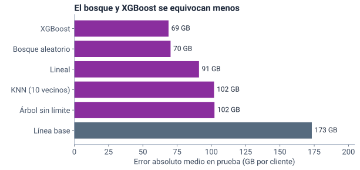
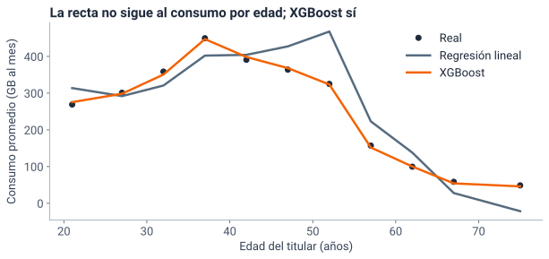
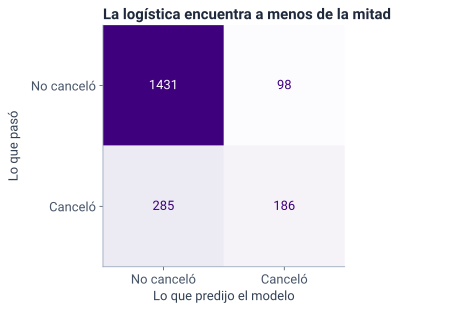
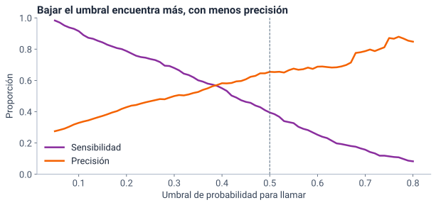
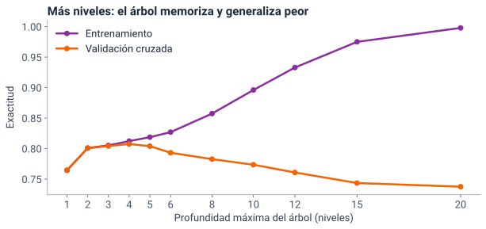

<!--
  Sesión 2 (6 h, 07:00–13:00): apertura 15 min · regresión 90 · pausa 15 · clasificación 100 ·
  pausa 10 · nube 70 · proyecto 40 · cierre 20. Las diapositivas de código corresponden a las
  celdas del notebook (mismo identificador entre corchetes); las salidas y las gráficas salen de
  ejecutarlo (precalculo/salidas_sesion2.json y recursos/s2/<id>.svg), con Python 3.13,
  pandas 2.2.3, scikit-learn 1.6.1 y xgboost 3.4.1. Las cifras del texto salen de la celda
  [cifras]. Los hitos de reloj y el orden de recorte están en las notas del primer divisor de
  cada bloque. Las fuentes (F-…) son las de fuentes/FUENTES.md.
-->

# Apertura {icono=fa-door-open}

> ¿Cuántos GB consumirá cada cliente, quién va a cancelar y quién puede ver esos datos?

???
07:00. Pedir desde ya que abran el notebook de la S2 (portada del curso → «Abrir en Colab»), que guarden una copia en Drive y que ejecuten la primera celda y [cargar]: la primera descarga los datos, como en la S1. Mientras tanto, la apertura.

## Seis horas en seis bloques, con dos pausas

::: flujo
1. **Apertura** — 15 min: de la sesión 1 a hoy
2. **Regresión** — 90 min: ¿cuántos GB consumirá cada cliente?
3. **Clasificación** — 100 min: ¿quién va a cancelar?
4. **Nube** — 70 min: ¿quién puede ver qué en Azure?
5. **Proyecto** — 40 min: el enunciado, la rúbrica y las parejas
6. **Cierre** — 20 min
:::

Pausas: **15 min a las 08:45** y **10 min a las 10:40**.

???
Hitos de reloj, que no se mueven: la regresión empieza a las 07:15; la pausa larga, a las 08:45; la clasificación, a las 09:00; la pausa corta, a las 10:40; la nube, a las 10:50; el proyecto, a las 12:00, y el cierre, a las 12:40. Cada bloque trae en la nota de su divisor qué se recorta si se atrasa. Lo que no se recorta nunca: la matriz de confusión y el umbral, la demostración de RBAC y Policy, y el enunciado del proyecto con la formación de parejas. Durante la exposición solo miran; ejecutan en las prácticas.

## En la sesión 1, la línea base acertó el 76,5 % y no encontró a nadie

- Decir siempre «No cancela» acierta tres de cada cuatro veces: es la **trampa de la exactitud**
- El árbol de dos preguntas acertó casi lo mismo (77,2 %) y encontró a **208 de los 471** que cancelaron
- La pregunta que importa: **¿a cuántos de los que cancelaron encontró?**

Hoy esas cuentas tienen nombre (matriz de confusión, precisión y sensibilidad) y las usamos con más modelos y más columnas.

???
Es el puente de la S1: la misma partición (la cuarta parte para prueba, semilla 2026, estratificada), así que hoy los 471 son los mismos clientes. Las cifras salen de la celda [cifras]: 0,7645 para la línea base (la S1 lo dio redondeado: 76,5 %) y 0,7715 para el árbol de dos niveles con el contrato mes a mes y la antigüedad. En la S1 se prometió ver cómo funciona un árbol por dentro: hoy se ve. Preguntar en el chat: ¿qué le dirían a una gerencia que solo mira la exactitud? Dos o tres respuestas y seguir. La S1 dejó la pregunta «¿Comprarías un modelo que acierta en el 75 % de los clientes?»: la siguiente diapositiva la retoma con dos modelos de hoy.

## Si cada llamada cuesta lo mismo, ¿cuál de los dos modelos le sirve más a la gerente? {.pregunta}

Los mismos 2000 clientes de prueba; cancelaron 471. El **primero** acierta el 81 %, llama a 284 y encuentra a 186. El **segundo** acierta el 72,5 %, llama a 509 y encuentra a 215. Vota: **el primero**, **el segundo** o **los dos por igual**.

::: respuesta
**El primero.** Cada llamada le rinde más: 186 de 284 (el 65 %) contra 215 de 509 (el 42 %). Con 509 llamadas, el primero encontraría a 276. Aun así, deja ir a 285: hoy lo arreglamos con el umbral y con un modelo mejor.
:::

???
Tres minutos con la votación. El primero es la regresión logística (80,85 %, 186 encontrados con 284 llamadas); el segundo, el árbol sin límite de profundidad (72,5 %, 215 con 509). Si la logística llamara a los 509 clientes de más riesgo, encontraría a 276 (celda [cifras], «apertura»). No adelantar los nombres de los modelos si no lo preguntan: se ven en la clasificación. Lo que deben llevarse: la exactitud no basta para decidir, y encontrar más no basta si es a costa de llamar a muchos más; lo justo es comparar con el mismo número de llamadas.

## Hoy, dos preguntas de aprendizaje automático y una de nube

::: tarjetas {columnas=3}
### Regresión
El jefe de TI, que planea la capacidad de la red: **¿cuántos GB al mes consumirá cada cliente?** La etiqueta, `consumo_gb`, es un **número**.
### Clasificación
La gerente de experiencia del cliente: **¿quién va a cancelar?** La etiqueta, `cancelo`, es una **categoría**.
### Nube
El oficial de protección de datos: **¿quién puede ver qué en Azure?** Microsoft Entra ID (antes, Azure Active Directory), Azure RBAC y Azure Policy.
:::

Las dos primeras son aprendizaje **supervisado** (como en la sesión 1): el modelo aprende de ejemplos que traen la respuesta, la **etiqueta**.

???
Supervisado, como en la S1: cada cliente trae la respuesta (cuánto consumió, si canceló) y el modelo aprende a predecirla con las demás columnas (ISLP, sec. 2.1.4, F-ML-05). La regresión y la clasificación solo cambian el tipo de etiqueta. La pregunta de nube cierra el hilo «ML en la nube»: si el modelo y los datos suben a Azure, ¿quién los puede ver? Transición: empezamos por el número.

# Regresión {icono=fa-chart-line}

> ¿Cuántos GB al mes consumirá cada cliente?

???
07:15 a más tardar. Noventa minutos: unos 72 de exposición y 15 de práctica (ejercicio 1), con 3 de margen. Hitos: la línea base, hacia las 07:30; KNN y el escalado, hacia las 07:50; el árbol sin límite, hacia las 08:05; la recta con la edad × usuarios, hacia las 08:22; la práctica empieza a más tardar a las 08:30. Si a las 07:50 no se ha llegado a KNN, recortar en este orden: (1) la fórmula de R² pasa a una frase sobre la diapositiva de la regresión lineal (−3 min); (2) la pregunta de qué cifra darle al jefe de TI se dice en una frase (−3 min); (3) la pregunta de KNN sin escalar se responde en una frase (−2 min); (4) la curva de la edad se muestra sin comentarla (−2 min). No se recortan el escalado, el árbol sin límite, la interacción ni la práctica. Hay dos momentos de «predice antes de ver» (KNN sin escalar y la recta con la edad × usuarios): son lo más cercano a ejecutar que tiene la exposición.

## Como en la sesión 1, el modelo aprende de 6000 clientes y se mide en 2000 que no vio

::: flujo
1. **Características en números** — las columnas que mira el modelo; las categorías, en columnas de 0 y 1
2. **Entrenamiento** — el modelo ve 6000 clientes con su consumo
3. **Prueba** — predice el consumo de 2000 que no vio
4. **Métricas** — contra la línea base: el promedio para todos
:::

???
Es el ciclo de la S1, ahora con un número como etiqueta. La partición es la misma idea: train_test_split con el 25 % para prueba y la semilla 2026 (F-ML-10). En regresión no se estratifica: no hay clases que equilibrar. Para el jefe de TI, saber el consumo esperado de cada cliente sirve para planear la capacidad de la red por ciudad; en el proyecto, el mismo modelo podría servir para recomendar un plan.

## Las características, en números: cada categoría, una columna de 0 y 1

```python [predictoras]
predictoras = clientes.drop(
    columns=["id_cliente", "consumo_gb", "cancelo"])
X = pd.get_dummies(predictoras, drop_first=True, dtype=int)
y = clientes["consumo_gb"]
print(f"{predictoras.shape[1]} columnas → {X.shape[1]} columnas numéricas")
#> 18 columnas → 24 columnas numéricas
```

```python [onehot]
print(clientes.loc[[0, 1, 2], "contrato"].to_list())
X.loc[[0, 1, 2], ["contrato_24 meses", "contrato_Mes a mes"]]
#> ['12 meses', 'Mes a mes', '24 meses']
#>    contrato_24 meses  contrato_Mes a mes
#> 0                  0                   0
#> 1                  0                   1
#> 2                  1                   0
```


???
Las **características** de la S1 son las columnas que el modelo puede mirar; en el código las llamamos `predictoras`. Hoy aparecen operaciones de pandas y numpy que el repaso de la S1 no cubrió (`.drop`, `.loc`, `.set_index`, `.assign`, `.T`, `.round`, `np.sqrt` y el formato `:.2%`): el notebook trae una tabla de repaso en la sección 1, después de [cargar]; mostrarla un minuto aquí. Es la codificación ***one-hot***: una columna por categoría; la primera se omite, porque se deduce de las demás. `pd.get_dummies` la hace. Con `drop_first=True` omite la primera categoría de cada columna en orden alfabético: el primer cliente tiene contrato a 12 meses y las dos columnas valen 0; esa es la categoría de referencia. Lo mismo pasa con la ciudad (la referencia es Barranquilla), el medio de pago y las columnas Sí/No. Se quitan el seudónimo (no describe al cliente), la etiqueta de hoy y `cancelo`, que se supo después, entre julio y septiembre: usarla para predecir el consumo sería usar el futuro. Si preguntan por `ColumnTransformer`: es la forma de hacer lo mismo dentro de un `Pipeline` de scikit-learn, útil cuando el modelo va a producción; hoy basta con get_dummies, porque las categorías no cambian entre entrenamiento y prueba.

## La línea base predice 299,7 GB para todos y se equivoca 173 GB por cliente

```python [linea_base_reg]
base = DummyRegressor()                    # predice el promedio, siempre
base.fit(X_ent, y_ent)                     # solo aprende el promedio
pred_base = base.predict(X_prueba)
print(f"Predice {pred_base[0]:.1f} GB para todos")
print(f"MAE  = {mean_absolute_error(y_prueba, pred_base):.1f} GB")
print(f"RMSE = {root_mean_squared_error(y_prueba, pred_base):.1f} GB")
print(f"R²   = {r2_score(y_prueba, pred_base):.3f}")
#> Predice 299.7 GB para todos
#> MAE  = 173.3 GB
#> RMSE = 257.5 GB
#> R²   = -0.000
```

- Un modelo que no le gane a la línea base no sirve

???
`DummyRegressor` ignora las columnas y predice el promedio del entrenamiento (F-ML-12: comparar con reglas simples es la verificación básica). La partición está en la celda [particion]: 6000 y 2000 clientes, con la semilla 2026. El R² sale −0,000 y no 0 porque el promedio es el del entrenamiento y se mide en la prueba: queda un poquito por debajo de cero. Transición: ¿qué miden esas tres cifras?

## El MAE y la RMSE miden el error en GB; la RMSE castiga más los errores grandes

$$ \text{MAE} = \frac{1}{n}\sum_{i=1}^{n} \lvert y_i - \hat y_i \rvert \qquad\qquad \text{RMSE} = \sqrt{\frac{1}{n}\sum_{i=1}^{n} (y_i - \hat y_i)^2} $$

\(y_i\) es el consumo real del cliente \(i\); \(\hat y_i\), el que predijo el modelo, y \(n\), el número de clientes. El **MAE** (error absoluto medio) es el error promedio por cliente. La **RMSE** (raíz del error cuadrático medio) eleva al cuadrado antes de promediar: unos pocos errores enormes la suben mucho.

???
Cómo se leen: «el MAE es el promedio de los errores en valor absoluto» y «la RMSE es la raíz del promedio de los errores al cuadrado». Las dos están en GB. La RMSE siempre es mayor o igual que el MAE; si es mucho mayor, hay pocos clientes con errores muy grandes. Aquí pasa: el consumo tiene una cola larga (la mediana es 243,6 GB y el máximo, 2500), así que hay clientes, sobre todo empresas pequeñas, muy lejos del promedio. En scikit-learn 1.6, la RMSE se calcula con `root_mean_squared_error`; el viejo `squared=False` ya no existe en las versiones nuevas (F-ML-19).

## R² compara el error del modelo con el de predecir el promedio

$$ R^2 = 1 - \frac{\sum (y_i - \hat y_i)^2}{\sum (y_i - \bar y)^2} $$

La línea base da 0; un modelo perfecto, 1. Es la parte de la **variación** del consumo que el modelo reproduce, no un porcentaje de aciertos.

???
Cómo se lee: «R cuadrado es uno menos la suma de los errores al cuadrado del modelo entre la suma de las distancias al promedio al cuadrado». El denominador es el error de la línea base. Si el modelo se equivoca igual que el promedio, R² = 0; si se equivoca más, es negativo (scikit-learn, sec. 3.4.6.1 de la misma página de métricas que F-ML-12). Recortable 1: si hace falta tiempo, se dice en una frase sobre la diapositiva siguiente.

## La regresión lineal se equivoca 91 GB por cliente y reproduce el 71 % de la variación

```python [medir]
def medir(modelo):
    modelo.fit(X_ent, y_ent)               # aprende de los ejemplos
    pred = modelo.predict(X_prueba)        # predice clientes que no vio
    return {"MAE": mean_absolute_error(y_prueba, pred),
            "RMSE": root_mean_squared_error(y_prueba, pred),
            "R²": r2_score(y_prueba, pred)}
```

```python [lineal]
lineal = LinearRegression()
resultados["Lineal"] = medir(lineal)
pd.DataFrame(resultados).T.round(3)
#>                 MAE     RMSE     R²
#> Línea base  173.260  257.462 -0.000
#> Lineal       90.962  139.069  0.708
```

???
La función `medir` junta lo de la diapositiva anterior para no repetirlo con cada modelo: entrena, predice la prueba y devuelve las tres métricas. La regresión lineal suma cada columna multiplicada por un coeficiente, y elige los coeficientes que dejan la menor suma de errores al cuadrado (F-ML-13). Baja el error de 173 a 91 GB. Transición: un modelo muy distinto, que no busca coeficientes sino vecinos.

## ¿Quién es el vecino más cercano de A: B o C? {.pregunta}

**KNN** (k vecinos más cercanos, *k-nearest neighbors*) predice con el promedio de los clientes más parecidos.

```python [tres]
tres                                   # A, B y C, en ese orden
#>             edad  usuarios  factura_mensual  consumo_gb
#> id_cliente                                             
#> C00053        28         2           114800       424.8
#> C00611        28         2           134800       387.2
#> C01689        66         2           114800        51.6
```

Con **solo estas tres columnas**, tal como están: vota **B**, **C** o **empatan**.

::: respuesta
**C.** De A a B hay 20 000 (pesos); de A a C, 38 (años): la factura decide sola, y C consume la octava parte. En desviaciones estándar, el vecino sería B.
:::

???
Dos minutos. Son tres clientes reales del archivo. «Parecido» es una distancia euclídea, la de la línea recta (F-ML-14: la distancia por defecto es Minkowski con p = 2, por lo que la escala importa). A consume 424,8 GB; C, 51,6: la octava parte (A consume unas 8,2 veces lo que C). Si alguien vota «empatan», preguntarle cuánto pesa una diferencia de 20 000 frente a una de 38 en la suma de cuadrados.

## Sin escalar, 20 000 pesos pesan más que 38 años

```python [escala]
columnas = ["edad", "usuarios", "factura_mensual"]
def distancia(datos, a, b):                # la distancia en línea recta
    return np.sqrt(((datos.loc[a] - datos.loc[b]) ** 2).sum())
crudos = tres[columnas]
print(f"Sin escalar: A–B {distancia(crudos, 'C00053', 'C00611'):.2f}",
      f"· A–C {distancia(crudos, 'C00053', 'C01689'):.2f}")
escalados = crudos / X_ent[columnas].std()   # en desviaciones estándar
print(f"Escalados:   A–B {distancia(escalados, 'C00053', 'C00611'):.2f}",
      f"· A–C {distancia(escalados, 'C00053', 'C01689'):.2f}")
#> Sin escalar: A–B 20000.00 · A–C 38.00
#> Escalados:   A–B 0.54 · A–C 2.55
```

- En desviaciones estándar, 20 000 pesos son media desviación; 38 años, más de dos y media
- Ojo: son solo tres columnas. Con las 24 del modelo, escaladas, C queda más cerca (5,82 contra 7,13): comparte con A ciudad, estrato, plan y contrato

???
La desviación estándar del entrenamiento es de unos 37 296 pesos en la factura y de 14,9 años en la edad (celda [cifras]): 20 000 / 37 296 ≈ 0,54 y 38 / 14,9 ≈ 2,55. Para la distancia solo importa dividir: restar la media no cambia las diferencias. Escalar no es un truco para ganar puntos: es para que la distancia no dependa de si la factura está en pesos o en millones.

## Escalar pone cada columna en desviaciones estándar del entrenamiento {columnas=3:2}

```python [knn]
knn = make_pipeline(StandardScaler(),
                    KNeighborsRegressor(n_neighbors=10))
resultados["KNN (10 vecinos)"] = medir(knn)
pd.DataFrame(resultados).T.round(3)
#>                       MAE     RMSE     R²
#> Línea base        173.260  257.462 -0.000
#> Lineal             90.962  139.069  0.708
#> KNN (10 vecinos)  101.937  151.548  0.653
```

|||

$$ z = \frac{x - \bar x_{\text{ent}}}{s_{\text{ent}}} $$

- El `Pipeline` escala y luego predice: la prueba se escala con lo aprendido del entrenamiento
- KNN no le gana a la recta: las 24 columnas pesan igual, también las que no informan el consumo

???
`StandardScaler` aprende la media y la desviación de cada columna con el entrenamiento y las aplica a la prueba: nunca se ajusta nada con la prueba (F-ML-18, «never call fit on the test data»). `make_pipeline` encadena los dos pasos, y así es imposible olvidar escalar la prueba (F-ML-11). Con 24 columnas escaladas, las caídas, el medio de pago o los pagos tardíos pesan en la distancia tanto como la edad o los usuarios, y estorban. La diapositiva siguiente pregunta qué pasa sin escalar.

## Sin escalar, ¿KNN saldrá mejor o peor? {.pregunta}

Predice antes de ver: **mejor**, **peor** o **igual**.

::: respuesta
```python [knn_sin]
knn_sin = KNeighborsRegressor(n_neighbors=10)   # sin escalar
r_sin = medir(knn_sin)
print(f"KNN sin escalar: MAE {r_sin['MAE']:.1f} GB · R² {r_sin['R²']:.3f}")
#> KNN sin escalar: MAE 94.3 GB · R² 0.658
```

**Un poco mejor.** Sin escalar, la distancia la deciden la factura y el plan, que resumen bien el consumo. Es suerte de las unidades: **se escala para no depender de ellas**, no para ganar puntos.
:::

???
Recortable 3. Dos minutos. Es la respuesta honesta a lo que algún estudiante va a probar en Colab. Con la factura en millones, KNN sin escalar casi no cambia (MAE 92,6 y R² 0,655, celda [cifras]): el plan, en Mbps, toma el relevo, porque los dos dicen casi lo mismo. Lo que más explica el consumo es ser empresa pequeña, y la factura lo refleja en parte. En la clasificación veremos un caso en que no escalar es un desastre: la SVM.

## ¿Qué R² tendrá un árbol sin límite de profundidad? {.pregunta}

Parte a los clientes hasta dejar casi uno por hoja. Comparado con la recta (R² de 0,71 en prueba), ¿qué esperas? Vota: **mejor en las dos**, **perfecto en entrenamiento y peor en prueba** o **perfecto en las dos**.

::: respuesta
**Perfecto en entrenamiento y peor en prueba**: 1 y 0,56. La recta tenía 0,71.
:::

???
Un minuto. Un árbol de decisión parte a los clientes con preguntas sobre una columna («¿tiene más de 3 usuarios?») hasta formar grupos de consumo parecido y predice el promedio de cada grupo. Sin límite, sigue partiendo: este tiene 30 niveles y 5987 hojas para 6000 clientes de entrenamiento (celda [cifras]).

## El árbol sin límite memorizó: R² de 1 en entrenamiento y de 0,56 en prueba

```python [arbol]
arbol = DecisionTreeRegressor(random_state=2026)   # sin límite
resultados["Árbol sin límite"] = medir(arbol)
r2_entrena = r2_score(y_ent, arbol.predict(X_ent))
print(f"R² en entrenamiento: {r2_entrena:.3f}")
print(f"R² en prueba:        {resultados['Árbol sin límite']['R²']:.3f}")
#> R² en entrenamiento: 1.000
#> R² en prueba:        0.563
```

- Se aprendió de memoria a cada cliente del entrenamiento, con sus rarezas al azar (el ruido): es **sobreajuste** (*overfitting*)

???
Los árboles tienden al sobreajuste y son inestables: pequeñas variaciones en los datos cambian el árbol (F-ML-15). Se controla limitando la profundidad (`max_depth`) o pidiendo un mínimo de clientes por hoja (`min_samples_leaf`): la primera opción es el ejercicio 1. Transición: la idea de la sesión.

## Aprender no es memorizar {.idea}

Un modelo que acierta todo lo que vio y falla con lo que no vio no aprendió: memorizó. Por eso cada modelo se mide en la prueba, contra su línea base.

???
Es el lema de la sesión. Lo veremos tres veces más: en el árbol de clasificación (100 % en entrenamiento), en la curva de profundidad y en la validación cruzada. La documentación de scikit-learn lo dice desde la primera línea del capítulo de validación: evaluar con los mismos datos con que se entrenó es un error metodológico (F-ML-11).

## El bosque promedia muchos árboles distintos; XGBoost los encadena

::: tarjetas
### Bosque aleatorio (*random forest*)
Cada árbol ve una **muestra al azar** (con repetición) de los clientes. Sus predicciones se **promedian**: los errores de unos se compensan con los de otros.
### XGBoost
Árboles pequeños **en secuencia**: cada uno corrige lo que los anteriores todavía no aciertan. Es un método de **potenciación del gradiente** (*gradient boosting*).
:::

Lo que se elige antes de entrenar (cuántos árboles, qué tan profundos) son **hiperparámetros** (*hyperparameters*).

???
Los dos son ensambles de árboles: el mismo tipo de modelo, entrenado de forma distinta (F-ML-20). El bosque reduce la varianza promediando muchos árboles (F-ML-16). En clasificación, `RandomForestClassifier` además sortea √p columnas en cada pregunta (`max_features='sqrt'`, F-ML-16), lo que decorrelaciona los árboles (ISLP 8.2.2, F-ML-22); en regresión, `RandomForestRegressor` usa por defecto todas las columnas (`max_features=1.0`, que equivale a *bagging*), y aquí se dejó así. XGBoost (*Extreme Gradient Boosting*) agrega un árbol nuevo en cada paso y su objetivo suma la pérdida de entrenamiento y un término de regularización que castiga los árboles complejos (F-ML-20, F-ML-21). Hoy: 300 árboles; `learning_rate=0.05` dice cuánto corrige cada uno y `max_depth=4`, cuántas preguntas hace cada uno (los valores por defecto de XGBoost son 0,3 y 6).

## El bosque y XGBoost se equivocan unos 70 GB por cliente; la recta, 91

```python [xgboost]
xgb = XGBRegressor(n_estimators=300, learning_rate=0.05, max_depth=4,
                   random_state=2026)
resultados["XGBoost"] = medir(xgb)
tabla_reg = pd.DataFrame(resultados).T
tabla_reg.round(3)
#>                       MAE     RMSE     R²
#> Línea base        173.260  257.462 -0.000
#> Lineal             90.962  139.069  0.708
#> KNN (10 vecinos)  101.937  151.548  0.653
#> Árbol sin límite  102.252  170.166  0.563
#> Bosque aleatorio   70.217  112.532  0.809
#> XGBoost            68.754  111.126  0.814
```

???
El bosque está en la celda [bosque]: `RandomForestRegressor(n_estimators=300, min_samples_leaf=5)`, con al menos 5 clientes por hoja. Cada uno tarda menos de un segundo en la réplica del docente (con las versiones de Colab, no en Colab). XGBoost baja el MAE un 60 % frente a la línea base. Los dos le ganan a la recta por unos 20 GB por cliente. En la RMSE pasa lo mismo: los errores grandes también bajan.

## XGBoost se equivoca un 60 % menos que la línea base

{alto=420}

???
La barra gris es la línea base. Leer de abajo arriba: la línea base, 173 GB; el árbol sin límite y KNN, unos 102; la recta, 91; el bosque y XGBoost, unos 70. El árbol solo, sin límite, queda casi como KNN; un árbol parecido (con al menos 5 clientes por hoja), repetido 300 veces sobre muestras al azar y promediado, es de los mejores: es lo que hace el promedio.

## La recta no sigue al consumo por edad; XGBoost sí

{alto=400}

- Para los de 70 años o más, la recta predice **−21,5 GB** en promedio; con 144 de los 2000 clientes de prueba predice un consumo negativo

???
Recortable 4: si falta tiempo, se muestra sin comentarla y se pasa a la pregunta. Son los clientes de prueba agrupados por edad: los puntos son el consumo real promedio de cada grupo, y las líneas, lo que predice cada modelo en promedio. La línea gris no es la recta de la edad sola: cada punto promedia las predicciones de un modelo de 24 columnas, y por eso no es recta. Los puntos reales también mezclan efectos: entre los 35 y los 39 años hay más hogares con muchos usuarios. Lo que la gráfica muestra es el síntoma; la causa está en la diapositiva siguiente.

## ¿Qué le agregas a la recta para que siga a los datos? {.pregunta}

Dos columnas posibles: la **edad al cuadrado**, para que pueda curvarse, o la **edad × usuarios**, para que el efecto de la edad dependa de cuántas personas usan la conexión. Vota: **la edad al cuadrado**, **la edad × usuarios** o **las dos ayudan igual**.

::: respuesta
```python [interaccion]
for nombre, columna in intentos.items():
    X2 = X.assign(nueva=columna)               # X con una columna más
    recta2 = LinearRegression().fit(X2.loc[X_ent.index], y_ent)
    pred2 = recta2.predict(X2.loc[X_prueba.index])
    print(f"Recta + {nombre}: MAE {mae2:.1f} GB · R² {r2:.3f}")
#> Recta + edad al cuadrado: MAE 89.2 GB · R² 0.710
#> Recta + edad × usuarios: MAE 74.5 GB · R² 0.801
```

**La edad × usuarios**: es una **interacción**. Cumplir años le quita más GB a un hogar de muchas personas. La recta solo suma efectos; los árboles combinan columnas solos.
:::

???
Tres minutos. Los dos intentos están en la celda [interaccion] (las líneas que calculan el MAE y el R² no se proyectan). En los hogares (celda [cifras]): entre los 18 y los 29 años, los de 1 o 2 usuarios consumen 264 GB y los de 5 o más, 577; entre los 49 y los 59, 65 y 247. La misma subida de edad le quita 199 GB a un hogar pequeño y 330 a uno grande: la recta supone el mismo cambio para todos. La edad sí importa: sin ella, XGBoost queda en MAE 92,9 y R² 0,653, como la recta. Lo que la recta no puede es combinarla con los usuarios, y cada pregunta de un árbol se hace dentro del grupo que dejó la anterior.

## ¿Qué cifras le sirven al jefe de TI para saber cuánto se equivoca el modelo? {.pregunta}

El jefe de TI quiere saber cuántos GB se equivoca el modelo con un cliente. Para XGBoost hay **R² = 0,81**, **MAE = 69 GB** y **RMSE = 111 GB**. Vota: **solo el MAE**, **el MAE y la RMSE** o **las tres**.

::: respuesta
**El MAE y la RMSE**: las dos están en GB. El MAE es el error promedio; la RMSE pesa más los errores grandes, y sirve si le preocupan los clientes de consumo extremo. El R² no está en GB: dice qué parte de la variación reproduce el modelo.
:::

???
Un minuto. Recortable 2. No hay una métrica «mejor»: cada una responde otra pregunta. El MAE de XGBoost es 68,8 GB, pero la mediana del error absoluto es 41,4 GB y el percentil 90, 156,9 GB (celda [cifras]): la mitad de los clientes se equivoca menos de 41 GB y unos pocos, mucho más, por la cola larga del consumo. Para planear la capacidad de la red, al jefe de TI le pueden importar los clientes de consumo muy alto; ahí la RMSE dice más. Lo que no se hace: dar el R² como si fuera un porcentaje de aciertos.

## Práctica: ejercicio 1, un árbol con límite

::: flujo
1. **Entrena** — un árbol de regresión con `max_depth=6` y la semilla 2026
2. **Mide** — el MAE en prueba y el R² en entrenamiento y en prueba
3. **Compara** — con el árbol sin límite: ¿se sobreajusta menos?
:::

Quince minutos, en el notebook: antes del ejercicio 1, haz clic en la celda del ejercicio → **Entorno de ejecución → Ejecutar anteriores**. Mientras quede un `...`, la celda da un error que menciona `Ellipsis`. El verificador da pistas sin dar la respuesta. Lo escrito va en «Tus respuestas».

???
08:30 a más tardar. Clave: MAE de 77,8 GB, R² de 0,827 en entrenamiento y de 0,763 en prueba (el sin límite: 1 y 0,563). La brecha entre entrenamiento y prueba baja de 0,44 a 0,06: se sobreajusta mucho menos, aunque no llega al bosque. El verificador acepta ±0,5 GB en el MAE y ±0,005 en cada R², y reconoce el MAE del entrenamiento, la RMSE en lugar del MAE, los dos R² cruzados, el R² en porcentaje, `r2_score` con los argumentos al revés, el redondeo a un decimal y los valores de otra profundidad (decide con los tres valores juntos). Si alguien termina antes: que pruebe `max_depth=4` y `max_depth=10` y escriba qué pasa con la brecha. Ojo con la conclusión: menos brecha no es mejor modelo; el bosque tiene más brecha (0,908 frente a 0,809) y más R² en prueba.

## Pausa de 15 minutos {.idea etiqueta="Pausa" icono=fa-mug-hot}

Volvemos a las 09:00 con la clasificación: ¿quién va a cancelar?

???
08:45. Si el ejercicio 1 no terminó, que lo terminen en la pausa o en casa: la clasificación no depende de él.

# Clasificación {icono=fa-user-xmark}

> ¿Quién va a cancelar?

???
09:00. Cien minutos: unos 70 de exposición y 25 de práctica (ejercicios 2 y 3; el 4 es opcional), con 5 de margen. Hitos: la matriz de confusión, hacia las 09:15; el árbol sin límite, hacia las 09:25; XGBoost, hacia las 09:45; el umbral, hacia las 09:55; la práctica empieza a más tardar a las 10:15. Si a las 09:45 no se ha llegado a XGBoost, recortar en este orden: (1) la diapositiva de la SVM como idea pasa a una frase sobre la de la SVM sin escalar (−2 min); (2) la gráfica del umbral se muestra sin comentarla (−3 min); (3) el ejercicio 4 queda para la casa, como ya está previsto. No se recortan la matriz de confusión, el umbral, la validación cruzada ni la pregunta de qué modelo le sirve a la gerente.

## Ahora la etiqueta es `cancelo`, con la misma prueba de la sesión 1

```python [preparar_c]
predictoras_c = clientes.drop(columns=["id_cliente", "cancelo"])
Xc = pd.get_dummies(predictoras_c, drop_first=True, dtype=int)
yc = (clientes["cancelo"] == "Sí").astype(int)   # 1 = canceló
Xc_ent, Xc_prueba, yc_ent, yc_prueba = train_test_split(
    Xc, yc, test_size=0.25, random_state=2026, stratify=yc)
print(f"Prueba: {len(yc_prueba)} clientes; cancelaron {yc_prueba.sum()}")
#> Prueba: 2000 clientes; cancelaron 471
```

- Los nombres llevan una **c**, de cancelación: así no se mezclan con los de la regresión

???
Las predictoras (las características) son ahora todas las demás columnas, y `consumo_gb` sí es una de ellas: se conocía el 30 de junio. `stratify=yc` deja la misma tasa de cancelación en el entrenamiento y en la prueba, como en la S1 (F-ML-10). Como la partición depende solo de la etiqueta y de la semilla, los 2000 clientes de prueba son los mismos de la S1 (comprobado en la celda [cifras]). `yc` es lo mismo que `cancelo_num` de la S1.

## Decir «No» a todos acierta el 76,45 % y no encuentra a nadie

```python [linea_base_c]
base_c = DummyClassifier(strategy="most_frequent")   # siempre «No»
base_c.fit(Xc_ent, yc_ent)
pred_base_c = base_c.predict(Xc_prueba)
encontrados_base = ((pred_base_c == 1) & (yc_prueba == 1)).sum()
print(f"Exactitud: {accuracy_score(yc_prueba, pred_base_c):.2%}")
print(f"Encontró a {encontrados_base} de los {yc_prueba.sum()}",
      "que cancelaron")
#> Exactitud: 76.45%
#> Encontró a 0 de los 471 que cancelaron
```

- Es la misma línea base de la sesión 1, que lo redondeó a 76,5 %

???
Es la línea base de la S1, con la misma cuenta de encontrados: predijo 1 y el cliente de verdad canceló. Hoy la exactitud sale con dos decimales: 76,45 % es lo que la S1 redondeó a 76,5 %. Transición: el primer modelo de hoy da una probabilidad.

## La regresión logística convierte una suma en una probabilidad entre 0 y 1

$$ P(\text{cancela}) = \frac{1}{1 + e^{-z}} \qquad\qquad z = b_0 + b_1 x_1 + b_2 x_2 + \dots + b_p x_p $$

\(z\) es una suma como la de la regresión lineal; la curva en S la deja entre 0 y 1. Si pasa de **0,5**, el modelo decide «cancela». Ese 0,5 es el **umbral**.

???
Cómo se lee: «la probabilidad de cancelar es uno sobre uno más e a la menos z». Si z es muy grande, la probabilidad se acerca a 1; si es muy negativa, a 0; si z = 0, vale 0,5. Pese a su nombre, la regresión logística es un modelo de clasificación (F-ML-13). Escalamos antes, como con KNN: sin escalar, el optimizador no converge bien. El umbral de 0,5 no es una ley: lo cambiamos en una hora.

## La logística acierta el 80,85 %, pero ¿a quién encontró?

```python [logistica]
logistica = make_pipeline(StandardScaler(),
                          LogisticRegression(max_iter=1000))
logistica.fit(Xc_ent, yc_ent)
pred_log = logistica.predict(Xc_prueba)    # 1 si P(cancela) pasa de 0.5
print(f"Exactitud: {accuracy_score(yc_prueba, pred_log):.2%}")
confusion_matrix(yc_prueba, pred_log)
#> Exactitud: 80.85%
#> array([[1431,   98],
#>        [ 285,  186]])
```

- `confusion_matrix(real, predicho)` arma la **matriz de confusión** (*confusion matrix*): primero lo que pasó, después lo que predijo

???
`max_iter=1000` le da al optimizador más iteraciones para converger. La matriz sale como un arreglo de 2 × 2: las filas son lo que pasó (0 y 1) y las columnas, lo que predijo. El orden importa: con los argumentos al revés, la matriz sale traspuesta, y los falsos positivos se cruzan con los falsos negativos. Es un error que el verificador del ejercicio 2 reconoce.

## De los 471 que cancelaron, la logística encontró a 186 {columnas=3:2}

{alto=430}

|||

- **VP** (verdaderos positivos) 186: los señaló y cancelaron; los «encontrados» de la sesión 1
- **FN** (falsos negativos) 285: cancelaron sin que los señalara; los que «se escaparon»
- **FP** (falsos positivos) 98: los señaló y no cancelaron; las «falsas alarmas»
- **VN** (verdaderos negativos) 1431: no los señaló y no cancelaron

???
Verdaderos positivos, falsos negativos, falsos positivos y verdaderos negativos: las cuentas de la S1 con su nombre. «Señalar» a un cliente es predecir que cancela; en la campaña de la gerente, es llamarlo. Para la gerente, un FP es una llamada de retención a alguien que no se iba (cuesta la llamada y quizá un descuento); un FN es un cliente que se va sin que nadie lo llame. La matriz no dice cuál cuesta más: eso lo decide el negocio. La celda oscura arriba a la izquierda son los 1431 que no cancelaron y el modelo lo vio: la mayoría de los aciertos de la exactitud viene de ahí.

## Cuatro métricas salen de la matriz, y cada una responde otra pregunta

| Métrica | Pregunta | Cuenta | Logística |
|---|---|---|---|
| **Exactitud** (*accuracy*) | De todos, ¿cuántos acertó? | (VP + VN) / n | 0,8085 |
| **Precisión** (*precision*) | De los que señaló (los que llamaría), ¿cuántos cancelaron? | VP / (VP + FP) | 0,655 |
| **Sensibilidad** (exhaustividad, *recall*) | De los que cancelaron, ¿a cuántos encontró? | VP / (VP + FN) | 0,395 |
| **F1** | ¿Las dos a la vez? | 2 × P × S / (P + S) | 0,493 |

\(n\) es el total de clientes de prueba; P, la precisión; S, la sensibilidad.

???
Las cuentas son las de scikit-learn (F-ML-12): precision = tp / (tp + fp) y recall = tp / (tp + fn); F1 es la media armónica de la precisión (P) y la sensibilidad (S), y solo es alta si las dos lo son. Ojo con la palabra: en español, «precisión» es *precision*, nunca *accuracy*; a *accuracy* le decimos exactitud. La celda [metricas_c] las calcula a mano y con scikit-learn, y dan lo mismo.

## Cuando la logística señala a alguien, acierta 2 de cada 3; pero deja ir a 6 de cada 10

```python [metricas_c]
vn, fp, fn, vp = confusion_matrix(yc_prueba, pred_log).ravel()
print(f"VN {vn} · FP {fp} · FN {fn} · VP {vp}")
print(f"Precisión:    {vp / (vp + fp):.3f}",
      f"= {precision_score(yc_prueba, pred_log):.3f}")
print(f"Sensibilidad: {vp / (vp + fn):.3f}",
      f"= {recall_score(yc_prueba, pred_log):.3f}")
print(f"F1:           {f1_score(yc_prueba, pred_log):.3f}")
#> VN 1431 · FP 98 · FN 285 · VP 186
#> Precisión:    0.655 = 0.655
#> Sensibilidad: 0.395 = 0.395
#> F1:           0.493
```

- `.ravel()` aplana la matriz en este orden: VN, FP, FN, VP

???
Precisión 0,655: de cada 3 que señala, 2 cancelaron. Sensibilidad 0,395: de los 471 que cancelaron, encontró a 186; los otros 285, el 60,5 %, se van sin llamada. La celda [medir_c] junta estas métricas en una función, como `medir` en la regresión, y agrega `encontrados`.

## La gerente quiere retener a los que se van. ¿Qué métrica mira primero? {.pregunta}

Vota en el chat: **la precisión**, **la exactitud** o **la sensibilidad**.

::: respuesta
**La sensibilidad**: de los que se van, a cuántos encuentra. Con la **precisión** al lado, porque cada señalado que no se iba es una llamada perdida. La exactitud sola la engaña: la línea base tiene una exactitud del 76 %.
:::

???
Un minuto. Si alguien dice «la precisión», no está mal pensado: es la otra mitad. Lo que se discute es cuál va primero para esta decisión. Para una campaña con muy pocas llamadas posibles, la precisión pesa más; para no perder clientes, la sensibilidad. Transición: un modelo que encuentra más, pero mal.

## El árbol sin límite: 100 % en entrenamiento y 72,5 % en prueba, menos que la línea base

```python [arbol_c]
arbol_c = DecisionTreeClassifier(random_state=2026)   # sin límite
metricas["Árbol sin límite"] = medir_c(arbol_c)
exactitud_entrena = accuracy_score(yc_ent, arbol_c.predict(Xc_ent))
print(f"Exactitud en entrenamiento: {exactitud_entrena:.2%}")
print(f"Exactitud en prueba:        "
      f"{metricas['Árbol sin límite']['exactitud']:.2%}")
#> Exactitud en entrenamiento: 100.00%
#> Exactitud en prueba:        72.50%
```

- Encuentra a 215, más que la logística, pero señala a 294 que no se iban: es el segundo modelo de la apertura

???
Tiene 26 niveles y 977 hojas (celda [cifras]). Memorizó el entrenamiento, ruido incluido: el sobreajuste se ve en la brecha de 27,5 puntos. Su precisión es 0,422: de cada 5 que señala, cancelaron apenas 2. Por exactitud, pierde contra decir «No» a todos; por encontrados, le gana. Ninguna de las dos lecturas, sola, sirve para elegir.

## Un árbol de dos niveles se lee: con contrato mes a mes y 29 años o menos, canceló el 62 %

```python [reglas]
arbol2 = DecisionTreeClassifier(max_depth=2, random_state=2026)
arbol2.fit(Xc_ent, yc_ent)
print(export_text(arbol2, feature_names=list(Xc.columns),
                  show_weights=True))
#> |--- contrato_Mes a mes <= 0.50
#> |   |--- velocidad_pct <= 69.50
#> |   |   |--- weights: [55.00, 88.00] class: 1
#> |   |--- velocidad_pct >  69.50
#> |   |   |--- weights: [3424.00, 454.00] class: 0
#> |--- contrato_Mes a mes >  0.50
#> |   |--- edad <= 29.50
#> |   |   |--- weights: [286.00, 471.00] class: 1
#> |   |--- edad >  29.50
#> |   |   |--- weights: [822.00, 400.00] class: 0
```

- Cada pregunta busca grupos más **puros**: mes a mes canceló el 44,0 %; con permanencia, el 13,5 %

???
Es la promesa de la S1: cómo funciona un árbol por dentro. Cada `|---` es una pregunta y cada hoja dice cuántos clientes del entrenamiento no cancelaron y cuántos sí. Las cuatro reglas, con el entrenamiento: con permanencia (12 o 24 meses) y velocidad medida de 69 % o menos, cancelaron 88 de 143 (61,5 %); con permanencia y mejor velocidad, 454 de 3878 (11,7 %); mes a mes y 29 años o menos, 471 de 757 (62,2 %); mes a mes y 30 o más, 400 de 1222 (32,7 %). `contrato_Mes a mes <= 0.50` quiere decir que la columna vale 0: no es mes a mes. El 471 de la hoja «mes a mes y 29 años o menos» es una coincidencia: son clientes del entrenamiento, no los 471 que cancelaron en la prueba. Describe clientes, no juzga personas: los clientes jóvenes con contrato mes a mes cancelan más. Una regla que se lee es una explicación que se puede auditar: es lo que pide la sustentación del proyecto. La promesa de la S1: ¿por qué un árbol hace una pregunta si sus dos hojas dicen lo mismo? Porque cada pregunta busca grupos más **puros** (más parecidos entre sí en la etiqueta), medidos con un criterio como el índice de Gini, aunque no cambie la respuesta de la hoja (F-ML-15, sec. 1.10.7.1). Con el entrenamiento (celda [cifras], «pureza»): antes de preguntar cancelaron 1413 de 6000; con contrato mes a mes, el 44,0 % (871 de 1979); con permanencia, el 13,5 % (542 de 4021). El árbol elige la pregunta que más separa esos porcentajes. La regla de la S1 preguntaba por la antigüedad porque solo tenía dos columnas; hoy, con 25, la segunda pregunta es la velocidad o la edad.

## Con 4 niveles, el árbol ya no memoriza; el bosque promedia 300

```python [bosque_c]
arbol4 = DecisionTreeClassifier(max_depth=4, random_state=2026)
metricas["Árbol 4 niveles"] = medir_c(arbol4)
bosque_c = RandomForestClassifier(n_estimators=300, min_samples_leaf=5,
                                  random_state=2026, n_jobs=-1)
metricas["Bosque aleatorio"] = medir_c(bosque_c)
pd.DataFrame(metricas).T.astype({"encontrados": int}).round(REDONDEO)
#>                   exactitud  precisión  sensibilidad     F1  encontrados
#> Línea base           0.7645      0.000         0.000  0.000            0
#> Logística            0.8085      0.655         0.395  0.493          186
#> Árbol sin límite     0.7250      0.422         0.456  0.439          215
#> Árbol 4 niveles      0.8040      0.622         0.427  0.506          201
#> Bosque aleatorio     0.8125      0.658         0.425  0.516          200
```

???
El árbol de 4 niveles acierta casi como la logística y encuentra a 15 más. El bosque es el de mejor exactitud hasta ahora, pero encuentra a 200: con el umbral de 0,5, todos los modelos se quedan cortos en sensibilidad. `n_jobs=-1` usa todos los procesadores de la máquina.

## La SVM busca la frontera entre los que cancelan y los que no con el margen más ancho

::: tarjetas
### El margen
Entre las fronteras posibles, la **máquina de vectores de soporte** (*support vector machine*, SVM) elige la que deja más espacio a cada lado. Los clientes que tocan ese espacio son los **vectores de soporte**.
### El *kernel* (núcleo)
Con el *kernel* RBF (función de base radial), el de `SVC` por defecto, la frontera puede ser **curva**.
### Las distancias
Como KNN, mide distancias entre clientes: **hay que escalar**.
:::

???
Recortable 1: si falta tiempo, se dice en una frase sobre la diapositiva siguiente. La documentación de scikit-learn lo dice sin rodeos: se recomienda mucho escalar los datos (F-ML-17). La SVM no da probabilidades directamente (F-ML-17); su `decision_function` dice qué tan lejos de la frontera queda cada cliente, y eso sirve para ordenarlos por riesgo. Su entrenamiento crece al menos con el cuadrado del número de clientes: con 6000 tarda menos de un segundo en la réplica de Colab; con millones, no se usaría así.

## Sin escalar, la SVM dice «No» a todos, como la línea base

```python [svm]
svm_sin = SVC(random_state=2026)                       # sin escalar
svm = make_pipeline(StandardScaler(), SVC(random_state=2026))
sin_escalar = medir_c(svm_sin)
print(f"Sin escalar: exactitud {sin_escalar['exactitud']:.2%},",
      f"encontrados {sin_escalar['encontrados']}")
metricas["SVM"] = medir_c(svm)
print(f"Escalada:    exactitud {metricas['SVM']['exactitud']:.2%},",
      f"encontrados {metricas['SVM']['encontrados']}")
#> Sin escalar: exactitud 76.45%, encontrados 0
#> Escalada:    exactitud 80.50%, encontrados 171
```

- Sin escalar, la factura (cientos de miles de pesos) y el consumo deciden la distancia, y no separan a los que cancelan

???
Es el caso que prometimos en KNN: sin escalar, la distancia la deciden casi solo la factura y el consumo, que no separan a los que cancelan; el contrato, la antigüedad o la velocidad casi no cuentan, y la SVM termina prediciendo la clase más común. Mismo resultado que la línea base, con un modelo mucho más caro. Escalada, encuentra a 171: todavía menos que la logística, con el umbral de 0,5.

## XGBoost encuentra a 228: el que más, con el umbral de 0,5

```python [xgboost_c]
xgb_c = XGBClassifier(n_estimators=300, learning_rate=0.05, max_depth=3,
                      random_state=2026)
metricas["XGBoost"] = medir_c(xgb_c)
tabla_c = pd.DataFrame(metricas).T.astype({"encontrados": int})
tabla_c.round(REDONDEO)
#>                   exactitud  precisión  sensibilidad     F1  encontrados
#> Línea base           0.7645      0.000         0.000  0.000            0
#> Logística            0.8085      0.655         0.395  0.493          186
#> Árbol sin límite     0.7250      0.422         0.456  0.439          215
#> Árbol 4 niveles      0.8040      0.622         0.427  0.506          201
#> Bosque aleatorio     0.8125      0.658         0.425  0.516          200
#> SVM                  0.8050      0.655         0.363  0.467          171
#> XGBoost              0.8235      0.675         0.484  0.564          228
```

???
XGBoost tiene la mejor exactitud, la mejor precisión, la mejor sensibilidad y el mejor F1 de los siete. Pero aun así encuentra a menos de la mitad de los que cancelan: 228 de 471. Con el umbral de 0,5, el modelo solo señala a quien tiene más probabilidad de irse que de quedarse, y con una tasa de cancelación del 23,6 % eso deja fuera a muchos. Transición: movamos el umbral.

## Con 0,5, la logística encuentra 4 de cada 10; con 0,2, casi 8, y llama a tres veces más

```python [umbral]
prob_log = logistica.predict_proba(Xc_prueba)[:, 1]  # P(cancelar)
filas = {}
for umbral in [0.5, 0.4, 0.3, 0.2]:
    pred = (prob_log >= umbral).astype(int)          # 1 si llega al umbral
    filas[umbral] = {"llamadas": int(pred.sum()),
                     "encontrados": int(pred[yc_prueba == 1].sum()),
                     "precisión": precision_score(yc_prueba, pred),
                     "sensibilidad": recall_score(yc_prueba, pred),
                     "exactitud": accuracy_score(yc_prueba, pred)}
tabla_umbral = pd.DataFrame.from_dict(filas, orient="index")
tabla_umbral.round({"precisión": 3, "sensibilidad": 3, "exactitud": 4})
#>      llamadas  encontrados  precisión  sensibilidad  exactitud
#> 0.5       284          186      0.655         0.395     0.8085
#> 0.4       445          259      0.582         0.550     0.8010
#> 0.3       640          320      0.500         0.679     0.7645
#> 0.2       865          371      0.429         0.788     0.7030
```

???
`predict_proba` da la probabilidad de cada clase; la columna `[:, 1]` es la de cancelar. Con 0,2 llama a 865 clientes (tres veces los 284 de 0,5) y encuentra a 371. La exactitud baja de 0,8085 a 0,703, y a la gerente no le importa tanto: lo que le importa es cuántos encuentra y cuántas llamadas paga. En el ejercicio 3 hacen lo mismo con XGBoost, para una meta concreta.

## Bajar el umbral encuentra más, con menos precisión

{alto=420}

???
Recortable 2. A la derecha de la línea punteada, el modelo señala a pocos y acierta casi siempre con ellos; a la izquierda, señala a muchos, encuentra a casi todos y se equivoca más con cada llamada. El cruce no es el umbral «correcto»: el umbral sale de la decisión, de cuántas llamadas se pueden pagar o de qué fracción de los que se van hay que encontrar.

## La métrica la elige la decisión, no el modelo {.idea}

La gerente no necesita acertar más: necesita encontrar a los que se van con las llamadas que puede pagar. Por eso se eligen la sensibilidad, la precisión y el umbral, no la exactitud.

???
Es la segunda idea de la sesión, después del lema. La exactitud elige a la línea base antes que al árbol sin límite, y el umbral de 0,5 antes que el de 0,2: en los dos casos, contra lo que le sirve a la gerente. Transición: ¿y si los 2000 clientes de prueba tuvieron suerte?

## La validación cruzada (*cross-validation*) entrena 5 veces y da 5 puntajes

::: html
<div class="grid grid-cols-5 gap-1 text-center text-white mb-6" style="font-size:15px">
  <div class="bg-secondary rounded p-1">valida</div><div class="bg-primary rounded p-1">entrena</div><div class="bg-primary rounded p-1">entrena</div><div class="bg-primary rounded p-1">entrena</div><div class="bg-primary rounded p-1">entrena</div>
  <div class="bg-primary rounded p-1">entrena</div><div class="bg-secondary rounded p-1">valida</div><div class="bg-primary rounded p-1">entrena</div><div class="bg-primary rounded p-1">entrena</div><div class="bg-primary rounded p-1">entrena</div>
  <div class="bg-primary rounded p-1">entrena</div><div class="bg-primary rounded p-1">entrena</div><div class="bg-secondary rounded p-1">valida</div><div class="bg-primary rounded p-1">entrena</div><div class="bg-primary rounded p-1">entrena</div>
  <div class="bg-primary rounded p-1">entrena</div><div class="bg-primary rounded p-1">entrena</div><div class="bg-primary rounded p-1">entrena</div><div class="bg-secondary rounded p-1">valida</div><div class="bg-primary rounded p-1">entrena</div>
  <div class="bg-primary rounded p-1">entrena</div><div class="bg-primary rounded p-1">entrena</div><div class="bg-primary rounded p-1">entrena</div><div class="bg-primary rounded p-1">entrena</div><div class="bg-secondary rounded p-1">valida</div>
</div>
:::

- Los 6000 clientes de **entrenamiento**, en 5 pliegues: cada vez se entrena con 4 y se valida con el quinto
- El promedio estima el desempeño; la desviación, qué tanto depende de los clientes que le tocaron a cada pliegue
- La **prueba** sigue guardada para el final

???
Cada fila es un entrenamiento: con 4 pliegues se entrena y con el quinto se valida. `cross_val_score` devuelve un puntaje por pliegue (F-ML-11); `StratifiedKFold` conserva la tasa de cancelación en cada pliegue, lo que importa con clases desbalanceadas como la cancelación (*churn*). En la práctica se usa k = 5 o k = 10 (ISLP 5.1.4, F-ML-22). La prueba se guarda para medir al final. En esta sesión, para simplificar, comparamos los modelos y elegimos el umbral del ejercicio 3 mirando la prueba; en el proyecto, elijan modelo y umbral con validación cruzada sobre el entrenamiento y midan la prueba una sola vez.

## Con 5 pliegues, el F1 de XGBoost va de 0,514 a 0,583

```python [validacion_cruzada]
pliegues = StratifiedKFold(n_splits=5, shuffle=True, random_state=2026)
f1_xgb = cross_val_score(xgb_c, Xc_ent, yc_ent, cv=pliegues,
                         scoring="f1")
print("F1 de cada pliegue:", np.round(f1_xgb, 3))
print(f"F1 medio: {f1_xgb.mean():.3f} · desviación: {f1_xgb.std():.3f}")
#> F1 de cada pliegue: [0.514 0.522 0.531 0.522 0.583]
#> F1 medio: 0.534 · desviación: 0.025
```


- `scoring="f1"` pide la métrica que importa a la decisión, no la exactitud

???
El F1 medio es 0,534, con una desviación de 0,025: el F1 de la prueba (0,564) cae dentro de lo que se ve entre pliegues. Con la validación cruzada, XGBoost también queda primero en F1 (celda [cifras]: 0,534, frente a 0,460 la logística, 0,515 el árbol de 4 niveles y 0,496 el bosque), aunque frente al árbol la diferencia es menor que la desviación entre pliegues. En el AUC (área bajo la curva ROC, que no vimos hoy) también queda primero: 0,839, frente a 0,824 el bosque y 0,810 la logística. La validación cruzada entrena cinco veces: con XGBoost tarda unos segundos en Colab.

## Sesgo y varianza: con pocos niveles el árbol no aprende; con muchos, memoriza

{alto=380}

- A la izquierda, **alto sesgo** (subajuste, *underfitting*): demasiado simple, falla igual en las dos
- A la derecha, **alta varianza** (sobreajuste): acierta casi todo lo que vio y generaliza peor

???
Con 1 nivel, el árbol no aprende nada: dice «No» a todos, como la línea base (0,7645 en las dos curvas). Con 4 niveles, la validación cruzada llega a su máximo (0,8075). Con 20, el entrenamiento llega a 0,998 y la validación baja a 0,7375. La brecha entre las dos curvas es la varianza que se ve. ISLP lo formaliza en la sec. 2.2.2: el error de prueba esperado se descompone en varianza, sesgo al cuadrado y un error irreducible (F-ML-22). El ejercicio 4 elige la profundidad con el F1 de la validación cruzada.

## Para encontrar a 7 de cada 10, XGBoost necesita 613 llamadas; la logística, 686

```python [llamadas]
def llamadas_para(riesgo, meta=0.70):
    y = yc_prueba.to_numpy()
    for corte in np.sort(np.unique(riesgo))[::-1]:   # de mayor a menor
        llamados = riesgo >= corte          # los empatados, todos juntos
        if y[llamados].sum() >= meta * y.sum():
            return int(llamados.sum())
tabla_llamadas.sort_values("llamadas para 7 de cada 10")
#>                   llamadas para 7 de cada 10  exactitud con 0.5
#> XGBoost                                  613             0.8235
#> Bosque aleatorio                         634             0.8125
#> Logística                                686             0.8085
#> SVM                                      690             0.8050
#> Árbol 4 niveles                          812             0.8040
```

- Al azar, harían falta 1400 llamadas: 7 de cada 10 de los 2000 clientes

???
La gerente no decide con el umbral de 0,5: decide a cuántos llamar. La función baja el corte de riesgo de mayor a menor según cada modelo y cuenta cuántas llamadas hacen falta para encontrar a 330 de los 471 (el 70 %); los clientes con el mismo riesgo se llaman todos juntos. Un modelo que ordena mejor necesita menos llamadas. La SVM se ordena con su `decision_function`. El árbol de 4 niveles da solo 15 probabilidades distintas: sus clientes vienen en bloques, y por eso necesita 812. La diferencia entre XGBoost y la logística es de 73 llamadas para la misma meta; con el bosque, de 21, y con una sola partición esa diferencia no se puede dar por segura. En el ejercicio 3 saldrán 690 llamadas con XGBoost: es lo que cuesta la lista de umbrales de 0,05 en 0,05; con pasos de 0,01, el umbral 0,28 da 627 (celda [cifras]); ordenando por riesgo exacto bastan 613. Las líneas que arman la tabla no se proyectan.

## ¿Qué modelo le recomiendas a la gerente, y qué le dices de él? {.pregunta}

Escribe en el chat tu recomendación en una frase, con una cifra.

::: respuesta
**XGBoost, con el umbral que salga de su meta**: para encontrar a 7 de cada 10 necesita 613 llamadas; la logística, 686. El bosque queda casi empatado (634), y en la validación cruzada XGBoost queda primero, pero por poco. Y hay que poder **explicar** a quién llama: con las reglas de un árbol pequeño o con la logística al lado.
:::

???
Tres minutos. Las respuestas buenas traen una cifra (613 llamadas, 0,534 de F1 medio) y no usan la exactitud como argumento. La explicación importa por dos razones: la gerente tiene que confiar en el modelo para pagar las llamadas, y la sustentación del proyecto pide una «explicación auditable». Un modelo más simple que se explica bien puede ser una buena primera versión. Esta es la respuesta a la gerencia del notebook.

## Práctica: ejercicios 2 y 3, y el 4 si queda tiempo

::: flujo
1. **Ejercicio 2** — la matriz de confusión del bosque · 10 min
2. **Ejercicio 3** — el umbral más alto con el que XGBoost encuentra a 7 de cada 10 · 15 min
3. **Ejercicio 4 (opcional)** — la profundidad que elige la validación cruzada · en casa
:::

Antes del ejercicio 2: haz clic en la celda del ejercicio → **Entorno de ejecución → Ejecutar anteriores**.

???
10:15 a más tardar. Clave del 2: VN 1425, FP 104, FN 271, VP 200 (la logística: 186 y 98; casi la misma precisión, y el bosque encuentra a 14 más); el verificador reconoce la matriz traspuesta (FP y FN cruzados), los números de otro modelo, la matriz del entrenamiento (suma 6000), la tupla de `.ravel()` en una sola variable, proporciones en lugar de conteos y un solo número mal. Clave del 3: el umbral de 0,25, con 690 llamadas y 350 encontrados (sensibilidad 0,743); con 0,30, la sensibilidad es 0,684 y no llega. La exactitud baja de 0,8235 (con 0,5) a 0,7695: casi la de decir «No» a todos (0,7645), y aun así encuentra a 350 de 471. Con 500 llamadas (pregunta de «Tus respuestas»), el umbral de 0,40 da 479 llamadas y una sensibilidad de 0,62: no cumple la meta. Con pasos de 0,01, el umbral 0,28 da 627 llamadas. El verificador rechaza un umbral que no llega, uno más bajo que también llega (llama de más), el umbral en %, las llamadas confundidas con los encontrados y las de la logística. Clave del 4: 4 niveles, F1 medio 0,515 (5 niveles: 0,511; empatan dentro del ruido, y entre empatados se elige el más simple). Si alguien usa `cv=5` en lugar de `cv=pliegues`, le sale otra profundidad: el verificador lo reconoce. No se elige con la prueba porque entonces la prueba deja de ser datos que el modelo no vio: se elegiría a la medida de esos 2000 clientes.

## Pausa de 10 minutos {.idea etiqueta="Pausa" icono=fa-mug-hot}

Volvemos a las 10:50 con la nube: ¿quién puede ver qué en Azure? En la pausa, piensa con quién harás el proyecto: las parejas se forman a las 12:00.

???
10:40. El docente aprovecha la pausa para dejar abierto el portal de Azure con la sesión iniciada y la asignación de directiva ya hecha (ver la nota de la demostración).

# Nube {icono=fa-shield-halved}

> ¿Quién puede ver qué en Azure?

???
10:50. Setenta minutos: unos 25 de exposición, 15 de demostración del docente en el portal, 20 del ejercicio de diseño en salas y 10 de puesta en común. Hito: la demostración empieza a más tardar a las 11:15 y las salas, a las 11:30. Si se atrasa, recortar en este orden: (1) la pregunta de RBAC y Policy pasa a una frase sobre las tres directivas (−3 min); (2) la diapositiva de las identidades administradas se dice en una frase sobre la de Entra ID (−2 min). No se recortan la demostración ni la matriz de roles. Lo que se muestra cabe en la capa gratuita: Entra ID Free viene con la suscripción de Azure (F-AZ-14), Azure RBAC es gratis (F-AZ-15) y Azure Policy no se cobra en recursos de Azure (F-AZ-19a).

## En cualquier modelo de nube, los datos y las identidades son de Yarumo

> «En todos los modelos de implementación en la nube, los datos y las identidades son tuyos». — Microsoft Learn, *Responsabilidad compartida en la nube* (traducción nuestra)

- En la sesión 1: en IaaS, PaaS o SaaS, Yarumo conserva sus **datos**, sus **cuentas** y la **administración del acceso**
- Hoy: cómo se decide **quién** entra, **qué** puede hacer y **dónde**

???
Es la cita de F-AZ-01 (`#division-of-responsibility`); el original: «For all cloud deployment types, you own your data and identities». La misma página dice que el cliente siempre conserva los datos, los puntos de conexión, las cuentas y la administración del acceso: RBAC, MFA y acceso condicional (`#responsibilities-you-always-retain`). Matiz de la S1: la unidad AZ-900 dice que en PaaS y SaaS la identidad y el acceso se comparten; el proveedor opera la plataforma de autenticación, pero los usuarios, los roles y las directivas los administra el cliente (F-AZ-02). Hoy vemos las herramientas de Azure para esa parte que siempre es de Yarumo.

## Microsoft Entra ID guarda quién es quién en el inquilino de Yarumo

::: tarjetas {columnas=3}
### Inquilino
El directorio de la organización (*tenant*), con un dominio como `yarumo.onmicrosoft.com`. Quien usa Azure ya tiene uno.
### Usuarios
Una cuenta por persona: la analista, el jefe de TI, la gerente…
### Grupos
Los **de seguridad** dan acceso a recursos: se le da el permiso al grupo, no a cada persona.
:::

**Microsoft Entra ID** (antes, Azure Active Directory) es el servicio de identidad y acceso en la nube: comprueba quién es cada persona o aplicación (la **autentica**).

???
Microsoft Entra ID es el producto fundamental de la familia Entra: administración de identidades y acceso en la nube (F-AZ-10). Cada directorio nuevo trae un dominio inicial del tipo contoso.onmicrosoft.com; el de Yarumo es ficticio. Azure AD pasó a llamarse Microsoft Entra ID (se anunció el 11 de julio de 2023); solo cambió el nombre (F-AZ-11). Hay grupos de seguridad y de Microsoft 365; los de seguridad son los que dan acceso a recursos y admiten anidamiento (F-AZ-12). Los grupos dinámicos (que se llenan solos con una regla) piden la licencia P1: en la capa gratuita, grupos asignados a mano (F-AZ-12, F-AZ-14).

## Una identidad administrada deja que la aplicación entre sin contraseñas

::: tarjetas
### Asignada por el sistema
Se habilita en un recurso, por ejemplo la aplicación que predice la cancelación (*churn*), y **vive y muere con él**.
### Asignada por el usuario
Un recurso aparte, que se puede **reutilizar** en varias aplicaciones.
:::

Con una **identidad administrada** (*managed identity*), la aplicación obtiene sus credenciales de Entra ID: ninguna clave queda escrita en el código. Sus permisos se dan con **Azure RBAC**, como a una persona.

???
Recortable 2. Las identidades administradas eliminan la necesidad de que los desarrolladores administren secretos, certificados o claves, y no tienen costo adicional ni requisito de licencia (F-AZ-13, F-AZ-14). Para Yarumo: la aplicación que calcula el riesgo de cada cliente lee el modelo y la tabla del almacenamiento con su identidad administrada, sin una clave pegada en un notebook que alguien podría compartir. Es la quinta fila de la matriz de roles.

## Una asignación de rol dice quién, qué y dónde

::: tarjetas {columnas=3}
### Quién: la entidad de seguridad (*security principal*)
Un usuario, un **grupo**, una entidad de servicio o una **identidad administrada**.
### Qué: la definición de rol
Un conjunto de permisos: ver, administrar, leer datos…
### Dónde: el ámbito (*scope*)
Hasta dónde llegan esos permisos: toda la suscripción o un solo recurso.
:::

**Azure RBAC**, el control de acceso basado en roles de Azure: Entra ID dice quién eres; RBAC, qué puedes hacer y dónde.

???
Los tres elementos de una asignación de roles son la entidad de seguridad, la definición de rol y el ámbito (F-AZ-15, `#how-azure-rbac-works`). Usar Azure RBAC es gratis (F-AZ-15). Una asignación a un grupo vale para todos sus miembros, también los de grupos anidados (F-AZ-15). Ejemplo para leer en voz alta: «el grupo Analítica (quién) es Lector de datos de blobs (qué) en el contenedor de clientes (dónde)».

## Los permisos bajan: lo que se da arriba vale para todo lo de abajo

::: flujo
1. **Grupo de administración** — varias suscripciones
2. **Suscripción** — la de Yarumo
3. **Grupo de recursos** — `rg-yarumo-churn`
4. **Recurso** — la cuenta de almacenamiento; los roles de datos bajan hasta un contenedor
:::

- Los niveles de abajo **heredan** los permisos de arriba
- RBAC **suma**: con Colaborador en la suscripción y Lector en un grupo de recursos, sigue siendo Colaborador en ese grupo

???
Cuatro niveles de ámbito, de mayor a menor, en relación padre-hijo (F-AZ-16, `#scope-levels`): «Lower levels inherit role permissions from higher levels». El modelo es aditivo (F-AZ-15, `#multiple-role-assignments`): un permiso que se da arriba no se quita abajo con un rol menor. Por eso los permisos amplios se dan lo más abajo posible. Los roles de datos de blobs se pueden asignar en la suscripción, el grupo de recursos, la cuenta de almacenamiento o un contenedor (F-AZ-19d). La excepción son las asignaciones de denegación, que bloquean aunque haya roles (F-AZ-15); no las vemos hoy.

## Cuatro roles integrados actúan sobre los recursos y dos, sobre los archivos {.denso}

| Rol (en el portal puede salir en inglés) | Qué permite |
|---|---|
| **Propietario** (*Owner*) | Todo, incluso **asignar roles** a otros |
| **Colaborador** (*Contributor*) | Administrar todos los recursos, sin asignar roles |
| **Lector** (*Reader*) | Ver los recursos, sin cambiarlos |
| **Administrador de acceso de usuario** (*User Access Administrator*) | Administrar quién tiene acceso |
| **Lector de datos de blobs de almacenamiento** (*Storage Blob Data Reader*) | Leer los archivos (blobs) |
| **Colaborador de datos de blobs de almacenamiento** (*Storage Blob Data Contributor*) | Leer, escribir y borrar los archivos |

Los cuatro primeros actúan sobre el **plano de control** (los recursos y su configuración); los dos de datos, sobre el **plano de datos** (el contenido).

???
Definiciones de F-AZ-17: Propietario, Colaborador y Administrador de acceso de usuario están en la categoría de roles con privilegios; Lector, en la general; los dos de blobs, en la de almacenamiento (el Colaborador de datos es el punto 6). Hay muchos más roles integrados; estos alcanzan para la matriz de hoy. Si el portal está en español, puede mostrar los nombres en inglés: los dos valen. Ojo: el Colaborador de datos de blobs también permite borrar el contenedor; es un matiz para la discusión del privilegio mínimo.

## Con el rol Lector, ¿el proveedor puede leer la tabla de clientes? {.pregunta}

El proveedor externo tiene el rol **Lector** en la cuenta de almacenamiento. Vota en el chat: **sí**, **no** o **solo los nombres de los archivos**.

::: respuesta
**No.** Lector ve el recurso y su configuración (el plano de control), no el contenido de los blobs. Para leer los archivos hace falta un rol de datos, como **Lector de datos de blobs de almacenamiento**.
:::

???
Un minuto. Es el punto que más confunde: «Lector» suena a «puede leer todo». Lector sí ve el contenedor como recurso; lo que no ve es lo que hay dentro. La definición de F-AZ-17 lo dice: Lector (plano de control) no da acceso al contenido de los blobs. «Solo los nombres de los archivos» también es incorrecta: listar los blobs es una acción del plano de datos, que el Lector de datos de blobs sí permite (leer y enumerar contenedores y blobs, F-AZ-17). Transición: entonces, ¿qué rol darle a cada quien?

## Privilegio mínimo: cada quien, lo justo, donde lo necesita {.idea}

El privilegio mínimo (*least privilege*): solo el acceso necesario, en el ámbito más estrecho posible, y por el tiempo que haga falta. Microsoft recomienda dar los roles a grupos, no a personas, y tener como máximo tres propietarios en la suscripción.

???
Las tres prácticas son de Microsoft (F-AZ-18): conceder solo el acceso necesario en el ámbito más estrecho; asignar roles a grupos, no a usuarios; y tener como máximo 3 propietarios de suscripción, para que un propietario comprometido no lo comprometa todo. «Por el tiempo que haga falta»: Microsoft recomienda el acceso justo a tiempo con Privileged Identity Management (F-AZ-18), que pide licencias de pago (las asignaciones elegibles requieren P2 o Microsoft Entra ID Governance, F-AZ-19e); en la capa gratuita, se retira la asignación a mano cuando termina el trabajo. Es la tercera idea de la sesión.

## Azure Policy decide qué se puede crear, sin importar quién lo crea {columnas=1:1}

- Una **definición de directiva** (*policy definition*) es una regla en JSON; varias forman una **iniciativa**
- Se **asigna** a un ámbito y la heredan los niveles de abajo
- Se evalúa al crear o cambiar un recurso, y cada 24 horas

|||

::: tarjetas {columnas=1}
### Deny (denegar)
**Bloquea** la creación o el cambio que no cumple, antes de que exista.
### Audit (auditar)
**Deja pasar**, pero marca el recurso como no conforme y lo registra.
:::

???
F-AZ-19a: Policy evalúa las propiedades de los recursos contra reglas de negocio; las definiciones se asignan a un ámbito, y las asignaciones se heredan. Se evalúa al crear o actualizar recursos, al asignar o actualizar directivas y en un ciclo estándar cada 24 horas. F-AZ-19b: Deny responde con un 403 antes de que la solicitud llegue al proveedor de recursos; Audit registra una advertencia en el registro de actividad. Hay más efectos (Modify, DeployIfNotExists, Disabled…); hoy, estos dos. Microsoft recomienda empezar con Audit antes de bloquear (F-AZ-19a): así se ve qué se rompería.

## Tres directivas integradas fijan dónde y cómo se guardan los datos de Yarumo

::: tarjetas {columnas=3}
### Ubicaciones permitidas
*Allowed locations*: solo se crean recursos en las regiones que Yarumo eligió. Efecto **Deny**.
### Etiqueta (*tag*) obligatoria
*Require a tag on resources*: sin la etiqueta de Azure (no la del modelo), por ejemplo `clasificacion-datos`, el recurso no se crea. **Deny**.
### Sin acceso público
*Storage account public access should be disallowed*: ningún contenedor se puede leer de forma anónima. **Audit** o **Deny**.
:::

???
Las tres están en la lista de definiciones integradas, con sus GUID (F-AZ-19c). Ubicaciones permitidas sirve para requisitos de geocumplimiento; no aplica a los grupos de recursos (para eso hay otra, *Allowed locations for resource groups*). Qué región elegir, y si los datos pueden salir de Colombia, es tema de la S3 con la Ley 1581 (F-LEY-01, art. 26). La etiqueta obligatoria no aplica a los grupos de recursos. No confundir la tercera con *Storage accounts should disable public network access*, que es otra cosa: el acceso por red.

## Dos intentos de crear un almacenamiento: ¿cuál se bloquea? {.pregunta}

Una analista con el rol **Lector** intenta crearlo en una región permitida. Un **propietario** de la suscripción intenta crear otro en una región no permitida, con *Allowed locations* en Deny. Vota: **se bloquean los dos**, **solo el de la analista** o **solo el del propietario**.

::: respuesta
**Se bloquean los dos**, por razones distintas. A la analista la frena **RBAC**: Lector no puede crear recursos. Al propietario lo frena **Policy**: Deny bloquea aunque quien lo pida tenga todos los permisos.
:::

???
Recortable 1. Es la diferencia de F-AZ-19a (`#azure-policy-and-azure-rbac`): RBAC controla qué acciones puede hacer un usuario; Policy controla el estado de los recursos sin importar quién hace el cambio. Si el efecto fuera Audit, el del propietario pasaría, pero quedaría marcado como no conforme (F-AZ-19b). Microsoft lo resume: la combinación de RBAC y Policy da el control completo. Transición: veámoslo en el portal.

## Demostración: un grupo, un rol y una directiva en el portal de Azure

::: flujo
1. **Entra ID** — el inquilino, un usuario y un grupo de seguridad
2. **Control de acceso (IAM)** — el rol Lector para el grupo, en `rg-yarumo-demo`
3. **Azure Policy** — ubicaciones permitidas en el grupo de recursos
4. **La prueba** — crear un almacenamiento en otra región: denegado
5. **Limpieza** — borrar lo creado
:::

Todo esto cabe en la capa gratuita: Entra ID Free, Azure RBAC y Azure Policy no se cobran.

???
11:15 a más tardar; 15 min. Usar la cuenta del docente con el rol **Propietario** de la suscripción (la cuenta con que se creó): si «Agregar asignación de rol» sale deshabilitada, faltan permisos (F-AZ-19e). No usar una cuenta con datos reales ni mostrar en pantalla contraseñas, claves ni el identificador de la suscripción.

**Antes de la clase** (la noche anterior, o al menos 30 minutos antes: las asignaciones de roles pueden tardar hasta 30 minutos en propagarse, F-AZ-19g): cambiar el idioma del portal a español si se quiere (Configuración del portal → Idioma y región); crear el usuario `analista.demo` y el grupo de seguridad `g-yarumo-analitica` (para mostrarlos ya hechos); crear el grupo de recursos `rg-yarumo-demo` en la región que se usará como permitida, con la etiqueta `clasificacion-datos = personales`, y **asignarle ya** la directiva *Allowed locations* con solo esa región: una asignación nueva tarda unos cinco minutos en aplicarse (F-AZ-19f). Como respaldo, un segundo grupo `rg-yarumo-respaldo` con la misma asignación.

Guion en vivo:

1. **Entra ID.** Buscar «Microsoft Entra ID» → Información general: el nombre del inquilino y el dominio `….onmicrosoft.com` (F-AZ-10). Usuarios: mostrar `analista.demo` y abrir **Nuevo usuario → Crear nuevo usuario** sin completarlo (contraseña generada automáticamente, sin mostrarla). Grupos: mostrar `g-yarumo-analitica`, de tipo **Seguridad** y pertenencia **asignada** (la dinámica pide P1, F-AZ-12), con el usuario como miembro; si se crea en vivo, dejar «Se pueden asignar roles de Microsoft Entra al grupo» en No.
2. **RBAC.** En `rg-yarumo-demo` → **Control de acceso (IAM)** → **Agregar > Agregar asignación de rol** → rol **Lector** → **Siguiente** → pestaña **Miembros**: «Usuario, grupo o entidad de servicio» → **Seleccionar miembros** → `g-yarumo-analitica` → **Seleccionar** → **Revisar y asignar** (F-AZ-19e; el portal puede decir «asignación de rol» o «de roles»). Mostrar la pestaña **Asignaciones de roles** y decir los tres elementos: el grupo (quién), Lector (qué), el grupo de recursos (dónde). **Comprobar acceso** con el usuario muestra lo que tiene en ese ámbito; probarlo antes de clase.
3. **Policy.** Buscar «Directiva» (Azure Policy) → **Asignaciones**: mostrar la asignación ya hecha y abrirla. Para enseñar cómo se crea, **Asignar directiva** → pestaña **Aspectos básicos**: **Ámbito** (con «…») y **Definición de directiva** (con «…», buscar *Allowed locations*, «Ubicaciones permitidas»), sin crearla (F-AZ-19f). Abrir también la definición *Storage account public access should be disallowed* para ver sus efectos permitidos, sin asignarla.
4. **La prueba.** Cuentas de almacenamiento → Crear → grupo `rg-yarumo-demo`, un nombre cualquiera y **otra región** → Revisar y crear: la validación falla porque la directiva no lo permite (Deny, F-AZ-19b). Si la validación **pasa** (la directiva aún no se aplicó), **no hacer clic en Crear**: repetir en `rg-yarumo-respaldo`. Revisar y crear solo valida; el costo aparecería solo si se creara la cuenta.
5. **Limpieza.** Borrar los grupos de recursos (sus asignaciones de directiva y de roles se van con ellos), el grupo y el usuario. Con Entra ID Free, Azure RBAC y Azure Policy, nada de esto se cobra (F-AZ-14, F-AZ-15, F-AZ-19a).

Si el portal falla o no hay conexión: mostrar las capturas que el docente haya tomado al preparar, y hacer el paso 2 en voz alta con la diapositiva de «quién, qué y dónde». Si algún estudiante creó una cuenta de Azure for Students, puede encontrar ya asignada una directiva de ubicaciones; no hay documentación oficial que lo confirme (FUENTES, sección 4): que revise Azure Policy → Asignaciones.

## Ejercicio de diseño: tres contenedores, cinco grupos y un solo dueño de los datos

::: tarjetas {columnas=2}
### Los contenedores de `rg-yarumo-churn`
- `datos-clientes`: la tabla seudonimizada, con **datos personales**. La carga cada mes un proceso automático
- `modelos`: el modelo entrenado
- `informes`: los resultados de cada campaña, sin clientes uno a uno. Los escribe la aplicación
### Los grupos
- **Analítica** (tu equipo): entrena y evalúa los modelos
- **TI**: administra la infraestructura y asigna los accesos
- **Gerencia**: lee los resultados
- **Proveedor externo**: una consultora que revisa el modelo durante un mes
- **La aplicación que predice**: calcula el riesgo con su identidad administrada
:::

???
11:30 a más tardar. Leer el escenario en voz alta: está igual en el notebook (parte 3), para las salas. `datos-clientes` sigue siendo dato personal aunque esté seudonimizada (Ley 1581, F-LEY-01, art. 3).

## La matriz de roles de Yarumo: un rol y su ámbito para cada casilla

| Grupo | `datos-clientes` | `modelos` | `informes` |
|---|---|---|---|
| Analítica | ? | ? | ? |
| TI | ? | ? | ? |
| Gerencia | ? | ? | ? |
| Proveedor externo | ? | ? | ? |
| La aplicación que predice | ? | ? | ? |

Para cada casilla: **un rol integrado y su ámbito**, o «sin acceso», con una razón. **20 min en salas** de cuatro (o tres) que arma el docente; la plantilla está en el notebook.

Abran el documento de la sesión 1, la **versión 0 del plan de nube** (¿sube sus datos?, ¿con qué modelo?, ¿qué conserva?): hoy le suman la matriz de roles.

???
Salas de cuatro personas (o de tres) que arma el docente; pueden ser las mismas salas de la S1, para que retomen su documento. Pedir que justifiquen cada «sin acceso» tanto como cada rol. Lo que se pregunta en la puesta en común: ¿quién puede asignar roles?, ¿alguien quedó con Propietario?, ¿en qué ámbito?, ¿qué pasa con el proveedor cuando termina el mes?

## Una propuesta: los datos personales, solo para quien los necesita {.denso}

| Grupo | `datos-clientes` | `modelos` | `informes` |
|---|---|---|---|
| Analítica | Lector de datos de blobs | Colaborador de datos de blobs | Lector de datos de blobs |
| TI | Sin acceso | Sin acceso | Sin acceso |
| Gerencia | Sin acceso | Sin acceso | Lector de datos de blobs |
| Proveedor externo | Sin acceso | Lector de datos de blobs, hasta que termine | Sin acceso |
| La aplicación (identidad administrada) | Lector de datos de blobs | Lector de datos de blobs | Colaborador de datos de blobs |

Cada rol de datos, en **su contenedor**. TI administra con Colaborador y Administrador de acceso de usuario en el grupo de recursos; para que no lea el contenido, la cuenta **no permite la clave compartida**.

???
10 min de puesta en común; no es la única respuesta buena. Lo que la hace defendible: nadie del negocio ve datos personales si no los necesita; el proveedor externo ve el modelo, no los datos, y su acceso se retira al terminar (si necesitara datos, irían agregados o anonimizados, con un contrato de transmisión: Decreto 1377 de 2013, art. 25, compilado en el art. 2.2.2.25.5.2 del Decreto 1074 de 2015, F-LEY-03; es tema de la S3); la gerencia ve resultados; la aplicación lee lo que necesita para predecir y escribe sus resultados; Analítica guarda el modelo y lee los informes. Todo se asigna a grupos (F-AZ-18) y a la identidad administrada (F-AZ-13). El Colaborador de datos de blobs lee, escribe y elimina contenedores y blobs (F-AZ-17), y los roles de datos se asignan en el ámbito de un contenedor (F-AZ-19d).

Sobre TI, el matiz que más enseña: Microsoft recomienda autorizar con Entra ID y no permitir la clave compartida, que viene permitida por defecto (F-AZ-42). Mientras esté permitida, Colaborador y Propietario, que incluyen `listKeys`, pueden leer los blobs con la clave de la cuenta aunque no tengan rol de datos, y el portal usa esa clave si el usuario la tiene (F-AZ-19g). Por eso la propuesta desactiva la clave compartida (`AllowSharedKeyAccess = false`, F-AZ-42) y lo impone con la directiva integrada *Storage accounts should prevent shared key access*, con efecto Audit o Deny (F-AZ-19c, punto 4). Y quien asigna roles podría asignarse uno de datos: por eso son pocos y se revisa el registro de actividad. Para ver blobs en el portal con Entra ID, además del rol de datos hace falta un rol como Lector en la cuenta (F-AZ-19d, F-AZ-19g); por código basta el rol de datos. Las asignaciones de roles pueden tardar hasta 30 minutos en propagarse (F-AZ-19g).

# Proyecto final {icono=fa-diagram-project}

> El plan de adopción segura de Azure para el modelo de Yarumo

???
12:00. Cuarenta minutos: 15 para el enunciado y la rúbrica, 5 para preguntas y 20 para formar las parejas y escribir en el chat la pareja y una primera idea. La página del proyecto tiene todo; las diapositivas son el resumen. No se recorta.

## Tres partes: el modelo, el plan de nube y su sustentación

::: tarjetas {columnas=3}
### 1 · El notebook
Un modelo **supervisado** o de **agrupamiento** (sesión 3) con los datos de Yarumo, con sus métricas y **contra una línea base**.
### 2 · El plan de nube
Modelo de servicio, responsabilidad compartida, roles con **privilegio mínimo**, directivas, almacenamiento y monitoreo, privacidad según la **Ley 1581** y costo en la capa gratuita.
### 3 · La sustentación
En la sesión 5, el **viernes 20 de noviembre**: una **explicación auditable** del modelo y del plan.
:::

En **parejas** (un trío solo si el número es impar). La entrega es por la plataforma, **hasta el jueves 19 de noviembre a las 23:59** (hora de Colombia).

???
Es la decisión M6 del curso. «Explicación auditable» viene de los dos syllabus (Etapa 3, Transferencia): la sustentación presenta una explicación auditable de los principios estandarizados con las herramientas seleccionadas. Para el modelo, quiere decir que otra persona puede seguir cada cifra hasta su celda y entender por qué el modelo señala a un cliente; para el plan, que cada decisión de seguridad tiene su razón y su fuente. Lo de hoy (matriz de roles, directivas, métricas, umbral) es la mitad del proyecto.

## La lista mínima: sin estos elementos, el proyecto no se evalúa

- El notebook **corre de principio a fin** en Colab, con los datos del curso
- Una **línea base** y un modelo, medidos en datos que el modelo no vio, con la **métrica que sirve a la decisión**
- El **modelo de servicio** elegido y su matriz de **responsabilidad compartida**
- La **matriz de roles** con privilegio mínimo y al menos **dos directivas** de Azure Policy
- Dónde se **almacenan** los datos y el modelo, y cómo se **monitorean**
- La **privacidad** según la Ley 1581 y el **costo** en la capa gratuita

???
Es la lista mínima de la página del proyecto, resumida. «Al menos dos directivas», el formato de la entrega y la fecha de cierre los aprobó el docente el 6 de noviembre. La calidad de cada elemento se valora con la rúbrica. Lo de almacenamiento y monitoreo se ve en la S4 (Blob Storage, Azure SQL, Monitor y Defender for Cloud) y la privacidad, en la S3: hoy basta con saber que van en el plan. Si una pareja quiere usar un modelo de agrupamiento en lugar de uno supervisado, su línea base y su métrica se ven en la S3.

## La rúbrica: seis criterios, en cuatro niveles

| Criterio | Qué se mira | Syllabus |
|---|---|---|
| 1. El modelo y sus métricas | Línea base, métrica y umbral para la decisión, validación | ML, CR1 |
| 2. El cuidado del dato | Qué columnas, por qué, y la confidencialidad | ML, CR2 |
| 3. El modelo de servicio | IaaS, PaaS o SaaS y la responsabilidad compartida | Nube, CR1 |
| 4. El acceso y el gobierno | RBAC, directivas, almacenamiento y monitoreo | Nube, CR2 |
| 5. La privacidad y el costo | Ley 1581, región y capa gratuita | Nube, CR3 y tema 4.3 |
| 6. La sustentación | Una explicación que otro puede auditar | Etapa 3 |

Niveles: **Inicial**, **En desarrollo**, **Logrado** y **Destacado**. Los descriptores están en la página del proyecto.

???
Los criterios se alinean con los criterios de realización de los dos syllabus: en Machine Learning, CR1 (fundamentos de ML en la analítica y el gobierno de datos) y CR2 (integridad, custodia y confidencialidad del dato); el CR3 de ML (redes neuronales) se ve en la S4 y en el proyecto es un «Destacado» opcional. En Seguridad en Cloud Computing, CR1 (responsabilidad compartida), CR2 (servicios y seguridad que cumplen los estándares internos y de gobierno) y CR3 (servicios para el plan de seguridad y uso de la suscripción académica); la privacidad no está en un CR, sino en el tema 4.3 del syllabus («Regulaciones aplicables en entorno cloud: privacidad»). La primera frase del CR2 de ML (álgebra lineal y cálculo multivariable) no se evalúa en el proyecto. La evaluación es auto, co y heteroevaluación, como dicen los dos syllabus. Los pesos de la nota los fija el docente.

## Cinco pasos hasta la sustentación

::: flujo
1. **Hoy** — las parejas y una primera idea del modelo
2. **S3** — revisión del avance, en salas
3. **S4** — almacenamiento y monitoreo; laboratorio opcional para quien tenga cuenta de Azure
4. **19 de noviembre, 23:59** — la entrega por la plataforma (hora de Colombia)
5. **S5** — la sustentación y la coevaluación
:::

???
Los hitos salen del plan del curso. La revisión del avance en la S3 es en salas. El laboratorio de la S4 es para quien tenga la cuenta de Azure; nadie está obligado a crear recursos de pago, y el plan de nube se puede escribir completo sin crear nada (F-AZ-20, F-AZ-21: la cuenta gratuita pide tarjeta y Azure for Students exige ser estudiante de tiempo completo). Lo que cada hito pide en detalle está en la página del proyecto.

## Formen las parejas: escriban en el chat sus nombres y la pregunta de su modelo

- **Una pareja**, y un trío solo si el número es impar
- **Una pregunta** para su modelo: ¿cancelación, consumo o segmentos de clientes?
- **Autoevaluación** y **coevaluación**: los criterios están en la página del proyecto; los de la coevaluación son una propuesta que se acuerda en la sesión 3

[Página del proyecto final](https://jotamao1985.github.io/Machine-Learning-cloud-computing_Ucompensar/proyecto.html)

???
20 min. El docente arma las parejas que falten con quienes no tengan. La pregunta del modelo puede ser la de hoy (cancelación o consumo) u otra que se responda con los datos de Yarumo; la de segmentos se ve en la S3. La coevaluación se hace en la S5, después de cada sustentación, con los criterios de la página.

# Cierre {icono=fa-flag-checkered}

> Lo que te llevas y lo que sigue.

???
12:40. Veinte minutos: 5 de autoevaluación, 5 para «lo que te llevas» y 10 para el trabajo independiente, la próxima sesión y las preguntas.

## ¿Verdadero o falso? {.pregunta}

1. «Si un modelo tiene una exactitud del 76 %, encuentra a 3 de cada 4 de los que cancelan»
2. «Si un árbol tiene un R² de 1 en entrenamiento, con clientes nuevos tendrá un R² parecido»
3. «Bajar el umbral sube la sensibilidad y suele bajar la precisión»
4. «Un proveedor con el rol Lector de datos de blobs en el contenedor `modelos` no puede leer `datos-clientes`»

::: respuesta
**1** Falso: la línea base tiene una exactitud del 76 % y no encuentra a nadie · **2** Falso: el sin límite tuvo 0,56 en prueba · **3** Verdadero · **4** Verdadero: el rol vale solo en su ámbito
:::

???
Autoevaluación: tres minutos, y en el chat las cuatro respuestas en una línea. Las mismas preguntas están en «Tus respuestas» del notebook. No siguen el orden de la clase a propósito. Al revelar, completar: en la 1, la exactitud mezcla a los que no cancelan, que son la mayoría; en la 2, memorizó: se mira la prueba; en la 3, es la gráfica del umbral; en la 4, el ámbito es el contenedor `modelos` y RBAC solo suma lo que se asigna (F-AZ-15, F-AZ-19d), siempre que la cuenta no permita la clave compartida.

## Lo que te llevas hoy {.cierre}

- Un modelo se mide en datos que no vio, **contra su línea base**
- El MAE dice cuántos GB se equivoca; el R², qué parte de la variación reproduce
- La exactitud engaña con clases desbalanceadas: la **sensibilidad** y la **precisión** dicen a quién encontró
- El **umbral** y la métrica los elige la decisión; la **validación cruzada** muestra el sesgo y la varianza
- En Azure: **quién, qué y dónde**, con privilegio mínimo; Policy fija lo que nadie puede saltarse

???
Leer las cinco en voz alta y preguntar cuál les costó más. Cerrar con el lema: aprender no es memorizar.

## Para la sesión 3: tu pareja, tu pregunta y dos lecturas

- **Termina** los ejercicios del notebook (el 4 es opcional) y la matriz de roles
- **Con tu pareja**, prepara el avance de la sesión 3: la pregunta del modelo, su línea base, un primer modelo y el modelo de servicio elegido
- **Lee** la sección 2.2.2, sobre el sesgo y la varianza, de *An Introduction to Statistical Learning* (edición en Python), y la página de Microsoft Learn sobre qué es Azure RBAC

**Próxima sesión:** grupos sin etiqueta. Agrupamiento de clientes (*k-means* o k-medias, DBSCAN y jerárquico) y los riesgos, la regulación y la privacidad en la nube.

???
*An Introduction to Statistical Learning, with Applications in Python* (James, Witten, Hastie, Tibshirani y Taylor, 2023) es de acceso gratuito desde https://www.statlearning.com/ (F-ML-05, F-ML-22): la sec. 2.2.2 empieza en la p. 31. La página de RBAC: https://learn.microsoft.com/es-es/azure/role-based-access-control/overview (F-AZ-15), es una traducción automática; la versión en inglés es la de referencia. La S3 es el viernes 13 de noviembre, de 18:00 a 22:00, e incluye la revisión del avance del proyecto en salas. Recordar lo de la S1 sobre la cuenta de Azure: es opcional y para el laboratorio de la S4.

## Fuentes de esta sesión {.denso .arriba}

- James, G., Witten, D., Hastie, T., Tibshirani, R. y Taylor, J. (2023). *An introduction to statistical learning: With applications in Python*. Springer.
- Chen, T. y Guestrin, C. (2016). XGBoost: A scalable tree boosting system. En *Proceedings of the 22nd ACM SIGKDD Conference* (pp. 785–794). ACM.
- Pedregosa, F. et al. (2011). Scikit-learn: Machine learning in Python. *Journal of Machine Learning Research, 12*(85), 2825–2830.
- scikit-learn developers. (2025). *User guide* (versión 1.6.1), secciones 1.1, 1.4, 1.6, 1.10, 1.11, 3.1, 3.4 y 10.
- xgboost developers. (2026). *Introduction to boosted trees*.

|||

- Microsoft. (2026). *Responsabilidad compartida en la nube*. Microsoft Learn.
- Microsoft. (2025, 2026). *¿Qué es Microsoft Entra?*, *Grupos de Microsoft Entra* e *Identidades administradas de recursos de Azure*. Microsoft Learn.
- Microsoft. (2024–2026). *¿Qué es Azure RBAC?*, *Ámbito de RBAC*, *Procedimientos recomendados*, *Roles integrados* y *Acceso a datos de blobs*. Microsoft Learn.
- Microsoft. (2025, 2026). *Introducción a Azure Policy*, *Efectos de las definiciones* y *List of built-in policy definitions*. Microsoft Learn.
- Congreso de la República de Colombia. (2012). *Ley Estatutaria 1581 de 2012*; Presidencia de la República de Colombia. (2013). *Decreto 1377 de 2013*.

???
Las referencias completas, con URL y fecha de consulta (6 de noviembre de 2026), están en el banco de fuentes del curso: F-ML-05, F-ML-09 a F-ML-23, F-AZ-01, F-AZ-02, F-AZ-10 a F-AZ-19g, F-AZ-20, F-AZ-21, F-AZ-42, F-LEY-01 y F-LEY-03. La guía de scikit-learn se cita en la versión 1.6.1, la de Colab: allí «Common pitfalls» es el capítulo 10 (F-ML-23). Las páginas de Microsoft Learn en español son traducciones automáticas; ante una duda, la versión en inglés manda.
