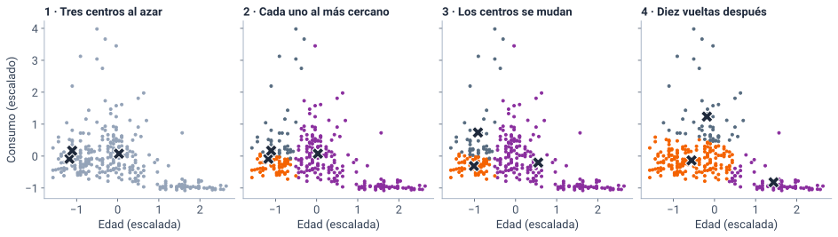
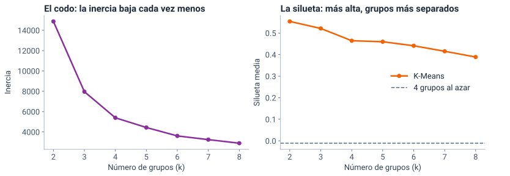
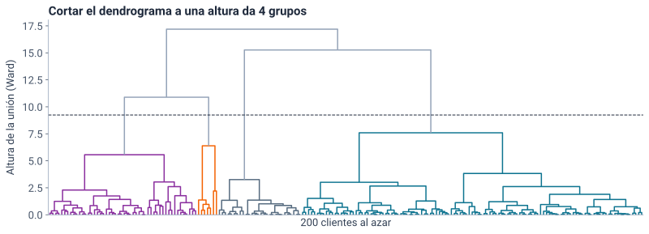
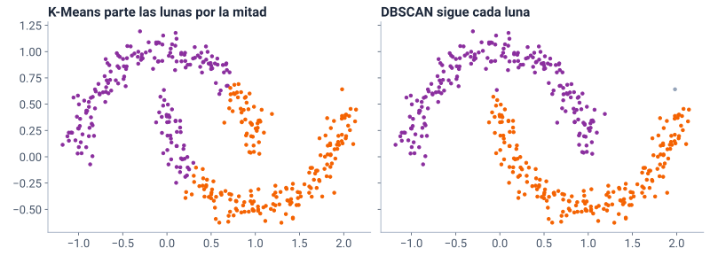

<!--
  Sesión 3 (4 h, viernes 13 de noviembre, 18:00–22:00): apertura 5 min · agrupamiento 70 · pausa 10 ·
  práctica 30 · nube 60 · avance en salas 45 · coevaluación 10 · cierre 10 (DISENO_S3_S4.md, sección 1).
  Las diapositivas de código corresponden a las celdas del notebook (mismo identificador entre
  corchetes); las salidas y las gráficas salen de ejecutarlo (precalculo/salidas_sesion3.json y
  recursos/s3/<id>.svg), con Python 3.13, pandas 2.2.3 y scikit-learn 1.6.1. Las cifras del texto salen
  de la celda [cifras]. Los hitos de reloj y el orden de recorte están en las notas del primer divisor
  de cada bloque. Las fuentes (F-…) son las de fuentes/FUENTES.md.
-->

# Apertura {icono=fa-door-open}

> Ya no hay etiqueta: ¿qué tipos de clientes tiene Yarumo?

???
18:00. Pedir desde ya que abran el notebook de la S3 (portada del curso → «Abrir en Colab»), que guarden una copia en Drive y que ejecuten la primera celda y [cargar], como en la S1 y la S2. Mientras tanto, la apertura: cinco minutos, no más.

## Cuatro horas en seis bloques, con una pausa

::: flujo
1. **Agrupamiento** — 70 min: grupos de clientes sin etiqueta
2. **Práctica en Colab** — 30 min: ¿cuántos grupos?, ¿cancelan igual?
3. **Nube** — 60 min: riesgos, privacidad y dónde vive el modelo
4. **Avance del proyecto** — 45 min, en salas de cuatro
5. **Coevaluación** — 10 min: acordamos los criterios
6. **Cierre** — 10 min
:::

Pausa: **10 min a las 19:15**.

???
Hitos de reloj, que no se mueven: el agrupamiento empieza a las 18:05; la pausa, a las 19:15; la práctica, a las 19:25; la nube, a las 19:55; las salas, a las 20:55; la coevaluación, a las 21:40, y el cierre, a las 21:50. Orden de recorte de toda la sesión (DISENO_S3_S4.md): (1) el jerárquico se reduce a la diapositiva del dendrograma; (2) por eso la comparación de Ward y el enlace simple (*single*) queda solo en sus notas (en la práctica, (1) y (2) son la misma diapositiva que se salta: −3 min); (3) la demostración de la máquina virtual se cambia por una captura (−3 min). Recortes adicionales, si hacen falta: la diapositiva de `eps` = 0,3 se salta (queda para el ejercicio 3, −2 min) y `nombrar` se dice sin proyectar el código (−2 min). No se recortan nunca la revisión en salas ni la IA responsable. Entre las 19:25 y las 22:00 no hay pausa: si el grupo lo pide, 3 minutos antes de la diapositiva de IaaS frente a PaaS (hacia las 20:35), a costa del recorte (3).

## Hoy la gerente pregunta algo que nadie ha etiquetado

::: tarjetas
### Sesión 2: con etiqueta
Cada cliente traía la respuesta (cuánto consumió, si canceló) y el modelo aprendía a predecirla. Se medía contra la **prueba**.
### Hoy: sin etiqueta
La gerente de experiencia del cliente: **¿qué tipos de clientes tenemos?** Nadie los ha clasificado. No hay respuesta correcta con la cual medirse.
:::

Es el aprendizaje **no supervisado** de la sesión 1: el **agrupamiento** (*clustering*) busca clientes parecidos entre sí y distintos de los demás.

???
Puente con los tipos de aprendizaje de la S1: supervisado, no supervisado y por refuerzo. En el no supervisado hay observaciones sin respuesta asociada; no se puede «supervisar» el análisis con una respuesta conocida (ISLP, sec. 2.1.4, F-ML-05). Por eso hoy no hay prueba ni exactitud: la pregunta «¿está bien?» se vuelve «¿le sirve a la gerente?». La otra pregunta de la gerencia sigue en pie y es el bloque de nube: ¿llevamos los datos a Azure sin poner en riesgo los datos personales?

# Agrupamiento {icono=fa-circle-nodes}

> Parecido es distancia. ¿Cuántos grupos, y cuáles?

???
18:05 a más tardar. Setenta minutos para unas 20 diapositivas. Hitos: K-Means paso a paso, hacia las 18:20; el codo y la silueta, hacia las 18:35; los perfiles, hacia las 18:45; el jerárquico, hacia las 18:52; DBSCAN, hacia las 19:00; la idea de cierre, a las 19:12. Si a las 18:45 no se ha llegado a los perfiles, recortar en este orden: (1) y (2) el jerárquico se queda en la diapositiva del dendrograma y se salta la pregunta del enlace simple, que se dice en una frase (−3 min); después, la diapositiva de `eps` = 0,3 (−2 min) y el código de `nombrar` (−2 min). No se recortan la silueta, la trampa de no escalar, los perfiles ni DBSCAN en Yarumo. Hay cuatro momentos de «predice antes de ver»: sin escalar, ¿cancelan igual?, el enlace simple y el ruido de DBSCAN.

## Agrupamos con tres columnas: quién es el cliente y cuánto usa la conexión

```python [columnas]
columnas = ["edad", "usuarios", "consumo_gb"]
X = clientes[columnas]
X.agg(["mean", "std", "min", "max"]).round(1)
#>       edad  usuarios  consumo_gb
#> mean  41.5       3.5       299.0
#> std   15.0       2.8       263.9
#> min   18.0       1.0        14.4
#> max   87.0      14.0      2500.0
```

- `cancelo` **no entra**: buscamos tipos de clientes, no a los que cancelan
- El consumo va de 14 a 2500 GB; los usuarios, de 1 a 14
- No entra el contrato: los grupos serían sus tres tipos

???
Por qué estas tres: describen cómo es el hogar del titular (edad, personas que usan la conexión) y cuánto usa el servicio. Son las columnas en las que el generador del caso dejó perfiles que el agrupamiento puede encontrar (glosario: «hay perfiles de cliente que el clustering puede encontrar»). No se usa el contrato: con él, los grupos serían los tres tipos de contrato. Tampoco la factura, que se mueve con el plan (correlación de 0,69, cálculo del revisor de exactitud): mezclaría el precio con el perfil. En el ejercicio 4 (opcional) se agrega `plan_mbps` y se ve qué cambia. Transición: si el consumo llega a 2500 y los usuarios a 14, ¿qué decide la distancia?

## Parecido es distancia, y la distancia depende de la escala

```python [escala]
from sklearn.preprocessing import StandardScaler
escalador = StandardScaler()
Z = escalador.fit_transform(X)            # cada columna, en desviaciones
print("Medias:", Z.mean(axis=0).round(2) + 0.0)   # + 0.0: sin «−0»
print("Desviaciones:", Z.std(axis=0).round(2))
#> Medias: [0. 0. 0.]
#> Desviaciones: [1. 1. 1.]
```


- Como en el KNN de la sesión 2: sin escalar, **el consumo decidiría solo**. Cada columna queda en desviaciones estándar: \( z = (x - \bar x) / s \)
- Sin entrenamiento ni prueba: el escalador aprende de los 8000 clientes

???
Es el escalado de la S2, sin repetir su pregunta (A, B y C): allí, 20 000 pesos pesaban más que 38 años. K-Means mide distancias euclídeas al cuadrado (su inercia, F-ML-32), así que una columna con números grandes domina; ISLP pone «¿estandarizar o no?» entre las decisiones pequeñas con efecto fuerte en el resultado (sec. 12.4.3, F-ML-33 y F-ML-39). `StandardScaler` resta la media y divide por la desviación (F-ML-33). En la S2 se ajustaba solo con el entrenamiento porque había una prueba que proteger; aquí no hay respuesta que predecir, así que se ajusta con todos. Si el modelo se usara después con clientes nuevos, se escalarían con la media y la desviación ya aprendidas (`transform`).

## K-Means (k-medias): k puntos de atención, y cada cliente va al más cercano

::: flujo
1. **Abrir k puntos** — en lugares al azar
2. **Asignar** — cada cliente va al punto más cercano
3. **Mudar** — cada punto se muda al centro de sus clientes
4. **Repetir** — 2 y 3, hasta que nadie cambie de punto
:::

Cada punto es el **centro del grupo** (centroide); sus clientes, un **grupo** (*cluster*). La «ciudad» es un mapa de perfiles: sus ejes son la edad, los usuarios y el consumo, no calles.

???
La analogía del diseño: Yarumo abre k puntos de atención en la ciudad. Es el algoritmo de Lloyd (F-ML-37, solo la referencia; la guía de scikit-learn dice que a K-Means se le suele llamar así, F-ML-32). K-Means exige fijar k antes: «This algorithm requires the number of clusters to be specified» (scikit-learn, sec. 2.3.2; F-ML-30 la cita en la 1.9.1, y F-ML-32 confirma la misma sección en la 1.6.1). Siempre converge, pero quizá a una solución que depende de dónde empezaron los puntos: por eso se repite (lo vemos dos diapositivas después, con `n_init`).

## Así se mueven los centros: asignar, mudar, repetir

{alto=330}

Cada **X** es un centro. Con dos columnas se puede dibujar; con tres, K-Means hace lo mismo en el espacio.

???
La celda [pasos] del notebook lo hace a mano con dos funciones, `asignar` y `mudar`, para que se vea que no hay magia: 300 clientes, edad y consumo escalados, tres centros. En el panel 2, cada cliente toma el color de su centro más cercano; en el 3, los centros (las X) se mudan al promedio de sus clientes; en el 4, tras diez vueltas, ya no cambian. Señalar que en el panel 4 los clientes de mucho consumo quedaron en un grupo y los mayores de poco consumo en otro. Si alguien pregunta: no es la forma de hacerlo en la práctica, es para ver el mecanismo.

## La inercia mide qué tan apretados quedan los grupos

$$ \text{inercia} = \sum_{i=1}^{n} \lVert z_i - c_{g(i)} \rVert^2 $$

La suma, sobre los clientes, del **cuadrado** de la distancia de cada uno \( z_i \) al centro \( c_{g(i)} \) de su grupo. K-Means busca los centros que la hacen **mínima**.

- *k-means++* pone los centros iniciales lejos unos de otros
- `n_init=10`: repite 10 veces y se queda con la de menor inercia

???
Cómo se lee: «la inercia es la suma de los cuadrados de las distancias de cada cliente a su centro». No está normalizada: menor es mejor y cero es el óptimo (F-ML-32). k-means++ elige cada centro inicial con probabilidad proporcional al cuadrado de la distancia al centro más cercano ya elegido (Arthur y Vassilvitskii, 2007, F-ML-36); es el valor por defecto de scikit-learn. Ojo, y es importante para el notebook: en scikit-learn 1.6.1, la versión de Colab, `n_init="auto"` con k-means++ hace **una sola corrida** (F-ML-32, hallazgo 20 de FUENTES.md). Por eso hoy siempre `n_init=10` y `random_state=2026`; con una sola corrida, los tamaños de los grupos cambian un poco (aquí, 603 clientes en lugar de 606 en el grupo de las pymes, celda [cifras]).

## Cuatro grupos, y sus números no significan nada

```python [kmeans4]
from sklearn.cluster import KMeans
km4 = KMeans(n_clusters=4, n_init=10, random_state=2026)
grupos = km4.fit_predict(Z)           # el número de grupo de cada cliente
print(f"Inercia: {km4.inertia_:.1f}")
pd.Series(grupos).value_counts().sort_index()
#> Inercia: 5390.3
#> 0    3021
#> 1     606
#> 2    1646
#> 3    2727
#> Name: count, dtype: int64
```

- 0, 1, 2 y 3 son **nombres**, no un orden: con otra semilla o versión, el mismo grupo puede cambiar de número
- Por eso cada grupo se nombrará por su **perfil**

???
`fit_predict` entrena y devuelve el grupo de cada cliente en una sola llamada. K-Means tardó 10 iteraciones en la mejor de las 10 corridas (celda [cifras]). Si en el Colab de alguien los números salen en otro orden, no está mal: por eso el ejercicio 2 se revisa por el perfil del grupo, no por su número. ¿Por qué 4? Es lo que discutimos ahora.

## La silueta compara la distancia a los de tu grupo con la del grupo vecino

::: definicion [Coeficiente de silueta de un cliente]
$$ s = \frac{b - a}{\max(a,\, b)} $$
\( a \): distancia media a los de **su** grupo · \( b \): distancia media a los del grupo **vecino** más cercano
:::

- Cerca de 1: bien metido en su grupo · cerca de 0: en la frontera · negativa: quizá en el grupo equivocado
- La silueta del agrupamiento es el **promedio** de los 8000

???
Rousseeuw (1987) la propuso como ayuda gráfica para interpretar y validar un agrupamiento (F-ML-35, solo la referencia); la fórmula y los rangos, de la guía de scikit-learn (sec. 2.3.11.5, F-ML-32). Una limitación que dice la propia guía: la silueta suele ser más alta para grupos convexos, como los de K-Means, que para los de densidad, como los de DBSCAN; no se usa sola para comparar métodos distintos. Transición: ¿cuántos grupos sugieren la silueta y el codo?

## El codo se dobla en 3 o 4; la silueta prefiere 2

{alto=360}

- **El método del codo** (*elbow method*): dónde la inercia deja de bajar mucho · **La línea base**: 4 grupos al azar, silueta cerca de 0

???
El codo: la inercia siempre baja al subir k (con 8000 grupos sería 0); se busca dónde deja de bajar mucho. Es una heurística, no una regla: Tibshirani, Walther y Hastie (2001) la llaman «folclore estadístico» y proponen la estadística de brecha para formalizarla (F-ML-39); ISLP dice que elegir K no es simple (sec. 12.4.1). Que el codo sea ambiguo aquí (¿3 o 4?) es una extensión razonable de esas fuentes, no una cita. La silueta es más alta con k = 2: 0,554; con k = 4, 0,464; con k = 8, 0,389. El reparto al azar da −0,011: la línea base del agrupamiento (como dice la página del proyecto: «otro número de grupos o un reparto al azar»).

## La gerente puede atender de 3 a 5 ofertas distintas: ¿cuántos grupos le das? {.pregunta}

Una oferta por grupo. Escribe en el chat **un número y una razón**: ¿qué te dicen el codo, la silueta y la gerente?

Lo decides con cifras en el **ejercicio 1**, y lo discutimos después de la práctica.

???
Dos minutos: leer tres o cuatro respuestas y no dar la solución todavía (el ejercicio 1 la pide; la discusión va en la puesta en común de las 19:49). Lo que debe salir: la respuesta no es «la silueta más alta»; k se elige por la decisión. Lo que se contesta en la puesta en común está en las notas de esa diapositiva.

## Sin escalar, con k = 4, ¿la silueta sube o baja? Escalada fue 0,464 {.pregunta}

::: respuesta
```python [sin_escalar]
km_crudo = KMeans(n_clusters=4, n_init=10, random_state=2026)
grupos_crudos = km_crudo.fit_predict(X)        # sin escalar
print(f"Silueta sin escalar: {silhouette_score(X, grupos_crudos):.3f}")
print(f"Silueta escalada:    {silhouette_score(Z, grupos):.3f}")
X.groupby(grupos_crudos).agg(["min", "max"]).round(0)
#> Silueta sin escalar: 0.535
#> Silueta escalada:    0.464
#>   edad     usuarios     consumo_gb
#>    min max      min max        min     max
#> 0   18  65        1  14      456.0   949.0
#> 1   18  71        1  14      202.0   456.0
#> 2   21  56        6  14      953.0  2500.0
#> 3   18  87        1  10       14.0   204.0
```

**Sube, y los grupos son peores:** cada uno es una franja de consumo, y no se parecen entre sí en edad ni en usuarios.
:::

???
Dos minutos. Es la trampa del diseño (D1): sin escalar, con k = 2 la silueta llega a 0,719 (celda [cifras]). La silueta mide distancias con las columnas que le das; si el consumo está en GB y la edad en años, la distancia es casi solo consumo, y en una sola dimensión es fácil separar franjas. La silueta no ve si las columnas son comparables; además, las dos siluetas se miden en espacios distintos (X y Z), así que compararlas ya es engañoso. Con 0,535 frente a 0,464, una lectura ingenua elegiría los grupos sin escalar: para la gerente, «clientes de 202 a 456 GB» no es un tipo de cliente.

## La silueta ayuda, pero no decide {.idea}

El método, las columnas y el número de grupos se eligen por la decisión que se va a tomar. Un grupo es una hipótesis que hay que poder describir, no un hallazgo.

???
Es el lema de la sesión. ISLP lo dice así: no hay una única respuesta correcta; sirve cualquier solución que revele algo interesante de los datos (sec. 12.4.3, F-ML-39). En la S2 la métrica la elegía la decisión; hoy, además, el número de grupos. La línea base del agrupamiento es otro número de grupos o un reparto al azar (página del proyecto): se proyecta en la idea de cierre del bloque.

## Cuatro perfiles que se pueden describir

```python [perfiles]
perfiles = clientes.groupby(grupos).agg(
    clientes=("edad", "size"),
    edad=("edad", "mean"),
    usuarios=("usuarios", "mean"),
    consumo_gb=("consumo_gb", "mean"),
    pymes=("tipo_cliente", lambda t: (t == "Pyme").mean()))
perfiles.round({"edad": 1, "usuarios": 1, "consumo_gb": 0, "pymes": 3})
#>    clientes  edad  usuarios  consumo_gb  pymes
#> 0      3021  28.2       2.0       257.0  0.000
#> 1       606  42.5      11.0       966.0  0.967
#> 2      1646  65.3       1.5        54.0  0.000
#> 3      2727  41.7       4.7       345.0  0.082
```

¿Quiénes son? Ponles nombre en el chat, **por su perfil**.

???
Un minuto para que propongan nombres. `tipo_cliente` no entró al agrupamiento y aun así un grupo es en un 96,7 % de pymes; el de hogares de 3 a 6 personas trae un 8,2 % de pymes (las más pequeñas: 7,2 usuarios de media frente a 11,1 de las del grupo de pymes, según el revisor de exactitud). Describimos clientes, no juzgamos personas (glosario): «titulares mayores», no «los viejos». Los rangos del 10 al 90 % de cada grupo están en [cifras] («perfiles»): los jóvenes van de 21 a 35 años y de 1 a 3 usuarios; los mayores, de 56 a 75 años y de 1 a 2 usuarios; los hogares, de 3 a 6 usuarios.

## Cada grupo se nombra por su perfil, con reglas que se pueden leer

```python [nombres]
def nombrar(fila):
    """Un nombre por el perfil del grupo, no por su número."""
    if fila["pymes"] > 0.5:
        return "Pymes con muchos usuarios"
    if fila["edad"] >= 55:
        return "Titulares mayores, 1 o 2 personas"
    if fila["usuarios"] >= 3:
        return "Hogares de 3 a 6 personas"
    return "Titulares jóvenes, hogares pequeños"

nombre = perfiles.apply(nombrar, axis=1)
nombre
#> 0    Titulares jóvenes, hogares pequeños
#> 1              Pymes con muchos usuarios
#> 2      Titulares mayores, 1 o 2 personas
#> 3              Hogares de 3 a 6 personas
#> dtype: object
```

???
Si el número de un grupo cambia en otro Colab, el nombre no cambia: la regla mira el perfil. Es también una forma de auditar: cualquiera puede leer por qué un grupo se llama así. Los umbrales (0,5, 55 años, 3 usuarios) son nuestros, elegidos mirando la tabla, y los nombres siguen a los rangos del 10 al 90 % de [cifras]; para la gerente, el nombre tiene que decir algo que pueda usar en una oferta.

## ¿Cancelan igual los cuatro grupos? {.pregunta}

`cancelo` no entró al agrupamiento. Predice: ¿cuál cancela más, y cuánto más que el promedio (23,6 %)?

Anota tu predicción: la comparamos con tu cálculo del **ejercicio 2**, después de la práctica.

???
Que escriban su predicción en el chat (un perfil y una cifra); se contrasta después de la práctica. No adelantar la respuesta: el ejercicio 2 la calcula. La tasa de todos los clientes, 23,55 %, sale de [cifras].

## El jerárquico une clientes paso a paso, y cortar el árbol da los grupos

{alto=360}

- Empieza con cada cliente solo y une los dos grupos más cercanos **según un criterio de enlace** (*linkage*), hasta que queda uno
- La **altura** de una unión dice qué tan distintos eran los grupos; cortar a una altura deja los grupos de ahí
- **Ward** une los que menos aumentan la suma de cuadrados (la inercia): un objetivo parecido al de K-Means

???
Recortable 1: si hay atraso, esta es la única diapositiva del jerárquico. El dendrograma dibuja las uniones; la altura de cada una dice qué tan distintos eran los grupos que se unieron. Cortarlo a una altura da k grupos; aquí, con 200 clientes, quedan grupos de 115, 50, 28 y 7 (celda [cifras]). Con 8000 no se leería. Ward (1963, solo la referencia) minimiza la suma de diferencias al cuadrado dentro de los grupos, parecido al objetivo de K-Means (F-ML-38, que lo toma de scikit-learn, sec. 2.3.6; F-ML-32, punto 3). Con los 8000 clientes, Ward y K-Means coinciden bastante, pero no del todo (índice de Rand ajustado de 0,745, [cifras]; no hace falta nombrarlo). Ventaja del jerárquico (criterio nuestro, a partir de cómo funciona el dendrograma): se puede mirar el árbol antes de elegir k.

## Con el enlace simple y 4 grupos, ¿cuántos clientes tendrá el más grande? {.pregunta}

El **enlace simple** (*single*) une los dos grupos que tienen los clientes más cercanos entre sí. Con los 8000 clientes, escribe en el chat un número.

::: respuesta
```python [encadena]
for enlace in ["ward", "single"]:
    jerarquico = AgglomerativeClustering(n_clusters=4, linkage=enlace)
    etiquetas_j = jerarquico.fit_predict(Z)
    tamanos = sorted(np.bincount(etiquetas_j).tolist(), reverse=True)
    print(f"{enlace:>6}: {tamanos}")
#>   ward: [3360, 2486, 1577, 577]
#> single: [7996, 2, 1, 1]
```

**7996 de 8000.** Basta una cadena de clientes parecidos para pegarlo todo: el enlace simple **encadena**. Ward da tamaños parecidos.
:::

???
Recortable (1)–(2): decirlo en una frase. La guía de scikit-learn describe el efecto «el rico se hace más rico»: el enlace simple da los tamaños más desiguales y Ward los más regulares, y el simple no es robusto al ruido (sec. 2.3.6.1, F-ML-32); «encadena» es nuestra forma de decirlo. Los tres grupos de 1 o 2 clientes son clientes extremos (consumo o usuarios muy altos). El criterio para unir importa tanto como el número de grupos.

## DBSCAN: grupos por densidad, como en una plaza llena

::: tarjetas {columnas=3}
### `eps`
Un paso: la distancia a la que alguien cuenta como **vecino**
### `min_samples`
Cuántos a menos de un paso, **contándose a sí mismo**, hacen **densa** una zona
### Ruido
Quien está solo, lejos de las zonas densas: etiqueta **−1**
:::

DBSCAN no pide k: lo encuentra. Y no obliga a nadie a entrar en un grupo.

???
La analogía: en una plaza llena, en el centro de una zona densa cada persona tiene, a menos de un paso (`eps`), al menos `min_samples` personas contándose a sí misma; quien está en el borde entra al grupo si toca una zona densa; el que está solo es ruido (F-ML-32, punto 4: `min_samples` cuenta el propio punto). Es de Ester, Kriegel, Sander y Xu (1996, F-ML-34): un algoritmo de densidad para encontrar grupos de forma arbitraria. Necesita dos parámetros; en el artículo, `MinPts` = 4 vale para datos de dos dimensiones y `eps` se elige con el gráfico de distancias a los k vecinos (sec. 4.2). La API de scikit-learn llama a `eps` el parámetro más importante, que normalmente no se deja en el valor por defecto (F-ML-32). Hoy usamos siempre `min_samples=20` (decisión del diseño, D2).

## Con dos lunas, K-Means corta por la mitad y DBSCAN sigue la forma

{alto=360}

K-Means supone grupos **redondos** alrededor de un centro; DBSCAN sigue la zona **densa**.

???
Son datos de juguete (`make_moons`, 400 puntos), no de Yarumo. K-Means con 2 grupos parte cada luna por la mitad; DBSCAN encuentra las dos lunas y deja un punto como ruido (en gris). Con el índice de Rand ajustado, que compara con las lunas verdaderas: 0,269 para K-Means y 0,985 para DBSCAN ([cifras]); no hace falta nombrarlo. La guía de scikit-learn: K-Means supone grupos convexos e isotrópicos y responde mal a grupos alargados (sec. 2.3.2, F-ML-32). Transición: ¿y con los clientes de Yarumo?

## En Yarumo, con `eps` = 0,5, ¿quiénes serán el ruido? {.pregunta}

Las mismas tres columnas escaladas y `min_samples=20`. Predice en el chat: ¿quiénes quedan lejos de todos?

::: respuesta
```python [dbscan]
db = DBSCAN(eps=0.5, min_samples=20)
etiquetas = db.fit_predict(Z)
ruido = etiquetas == -1                     # True si quedó como ruido
print(f"Grupos: {etiquetas.max() + 1} · ruido: {ruido.sum()} clientes")
clientes.groupby(ruido)[columnas].mean().round(1).rename(
    index={False: "el resto", True: "el ruido"})
#> Grupos: 1 · ruido: 168 clientes
#>           edad  usuarios  consumo_gb
#> el resto  41.6       3.3       278.3
#> el ruido  38.5      10.8      1263.9
```

**Los de consumo extremo y muchos usuarios.** Un solo grupo: aquí DBSCAN no hace segmentos, **encuentra lo atípico**.
:::

???
Dos minutos. Casi todo el ruido es de pymes: el 98,2 % ([cifras], «dbscan»); el consumo del ruido promedia 1264 GB frente a 278 del resto. No proyectar el porcentaje si se quiere dejar para el ejercicio 3: se calcula ahí. Para Yarumo, ese ruido es útil: clientes que no se parecen a nadie y quizá necesitan un plan propio o una revisión (¿un error de medición?).

## Con `eps` = 0,3 salen varios grupos: ¿qué tendrá en común cada uno? {.pregunta}

Una pista: mira la columna `usuarios` de cada grupo. Lo compruebas en el **ejercicio 3** (trabajo independiente).

???
Las cifras ([cifras], «dbscan», «0.3»): 7 grupos y 836 clientes de ruido; los grupos tienen 1, 2, 3, 4, 5 o 6 usuarios (los de 1 usuario, en dos grupos). Se dejan para el ejercicio 3: no proyectarlas ni dar la explicación. La causa, para el repaso de la S4: un usuario más son 1 / 2,8 ≈ 0,36 desviaciones, más que `eps` = 0,3, así que nadie con 2 usuarios es vecino de alguien con 3 (con 0,5 sí se tocan): la densidad la crea la columna, no un tipo de cliente. Con el `min_samples` por defecto (5) salen 34 grupos: por eso fijamos 20. Recortable: si hay atraso, se salta (−2 min).

## El método, las columnas y k se eligen por la decisión {.idea}

K-Means da segmentos que se pueden describir; el jerárquico deja ver el árbol antes de elegir k; DBSCAN encuentra lo atípico. La silueta, el codo y el dendrograma ayudan; ninguno decide solo. La línea base: otro número de grupos o un reparto al azar.

???
19:12. Resumen del bloque, en una frase por método. Para el proyecto: si una pareja elige agrupar, su línea base es otro número de grupos o un reparto al azar, y tiene que justificar cómo eligió k (página del proyecto). Transición a la pausa.

## Pausa de 10 minutos {.idea etiqueta="Pausa" icono=fa-mug-hot}

Volvemos a las 19:25 con la práctica. En la pausa, ejecuta el notebook hasta la celda [dbscan]: **Entorno de ejecución → Ejecutar anteriores** desde el ejercicio 1.

???
19:15. El notebook entero tarda menos de un minuto en Colab (unos 25 segundos en la réplica, con las soluciones). La hoja compartida de las salas (D6) ya está lista desde antes de clase (ver las notas del bloque del avance); en la pausa solo se comprueba el enlace.

# Práctica en Colab {icono=fa-laptop-code}

> ¿Cuántos grupos?, y ¿cancelan igual?

???
19:25. Treinta minutos: 12 para el ejercicio 1, 12 para el 2 y 6 para la puesta en común (3 por ejercicio). El 3 es trabajo independiente y el 4, opcional.

## Dos ejercicios en clase, con revisión automática

::: flujo
1. **Ejercicio 1** — la silueta de k = 2 a 8, el k de la silueta más alta y el k para la gerente, que puede atender **de 3 a 5 ofertas** · 12 min
2. **Ejercicio 2** — la tasa de cancelación de cada grupo: ¿qué perfil cancela más, y cuánto? · 12 min
3. **Ejercicio 3** — lo atípico, con DBSCAN · en casa
4. **Ejercicio 4 (opcional)** — otra columna, `plan_mbps`
:::

Antes de empezar: haz clic en la celda del ejercicio 1 → **Entorno de ejecución → Ejecutar anteriores**.

???
Clave del 1: las siluetas de k = 2 a 8 son 0,554, 0,521, 0,464, 0,460, 0,441, 0,415 y 0,389; `k_silueta` = 2; `k_gerente` de 3 a 5 (lo justifican en «Tus respuestas»). El verificador reconoce las siluetas sin escalar (0,719 con k = 2), las de una sola corrida (`n_init="auto"`), las escritas como porcentaje, un `k_silueta` que no es el de la silueta más alta (dice cuál es su silueta) o es el de la más baja, y un `k_gerente` fuera de 3 a 5. Clave del 2: el grupo de titulares jóvenes de hogares pequeños, con 36,6 % (los otros: 12,0, 16,2 y 17,7 %); el verificador lo revisa por el perfil, no por el número, acepta la tasa con ±1,5 puntos y como porcentaje, y reconoce la tasa de todos (23,6 %), la de otro grupo, la de los que no cancelan, un conteo y los grupos sin escalar. Clave del 3: con `eps` 0,3, 7 grupos y 836 de ruido; con 0,5, 1 y 168; el 98,2 % del ruido es de pymes; reconoce `min_samples` por defecto, contar el ruido como grupo, los datos sin escalar y la proporción al revés (de las pymes, el 20,4 % es ruido). El 4 solo da pistas: el grupo de titulares jóvenes se parte casi por mitades por plan (unos 650 Mbps de media frente a unos 190); parte de los hogares se junta con los jóvenes de plan bajo.

## ¿Cuántos grupos le diste a la gerente, y por qué? {.pregunta}

Escribe en el chat tu `k_gerente` y la razón.

::: respuesta
**De 3 a 5, no 2.** La silueta más alta es la de k = 2 (0,554), pero el grupo pequeño de ese corte (810 clientes) tiene un 86,3 % de pymes: casi solo aparta a las pymes, y eso la gerente ya lo sabe. Con 3, los titulares jóvenes y los hogares grandes quedan juntos; con 4 se separan.
:::

???
Tres minutos de puesta en común, a las 19:49. Cifras de [cifras], «k2»: el grupo pequeño tiene 810 clientes, 9,9 usuarios y 876 GB de media, y el 86,3 % son pymes (y ahí cae el 86,4 % de las 809 pymes). Es la lección de D1 del diseño. Con k = 3, según el revisor de exactitud, ya sale aparte un grupo de 1700 titulares mayores, y los jóvenes y los hogares grandes van juntos (5566 clientes); k = 4 los separa. Cualquier k de 3 a 5 bien justificado vale (el verificador acepta los tres).

## El grupo que más cancela: ¿acertaste? {.pregunta}

Escribe en el chat el **perfil** (no el número) del grupo que más cancela y su tasa.

::: respuesta
**Titulares jóvenes, de hogares pequeños: 36,6 %.** Los otros tres cancelan entre el 12,0 y el 17,7 %; el promedio es 23,6 %. Sin usar `cancelo`, el agrupamiento encontró un perfil en el que conviene empezar la retención.
:::

???
Tres minutos, a las 19:52. Pedir dos o tres respuestas de «Tus respuestas»: qué le propondrían a la gerente. Cuidado con la lectura: el grupo cancela más; no es que «los jóvenes sean infieles» (glosario). Puente con la S1: allí se vio que con contrato mes a mes se cancela más (la edad no se miró allí); el grupo no explica por qué, pero dice dónde mirar. Y con la S2: un modelo supervisado responde quién va a cancelar; el agrupamiento, qué tipos de clientes hay para diseñar la oferta.

# Nube {icono=fa-shield-halved}

> Riesgos, privacidad y dónde vive el modelo

???
19:55. Sesenta minutos: 4 de por qué la nube, 12 de riesgos, 20 de privacidad, 10 de IaaS frente a PaaS con la demostración, 8 de gobernanza e IA responsable y 6 de «Para Yarumo». Si se atrasa: (3) la demostración de la máquina virtual se cambia por una captura (−5 min); la gobernanza se dice sobre la diapositiva de las tarjetas, sin detenerse en Fabric y Databricks (−3 min). No se recortan la IA responsable ni «Para Yarumo», que alimentan las salas. Lo que se muestra en el portal no crea nada ni cobra.

## Yarumo no iría a la nube principalmente para ahorrar

> «La propuesta de valor de la nube no es principalmente el ahorro de costos». — Microsoft Learn, *Aspectos básicos de Azure para expertos locales* (traducción nuestra)

- Lo que gana: **agilidad**. Pagar por uso; escalar, encender y apagar más rápido que en su centro de datos de Pereira
- Lo que no cambia: Yarumo sigue respondiendo por sus datos (sesión 1)

???
Cuatro minutos (tema 4.1 del syllabus). La cita es de F-AZ-50 (`#use-a-scale-on-demand-approach-to-capacity`); el original: «the cloud value proposition isn't primarily cost savings». La misma página advierte que, si los recursos se dimensionan para la demanda máxima, como en local, se termina sobreaprovisionado y sin los menores costos de la nube. Y Microsoft insiste en que una carga optimizada en costos no es necesariamente de bajo costo (F-AZ-51). La responsabilidad no se terceriza: ENISA (2009) lo dice así: «you can outsource responsibility but you can't outsource accountability» (F-NUBE-07, p. 10); el NIST, igual (F-NUBE-03, sec. 2.3). Transición: si los datos suben, ¿qué riesgos nuevos aparecen?

## En 2026, el primer riesgo de la nube es la identidad, no la configuración {.denso}

| 2026 | Amenaza (Cloud Security Alliance) | En 2024 |
|---|---|---|
| 1 | Gestión de identidades y accesos inadecuada | 2.º |
| 2 | Ataques potenciados con IA | nueva |
| 3 | Recursos de terceros inseguros | 5.º |
| 4 | Interfaces y API inseguras | 3.º |
| 5 | Configuración errónea y control de cambios inadecuado | 1.º |

Las razones del primer puesto: **permisos de más**, identidades que no son personas y credenciales mal cuidadas.

???
Fuente: CSA, *Top Threats to Cloud Computing Survey Report 2026* (F-NUBE-05, comunicado del 13 de agosto de 2026; el informe completo exige registro y no se leyó). La traducción de los nombres es nuestra. Encuesta a más de 500 expertos; once amenazas finales. La de 2024 (F-NUBE-06) ponía primero la configuración errónea: si alguien leyó eso, es de 2024. La amenaza 6 es el compromiso de sistemas de IA. Conecta con la S2 (criterio nuestro, a partir de las razones que da la CSA): Entra ID, RBAC y privilegio mínimo atacan la amenaza número 1. Si hay atraso, esta diapositiva se dice en dos frases y el tiempo pasa a privacidad.

## Cinco riesgos de Yarumo, y el control de cada uno {.denso}

| Riesgo | Prob. | Impacto | Control |
|---|---|---|---|
| Alguien de analítica cae en un correo falso (*phishing*) y su cuenta no tiene **autenticación multifactor (MFA)** | Alta | Alto | MFA: un segundo factor al entrar (nuevo hoy); grupos con privilegio mínimo (S2) |
| El acceso de la **consultora** sigue abierto después de terminar su trabajo | Media | Medio | Rol con ámbito estrecho (S2), que se quita al terminar |
| Alguien deja **público** el contenedor `datos-clientes` | Baja | Alto | Directiva: sin acceso público a blobs (S2) |
| Se filtra la **clave compartida** o una **firma de acceso compartido (SAS)**, un enlace con permisos, en un notebook | Media | Alto | Sin clave compartida: Entra ID y roles de datos (S2) |
| Alguien pega la tabla en una **herramienta externa** de IA | Media | Alto | Finalidad y contrato (hoy); el proyecto prohíbe pegar datos en herramientas externas |

Probabilidad e impacto: estimación nuestra para Yarumo.

???
Doce minutos con la de arriba (tema 4.2). La probabilidad y el impacto son nuestra estimación para Yarumo, no una cifra de una fuente: el registro de riesgos del Cloud Adoption Framework pone por cada riesgo su probabilidad, su impacto, una estrategia (p. ej., mitigar) y un dueño (paso 2 de «Govern», F-AZ-38). Fuentes de los controles: MFA, cuentas y acceso los conserva siempre el cliente (F-AZ-01); RBAC: privilegio mínimo, grupos y, para dar permisos solo por unas horas, PIM con acceso justo a tiempo (F-AZ-18; PIM pide licencia de pago, como dijo la S2 con F-AZ-19e; en la capa gratuita, la asignación se quita a mano); el acceso anónimo a blobs está prohibido por defecto y hay una directiva integrada para impedirlo (F-AZ-41, F-AZ-19c); si una SAS se filtra, cualquiera que la tenga puede usarla, y Microsoft recomienda Entra ID y no permitir la clave compartida (F-AZ-42; directiva en F-AZ-19c). La consultora es el proveedor externo de la matriz de roles de la S2 (con acceso solo a `modelos`, por eso el impacto es medio). La fila 5 se apoya en la página del proyecto («El uso de IA»). Preguntar: ¿cuál de los cinco es más probable en su empresa?

## Cada riesgo ataca la confidencialidad, la integridad o la disponibilidad

::: tarjetas {columnas=3}
### Confidencialidad
Que solo vea los datos quien debe. La clave filtrada, la cuenta sin MFA, el contenedor público.
### Integridad
Que nadie los altere sin permiso. Un permiso de escritura de más, un modelo cambiado.
### Disponibilidad
Que estén cuando se necesitan. Un borrado por error, una región caída (sesión 4).
:::

La Ley 1581 pide medidas contra la **adulteración, la pérdida y el acceso no autorizado** (art. 4, principio de seguridad).

???
Es el repaso que la S1 prometió (en la celda de descarga se habló de integridad: la huella SHA-256). Las tres definiciones son el vocabulario clásico de seguridad de la información, sin entrada propia en el banco de fuentes: decirlo como repaso, no como cita. El principio de seguridad de la Ley 1581 (art. 4, lit. g; F-LEY-01): medidas técnicas, humanas y administrativas contra adulteración, pérdida, consulta, uso o acceso no autorizado o fraudulento. La disponibilidad (redundancia, eliminación temporal, versiones) es tema de la S4. Transición: ese principio de seguridad es uno de varios; vamos a la ley.

## Seudonimizada, la tabla sigue siendo de datos personales

- `id_cliente` reemplaza al nombre y la cédula, pero **Yarumo puede volver a unirlos** con la persona
- Edad, ciudad y estrato, **juntas**, ayudan a identificar a alguien
- Por eso la Ley 1581 aplica a todo lo que haga Yarumo con esta tabla en la nube

???
Repaso corto de la S1 (allí se dijo con F-LEY-01 y F-LEY-09). Lo nuevo de hoy: la SIC, citando a la Corte Constitucional, dice que un dato personal permite identificar a la persona «en mayor o menor medida» gracias a la visión de conjunto que se logre con ese y otros datos (Concepto 14-283428 de 2015, num. 2.1, F-LEY-10). Por eso combinar columnas «inocentes» puede volver identificable a un cliente. Lo de la SIC de 2026 sobre la seudonimización es de datos biométricos: aplicarlo aquí es una extensión razonable (F-LEY-09).

## Finalidad: Yarumo solo puede usar los datos para lo que informó

- El tratamiento debe tener una **finalidad legítima, informada al titular** (Ley 1581, art. 4, lit. b)
- Un modelo de retención con los datos del servicio: ¿está dentro de lo que se informó al contratar?
- **Subir la tarifa** a quien el modelo dice que no se va: puede ser otra finalidad (diagnóstico, sesión 1)

???
Retoma la pregunta 6 del diagnóstico de la S1 (respuesta C: ese uso cambia la finalidad de los datos), que prometía volver hoy. Que subir la tarifa quede fuera de la finalidad informada es criterio del docente: depende de lo que Yarumo informó; la ley exige que la finalidad sea legítima e informada. El principio de finalidad: el tratamiento debe obedecer a una finalidad legítima de acuerdo con la Constitución y la ley, informada al titular (art. 4, lit. b; F-LEY-01). Para el proyecto: el plan de nube debe decir para qué se usan los datos. Si la finalidad informada no cubre el modelo, no basta con que los datos ya estén en manos de Yarumo.

## Yarumo es el responsable; Microsoft, el encargado

::: tarjetas
### Responsable del tratamiento
**Decide** sobre la base de datos y para qué se usa. Yarumo.
### Encargado del tratamiento
Trata los datos **por cuenta del responsable**, según sus instrucciones. Microsoft, cuando aloja y procesa los datos de Yarumo en Azure.
:::

La SIC recomienda firmar con el proveedor de nube un **contrato de transmisión**.

???
Definiciones del art. 3 de la Ley 1581, lits. d y e (F-LEY-01): el encargado trata los datos «por cuenta del Responsable del Tratamiento». La SIC, en un concepto sobre un servicio de nube (Firebase, 2025), dice que el proveedor actúa sujeto a las instrucciones del responsable y recomienda contratos de transmisión con cláusulas de confidencialidad, seguridad, restricción de acceso y manejo de incidentes (F-LEY-08); es la misma lógica para Azure. Las recomendaciones de la Red Iberoamericana, que aloja la SIC, también tratan al proveedor de nube como encargado (F-LEY-06). Microsoft, por su parte, dice que no reclama la propiedad de los datos y que su personal no accede a ellos por defecto (F-AZ-53).

## Transmisión o transferencia: depende de quién recibe los datos {columnas=1:1}

::: definicion [Transmisión]
Los datos van a un **encargado** que los trata **por cuenta** de Yarumo, dentro o fuera de Colombia.
:::

Si es **internacional** y hay un **contrato de transmisión** que fije el alcance y obligue al encargado a la seguridad y la confidencialidad, **no hay que informar al titular ni pedirle consentimiento** (art. 24).

|||

::: definicion [Transferencia]
Los datos van a otro **responsable**, que decide por su cuenta qué hace con ellos, dentro o fuera de Colombia.
:::

Si es hacia otro país, solo si ese país tiene un **nivel adecuado de protección** (o aplica una excepción de la ley).

???
Veinte minutos para todo el bloque de privacidad: esta es la diapositiva central. Decreto 1377 de 2013, art. 3, nums. 4 y 5 (según el banco de fuentes, compilado en el art. 2.2.2.25.1.3 del Decreto 1074 de 2015, dato aún por confirmar; F-LEY-03); art. 24: las transmisiones internacionales de responsable a encargado no requieren informar al titular ni su consentimiento cuando hay un contrato conforme al art. 25; art. 25: el contrato fija el alcance y las actividades, y el encargado se obliga a los principios, a la seguridad y a la confidencialidad. Las transferencias internacionales se rigen por el art. 26 de la Ley 1581 (F-LEY-01): solo a países con nivel adecuado, que fija la SIC, salvo excepciones. Las cláusulas modelo de la Red Iberoamericana (Circular Externa 003 de 2025) son opcionales (F-LEY-07). Un matiz: el Decreto 1377 no condiciona la transmisión al país, pero el Título V de la SIC (num. 3.2, parágrafo cuarto) dice que es posible transmitir a países adecuados «en los términos que rigen la transferencia»; el propio banco lo marca como redacción ambigua (F-LEY-12). Para una región en Chile o Brasil: contrato del art. 25 y consultar a la SIC.

## ¿Transmisión o transferencia? {.pregunta}

1. Yarumo le pasa la tabla a una aseguradora de Medellín, que hará con ella sus propias campañas
2. Yarumo sube la tabla a un almacenamiento en Estados Unidos; el proveedor solo la guarda, y el contrato le prohíbe cualquier otro uso
3. Un centro de llamadas de Bogotá recibe la lista de clientes que Yarumo quiere retener y los llama a nombre de Yarumo, con el guion que Yarumo le fijó
4. Yarumo le vende la tabla a una empresa de mercadeo en México, que la usará para vender otros servicios

::: respuesta
**1** Transferencia, aunque no salga del país · **2** Transmisión, aunque salga del país · **3** Transmisión · **4** Transferencia: México está en la lista de la SIC, pero ¿se informó esa finalidad?
:::

???
Tres minutos, en el chat: «1 …, 2 …». La clave es quién decide: si el que recibe decide para qué usa los datos, es responsable y hay transferencia (F-LEY-03, art. 3); el país no decide si es una u otra. En el 1, aun siendo una aseguradora colombiana, es transferencia; en el 2, aunque salga del país, es transmisión. En el 3, el centro de llamadas trata los datos por cuenta de Yarumo: con contrato, transmisión; sin él, Yarumo no tiene cómo exigirle seguridad. (No es la consultora de la S2, que solo veía el contenedor `modelos` y no recibía datos de clientes.) En el 4, el país es adecuado (F-LEY-12), pero vender datos para otra finalidad choca con el principio de finalidad.

## No hay región de Azure en Colombia: ¿dónde quedan los datos? {.denso}

| Región de Azure | País | ¿En la lista de países adecuados de la SIC? (pesa en las transferencias) |
|---|---|---|
| Mexico Central | México | **Sí** |
| East US y otras de Estados Unidos | Estados Unidos | **Sí** |
| Brazil South | Brasil | **En discusión**: no figura por nombre; la UE lo declaró adecuado en enero de 2026 |
| Chile Central | Chile | **No figura** |

- Cada región pertenece a una **geografía**, que es el límite de residencia de los datos
- Para elegir: dónde quedan los datos, servicios disponibles, latencia y costo. Justifica tu criterio

???
Colombia no aparece en la lista de regiones de Azure; en Latinoamérica están Brazil South, Brazil Southeast (restringida), Chile Central y Mexico Central (F-AZ-30). Cada geografía es un límite de residencia de datos: «Each geography represents a data residency boundary» (F-AZ-31); Microsoft no almacena ni procesa datos del cliente fuera de la geografía elegida, con excepciones por servicio (F-AZ-32). La lista de la SIC (Título V, actualizado el 9 de enero de 2026, num. 3.2, F-LEY-12) nombra a Estados Unidos y a México; Chile no figura. Brasil no figura por nombre, pero la lista incluye a los países que declare la Comisión Europea, que lo declaró adecuado el 26 de enero de 2026; si la SIC lo lee así no está confirmado, y un proyecto de mayo de 2026 lo agregaría por nombre (F-LEY-14). En clase: «Brasil no figura por nombre; está en trámite; consultar a la SIC o tener contrato antes de llevar datos». Qué región elegir para Yarumo (latencia, servicios, costo, la lista) es criterio de cada pareja con su porqué; ninguna fuente oficial dice cuál es «la más cercana».

## Si un modelo puede ser de alto riesgo para los titulares, pide un estudio de impacto

- **IA y datos personales.** La SIC pide un **estudio de impacto de privacidad**, antes de diseñar el sistema, si es probable un alto riesgo para los titulares, y privacidad desde el diseño (Circular 002 de 2024)
- **El Registro Nacional de Bases de Datos (RNBD).** Solo inscriben los responsables con activos de más de 100 000 unidades de valor tributario (UVT), y las entidades públicas; quien no inscribe sigue sujeto a toda la ley

???
Circular Externa 002 de 2024 de la SIC sobre datos personales en sistemas de IA (F-LEY-05; el PDF es escaneado y su lectura está por confirmar): las leyes son tecnológicamente neutras y se aplican a desarrollar, probar y monitorear sistemas de IA; estudio de impacto si hay alto riesgo (instrucción IV); privacidad desde el diseño y por defecto (VI). Criterio del docente: un modelo que decide a quién llamar para retenerlo no parece de alto riesgo para el titular, pero si se usara para cobrar distinto, sí: que lo discutan. La rúbrica del proyecto también lo pide «cuando es probable un alto riesgo». RNBD: Decreto 090 de 2018 (art. 2.2.2.26.1.2 del Decreto 1074) y Título V de 2026 (F-LEY-13): sociedades y entidades sin ánimo de lucro con activos totales superiores a 100 000 UVT, y personas jurídicas públicas; el encargado no inscribe. No dar el valor en pesos de la UVT de 2026: no se comprobó. Si Yarumo inscribe, el registro pide declarar las transferencias y también las transmisiones internacionales (Título V, num. 2.1, lits. d y e, según el revisor de exactitud, que leyó el PDF; F-LEY-13 solo menciona las transferencias): Azure como encargado fuera de Colombia sería una de ellas.

## ¿Dónde vive el modelo? En una máquina virtual, Yarumo administra más {.denso}

| Lo administra… | Máquina virtual (IaaS) | App Service (PaaS) |
|---|---|---|
| El edificio, los servidores, la red física | Microsoft | Microsoft |
| El sistema operativo y sus **parches** | **Yarumo** | Microsoft |
| La versión de Python y el servidor web | **Yarumo** | Yarumo la elige; Microsoft la mantiene |
| Las bibliotecas del modelo (scikit-learn…) | **Yarumo** | **Yarumo** |
| El modelo, los datos y quién entra | **Yarumo** | **Yarumo** |

Máquina virtual si necesitas controlar el sistema o instalar software propio; App Service o un **punto de conexión administrado** de Azure Machine Learning si quieres servir el modelo sin mantener máquinas.

???
Diez minutos con la demostración (tema 5 del syllabus). Con una VM no hay que comprar hardware, pero hay que configurar, parchear e instalar el software: «you still need to maintain the virtual machine» (F-AZ-33). App Service ejecuta aplicaciones web y API sin administrar la infraestructura subyacente, con el sistema operativo y el entorno de ejecución parcheados (F-AZ-34). El árbol de decisión de Microsoft: en IaaS, «Microsoft manages the infrastructure, and you manage the VMs»; las VM tienen la mayor sobrecarga operativa (F-AZ-35; citar la versión en inglés: la traducción al español invierte quién administra). La fila de Python en App Service es una simplificación nuestra de «entorno de ejecución administrado»; las bibliotecas y el código siguen siendo del cliente (F-AZ-01: en PaaS, el cliente responde por la configuración y la seguridad de su aplicación). La regla para elegir es criterio nuestro. Los puntos de conexión en línea administrados de Azure ML se encargan de servir, escalar, proteger y supervisar el modelo (F-AZ-36); llamarlos PaaS es nuestro criterio. Lo que no cambia: el modelo, los datos y el acceso son siempre de Yarumo (S1, F-AZ-01).

## Crear una máquina virtual obliga a Yarumo a decidir todo esto (sin crearla)

::: flujo
1. **Conceptos básicos** — suscripción, grupo de recursos, región, imagen y tamaño
2. **Administrador** — la cuenta y la clave: ahora son de Yarumo
3. **Puertos de entrada** — qué queda abierto a internet
4. **Revisar y crear** — el precio por hora… y **no se crea**
:::

Fíjate en todo lo que **Yarumo** tiene que decidir y mantener.

???
Cinco minutos, en el portal del docente, en la suscripción de demostración. Se recorre el asistente «Crear máquina virtual» hasta «Revisar y crear» y se cierra sin crear nada: no cobra. Los rótulos del portal pueden cambiar; los que se nombran aquí son orientativos. Qué señalar: la región (¿cuáles hay en Latinoamérica?, el bloque anterior), el tamaño y su precio, la cuenta de administrador (alguien de Yarumo tendrá que parchear), y los puertos (abrir SSH o RDP a internet es un ejemplo de configuración errónea; criterio nuestro, sin entrada propia en el banco). Recortable 3: si el portal falla o hay atraso, se muestra la captura preparada antes de clase.

## Gobernar la nube es un proceso continuo, con cuatro herramientas

::: tarjetas {columnas=2}
### Azure Policy
Lo que se exige a todos (con efecto *Deny*): región permitida, sin blobs públicos (sesión 2).
### Etiquetas
`centro-de-costo`, `clasificacion-datos`: ordenan la factura. Son **texto plano** y **no se heredan**.
### Bloqueos
Impiden borrar o cambiar el **recurso**, para todos; **no protegen** los blobs de adentro.
### Presupuestos
**Avisan**; no cortan el gasto.
:::

???
Ocho minutos con las dos siguientes (temas 2.5, 4.4 y 5.4). El Cloud Adoption Framework: la gobernanza no es un proyecto de una vez sino un proceso continuo: equipo, riesgos, políticas, cumplimiento y monitoreo (F-AZ-38). Etiquetas: pares clave-valor, sin herencia del grupo de recursos (hay que usar una directiva), se guardan como texto plano: nada de datos de clientes en una etiqueta (F-AZ-39). Bloqueos `CanNotDelete` y `ReadOnly`: se aplican a todos los usuarios, solo cubren el plano de control y ni `ReadOnly` ni `CanNotDelete` impiden borrar o cambiar los blobs (F-AZ-48; lo que recupera un borrado es la eliminación temporal, S4). Presupuestos: alertan con costos reales o pronosticados; los recursos no se ven afectados; se evalúan cada 24 horas; según Learn, Azure for Students figura entre las ofertas que Cost Management no admite (F-AZ-49): no prometer presupuestos en cuentas de estudiante sin probarlo.

## Fabric, Databricks y Azure ML: para Big Data y ML, y ninguno gratis del todo

- **Microsoft Fabric**: una plataforma de analítica de punta a punta, como SaaS; prueba gratuita de 60 días
- **Azure Databricks**: analítica unificada sobre un lago de datos (*lakehouse*); prueba de 14 días. En su *Free Edition*, Databricks se reserva el derecho de **entrenar con tus datos**: nada real
- **Azure Machine Learning**: entrenar, desplegar y operar modelos; el servicio no cobra, se paga el cómputo

Ni Fabric ni Databricks están en la lista de servicios gratuitos de Azure.

???
Fabric (F-AZ-68): ingesta, transformación, tiempo real, analítica y reportes, sobre OneLake; la prueba da 60 días; el administrador del inquilino puede haberla deshabilitado. Databricks (F-AZ-69): la prueba de 14 días exige una suscripción que no sea de prueba; la Free Edition es para aprender, con un correo personal, y su tabla de comparación dice que Databricks se reserva el derecho de entrenar con tus datos. Azure ML (F-AZ-36, según la página de precios que leyó el subagente del banco): el servicio no tiene cargo adicional y se paga el cómputo; para no pagar en reposo, el clúster en 0 nodos. Ni Fabric ni Databricks están en la lista de servicios gratuitos (F-AZ-59). Solo para ubicarlos: ninguna práctica del curso los usa.

## El modelo sugiere a quién llamar; la decisión es de una persona {.idea icono=fa-scale-balanced}

Los sistemas de IA no deben ser la autoridad final sobre decisiones que afectan la vida de las personas. Yarumo responde por lo que haga con lo que el modelo dice.

???
No se recorta. Principio de responsabilidad de la IA responsable de Microsoft: «AI systems are not the final authority on decisions that affect people's lives» (F-AZ-54, sección *Accountability*); los seis principios: imparcialidad, confiabilidad y seguridad, privacidad y seguridad, inclusión, transparencia y responsabilidad. La SIC pide el estudio de impacto y la privacidad desde el diseño (F-LEY-05). Para Yarumo: el modelo de cancelación ordena a quién llamar; si se usara para negar un servicio o subir una tarifa, ya no es apoyo sino decisión, y cambia la finalidad. El modelo de responsabilidad compartida de Microsoft para IA (F-AZ-37) es de IA generativa: solo por analogía.

## Para Yarumo: cuatro decisiones (cinco filas) que llevas a las salas

::: tarjetas {columnas=2}
### Región
¿Dónde quedan los datos y el modelo? ¿Por qué?
### Base legal
¿Transmisión o transferencia? ¿Con qué contrato?
### Modelo de servicio
¿Máquina virtual, App Service o un punto de conexión administrado?
### Dos riesgos
Cada uno con su control, de la sesión 2 o de hoy.
:::

Escríbelas en la tabla «Para Yarumo» del notebook: van al **plan de nube**.

???
Seis minutos: que cada pareja escriba una línea por fila en el notebook (parte 2) y la lleve a la sala. La región, la base legal (responsable y encargado) y el modelo de servicio son de la lista mínima del proyecto; los dos riesgos con su control no son requisito, pero fortalecen el plan. No hay una sola respuesta correcta para la región; sí la hay para la base legal con Azure como encargado (transmisión con contrato).

# Avance del proyecto {icono=fa-people-group}

> Dos parejas por sala: cada una revisa el avance de la otra

???
20:55. Cuarenta y cinco minutos: 3 de instrucciones aquí, 2 para entrar, 35 en salas y 5 para volver. **Preparado antes de clase** (lo hace el docente): la hoja compartida, con una fila por pareja (nombres y sala), el Sí / En parte / No de los cuatro puntos como lista desplegable, una columna «consejo», la lista del avance y los tres criterios arriba, y para los criterios una columna «Conservar / Cambiar» (desplegable) con la redacción solo si cambia; las salas, preasignadas de dos parejas (si el número es impar, una sala de tres parejas, que reparte los 35 minutos en tres turnos de 10 + 1 de marcar). El docente pega el enlace en el chat y abre las salas. Durante las salas, lee la hoja (el primer «No» aparece hacia el minuto 15) y visita primero las salas con algún «No». Con unas 12 parejas son unas 6 salas: de 3 a 4 minutos por sala.

## En la sala, cada pareja presenta y la otra marca la lista

::: flujo
1. **Pareja A presenta** — 10 min, con su notebook y su tabla «Para Yarumo»
2. **Pareja B marca** — 5 min: Sí, En parte o No en cada punto, y un consejo
3. **Cambian** — 15 min más: B presenta y A marca
4. **Los criterios de la coevaluación** — 5 min: conservar o cambiar cada uno
:::

Todo va a la **hoja compartida** (el enlace está en el chat); ahí están también la lista del avance y los tres criterios.

???
Así se ensaya la coevaluación de la S5 con algo que no cuenta para la nota (D6 del diseño). El docente necesita la hoja para decidir a qué salas entrar primero. Si una pareja no tiene nada todavía, la otra le ayuda a escribir la pregunta y la línea base: eso también es avance.

## La lista del avance: lo que pide el hito de la sesión 3 {.denso}

| Punto | Sí, si… |
|---|---|
| **La pregunta** | La gerencia la entiende y el modelo la responde: cancelación, consumo o grupos de clientes |
| **La línea base** | Hay una cifra con la que comparar (decir siempre «No», el promedio, o un reparto al azar si agrupan) |
| **Un primer modelo** | Corre en Colab y tiene su métrica **frente a la línea base** |
| **El modelo de servicio** | IaaS, PaaS o SaaS, con su porqué frente a otra opción |
| *De hoy (opcional, no se marca)* | *La tabla «Para Yarumo»: región, base legal y dos riesgos* |

Si agrupas, en lugar de datos no vistos: la **silueta frente a un reparto al azar** y el **número de grupos justificado con la decisión**.

???
Los cuatro primeros puntos son el hito de la S3 de la página del proyecto («la pregunta, la línea base, un primer modelo y el modelo de servicio elegido»). El quinto es lo que acaban de escribir: se presenta si hay tiempo, pero no se marca; va en el plan de nube. Recordar: la entrega es el jueves 19 de noviembre a las 23:59 (hora de Colombia), y la sustentación, el viernes 20.

## Tres criterios para la coevaluación: ¿los conservamos así? {.denso}

1. **Se puede auditar.** Cuando el docente preguntó de dónde sale una cifra, la pareja mostró la celda o la fuente que la respalda
2. **El acceso es mínimo.** En su matriz de roles, nadie que no lo necesite puede ver los datos personales
3. **La recomendación sirve a la gerencia.** La métrica, y el umbral si lo hay, se justifican con la decisión que toma la empresa, no solo con la exactitud

En la hoja, para cada uno: **conservar** o **cambiar**, con la redacción que propones.

???
Es la propuesta de partida de la página del proyecto, copiada tal cual. Los criterios son tres y no se agregan (M7); lo que se acuerda es su redacción. Se marcan con Sí, En parte o No, en un minuto, y los llena en la S5 la pareja que sustenta justo después. Si una pareja agrupa (sin umbral), el criterio 3 se lee con su k: ¿se justifica con la decisión?

# Coevaluación {icono=fa-handshake}

> Los criterios se acuerdan entre todos

???
21:40. Diez minutos en plenaria. El docente lee el conteo de la hoja y presenta, pegándolas en el chat, las dos o tres propuestas de cambio más repetidas.

## Acordamos la redacción: si nadie está en contra, queda

- Para cada propuesta, 60 segundos: escribe en el chat **«de acuerdo»** o **«en contra»**, con el porqué
- Sin nadie en contra, la propuesta queda; si hay objeciones, se ajusta y se pregunta otra vez
- La redacción acordada se publica en la página del proyecto antes de la sesión 5

???
Consenso, como piden los syllabus, no votación: queda lo que nadie objeta (D6); se pide un «de acuerdo» explícito para no confundir el silencio con acuerdo. Si en 10 minutos no hay acuerdo sobre una propuesta, se conserva la redacción de partida. Después de la clase, el docente pasa la redacción acordada a la sesión maestra, que actualiza `proyecto.html` (y publica solo con su permiso).

# Cierre {icono=fa-flag-checkered}

> Lo que te llevas y lo que sigue.

???
21:50. Diez minutos: 3 de autoevaluación, 2 para «lo que te llevas» y 5 para el trabajo independiente y la próxima sesión.

## ¿Verdadero o falso? {.pregunta}

1. «Con una máquina virtual, Yarumo parchea su sistema operativo»
2. «Si K-Means usa las columnas sin escalar, pasar el consumo de GB a MB no cambia los grupos»
3. «Si Microsoft guarda en Mexico Central los datos de Yarumo, por cuenta de Yarumo y con contrato, pasa a ser el responsable de esos datos»
4. «Una silueta alta no basta para elegir el número de grupos»

::: respuesta
**1** Verdadero: en IaaS, la máquina es de Yarumo · **2** Falso: la distancia cambia con la unidad; por eso se escala · **3** Falso: Microsoft es encargado; Yarumo sigue siendo el responsable · **4** Verdadero: la silueta ayuda, pero no decide
:::

???
Tres minutos, y en el chat las cuatro respuestas en una línea. Las mismas preguntas están en el notebook (autoevaluación). No siguen el orden de la clase a propósito. En la 2: sin escalar, el consumo en MB pesa mil veces más en la distancia, y los grupos cambian; con escalado, daría igual. En la 4: sin escalar, la silueta subió y los grupos empeoraron; con 2 grupos, la más alta, casi solo se apartaban las pymes.

## Lo que te llevas hoy {.cierre}

- Sin etiqueta no hay respuesta correcta: parecido es **distancia**, y por eso se **escala**
- K-Means necesita k; el **codo** y la **silueta** ayudan, y la decisión elige
- El jerárquico deja ver el árbol; **DBSCAN** encuentra lo atípico
- Según la CSA, la identidad es hoy el primer riesgo; con Azure como encargado, es una **transmisión con contrato**
- En IaaS, Yarumo mantiene la máquina; en PaaS, su aplicación, sus datos y quién entra

???
Leer las cinco en voz alta y cerrar con el lema: un grupo es una hipótesis, no un hallazgo.

## Esta semana: el ejercicio 3 y el plan de nube; antes de mañana, nada obligatorio

- **Antes del jueves 19**: el ejercicio 3 (lo atípico, con DBSCAN; el 4 es opcional), y con tu pareja, la región, la base legal y los dos riesgos en el plan de nube
- **Lecturas, cuando puedas**: la introducción de Azure Monitor en Microsoft Learn y, para hojear, la sección 6.3 de *Deep Learning* (Goodfellow, Bengio y Courville)

**Mañana a las 7:00:** redes neuronales y los datos de Yarumo en Azure: almacenamiento, monitoreo y Defender for Cloud. La demostración del docente y el ejercicio de diseño son para todos; repetir los pasos en una cuenta propia de Azure es opcional.

???
Goodfellow, Bengio y Courville (2016), *Deep Learning*, MIT Press, gratis en https://www.deeplearningbook.org/ (F-ML-40): la sec. 6.3, «Hidden Units», presenta la ReLU. La introducción de Azure Monitor (F-AZ-45). La S4 no depende de ninguna de las dos: son 9 horas después de esta clase. La S4 es el sábado 14 de noviembre, de 07:00 a 13:00, con un laboratorio en el que la demostración del docente y el ejercicio de diseño son para todos; repetirlo en una cuenta propia es opcional.

## Fuentes de esta sesión: agrupamiento {.denso .arriba}

- Arthur, D. y Vassilvitskii, S. (2007). k-means++: The advantages of careful seeding. En *Proceedings of the Eighteenth Annual ACM-SIAM Symposium on Discrete Algorithms* (pp. 1027–1035). SIAM.
- Ester, M., Kriegel, H.-P., Sander, J. y Xu, X. (1996). A density-based algorithm for discovering clusters in large spatial databases with noise. En *Proceedings of KDD-96* (pp. 226–231). AAAI Press.
- James, G., Witten, D., Hastie, T., Tibshirani, R. y Taylor, J. (2023). *An introduction to statistical learning: With applications in Python*. Springer.
- Lloyd, S. (1982). Least squares quantization in PCM. *IEEE Transactions on Information Theory, 28*(2), 129–137.

|||

- Rousseeuw, P. J. (1987). Silhouettes: A graphical aid to the interpretation and validation of cluster analysis. *Journal of Computational and Applied Mathematics, 20*, 53–65.
- scikit-learn developers. (2025). *User guide* (versión 1.6.1), secciones 2.3 y 6.3.
- Tibshirani, R., Walther, G. y Hastie, T. (2001). Estimating the number of clusters in a data set via the gap statistic. *Journal of the Royal Statistical Society: Series B, 63*(2), 411–423.
- Ward, J. H. (1963). Hierarchical grouping to optimize an objective function. *Journal of the American Statistical Association, 58*(301), 236–244.

???
Referencias completas, con URL y fecha de consulta (6 o 12 de noviembre de 2026, según la entrada), en el banco de fuentes del curso: F-ML-05, F-ML-22, F-ML-30, F-ML-32 a F-ML-39. Lloyd, Ward y Rousseeuw solo se comprobaron por sus metadatos (las editoriales bloquean la lectura). Los editores del volumen de KDD-96 no se comprobaron; las páginas y el volumen de Arthur y Vassilvitskii vienen de OpenAlex y de la propia copia de los autores (F-ML-36).

## Fuentes de esta sesión: nube y datos personales {.denso .arriba}

- Cloud Security Alliance. (2024, 2026). *Top threats to cloud computing 2024* y *… survey report 2026*.
- Catteddu, D. y Hogben, G. (Eds.). (2009). *Cloud computing: Benefits, risks and recommendations for information security*. ENISA. Jansen, W. y Grance, T. (2011). *NIST SP 800-144*.
- Microsoft. (2025, 2026). *Responsabilidad compartida en la nube*, *Aspectos básicos de Azure para expertos locales*, *Protección de datos del cliente*, *Procedimientos recomendados para RBAC*, *Acceso anónimo a blobs*, *Autorización de acceso a datos*, *List of built-in policy definitions*, *Gobernanza* (CAF), *Etiquetas*, *Bloqueos* y *Presupuestos*. Microsoft Learn.
- Microsoft. (2025, 2026). *List of Azure regions*, *What are Azure regions?*, *Máquinas virtuales*, *App Service*, *Choose an Azure compute service*, *Azure Machine Learning*, *Microsoft Fabric*, *Azure Databricks* e *IA responsable*. Microsoft Learn.

|||

- Congreso de la República de Colombia. (2012). *Ley Estatutaria 1581 de 2012*.
- Presidencia de la República de Colombia. (2013, 2018). *Decreto 1377 de 2013* y *Decreto 090 de 2018*.
- Superintendencia de Industria y Comercio. (2015, 2024, 2025, 2026). *Concepto 14-283428*; *Circular Externa 002 de 2024*; concepto sobre almacenamiento en la nube (2025); *Título V de la Circular Única* (9 de enero de 2026). Red Iberoamericana de Protección de Datos. (2021). Recomendaciones sobre la nube.
- European Commission. (s. f.). *Data protection adequacy for non-EU countries*.

???
Referencias completas en el banco de fuentes: F-NUBE-03, F-NUBE-05 a F-NUBE-07; F-AZ-01, F-AZ-18, F-AZ-19c, F-AZ-19e, F-AZ-30 a F-AZ-37, F-AZ-38, F-AZ-39, F-AZ-41, F-AZ-42, F-AZ-45, F-AZ-48 a F-AZ-51, F-AZ-53, F-AZ-54, F-AZ-59, F-AZ-68, F-AZ-69; F-LEY-01, F-LEY-03, F-LEY-05 a F-LEY-10, F-LEY-12 a F-LEY-14; F-ML-40 (lectura). La lectura de *Deep Learning* es de F-ML-40. Las páginas de Microsoft Learn en español son en su mayoría traducciones automáticas; ante una duda, la versión en inglés manda (en el árbol de decisión de cómputo, la traducción invierte quién administra las VM).
