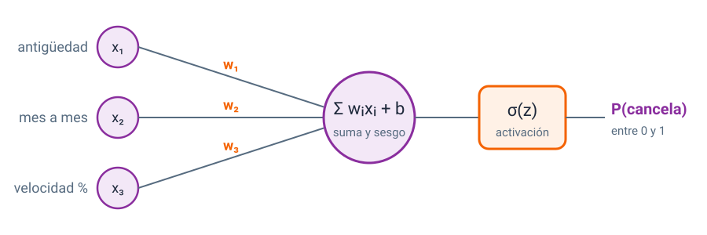
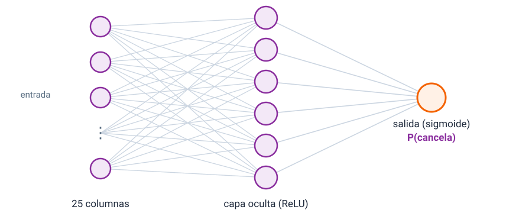
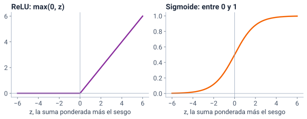
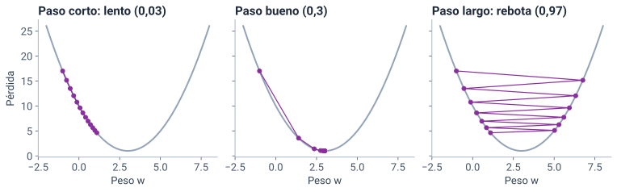
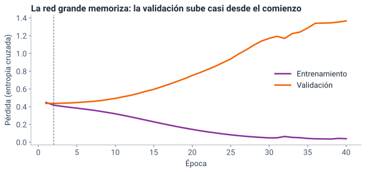
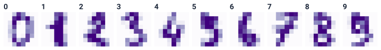
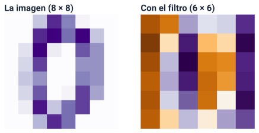
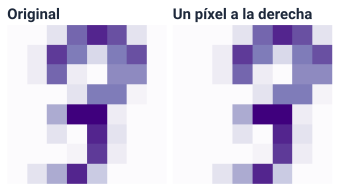
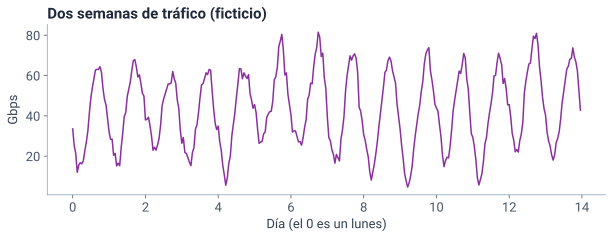

<!--
  Sesión 4 (6 h, sábado 14 de noviembre, 07:00–13:00): apertura 15 min · de la neurona a la red 45 ·
  la red en Yarumo 40 · práctica 25 · pausa 15 · imágenes y secuencias 40 · nube 70 · pausa 10 ·
  laboratorio 55 · proyecto 30 · cierre 15. Las diapositivas de código corresponden a las celdas del
  notebook (mismo identificador entre corchetes); las salidas y las gráficas salen de ejecutarlo
  (precalculo/salidas_sesion4.json y recursos/s4/<id>.svg), con Python 3.13, pandas 2.2.3,
  scikit-learn 1.6.1, TensorFlow 2.21.0 y Keras 3.13.2. Las cifras del texto salen de la celda
  [cifras]; las de Keras se dicen «cerca de», porque pueden variar un poco en otro equipo. neurona.svg
  y red.svg son esquemas dibujados a mano, sin datos. Los hitos de reloj y el orden de recorte están
  en las notas del primer divisor de cada bloque. Las fuentes (F-…) son las de fuentes/FUENTES.md.
-->

# Apertura {icono=fa-door-open}

> ¿Una red neuronal encuentra mejor a los que cancelan? ¿Y dónde guardamos los datos en Azure?

???
07:00. Pedir desde ya que abran el notebook de la S4 (portada del curso → «Abrir en Colab»), que guarden una copia en Drive y que ejecuten la primera celda y [preparar]: la primera descarga los datos, como en las sesiones anteriores. El entorno normal de Colab basta; no hace falta GPU. Mientras tanto, la apertura.

## Seis horas: aprendizaje automático hasta las 10:00, nube hasta las 12:15

::: tarjetas {columnas=3}
### Redes neuronales
- **07:15** De la neurona a la red
- **08:00** La red en Yarumo
- **08:40** Práctica: ejercicios 1 y 2
- **09:20** Imágenes y secuencias
### Nube
- **10:00** Los datos de Yarumo en Azure, y cuánto cuestan
- **11:20** Laboratorio: demostración y ejercicio de diseño
### Proyecto y cierre
- **12:15** La lista mínima frente a lo que llevan
- **12:45** Cierre
:::

Pausas: **15 min a las 09:05** y **10 min a las 11:10**.

???
Hitos de reloj, que no se mueven: la red en Yarumo empieza a las 08:00; la práctica, a las 08:40; la pausa larga, a las 09:05; las imágenes y secuencias, a las 09:20; la nube, a las 10:00; la pausa corta, a las 11:10; el laboratorio, a las 11:20; el proyecto, a las 12:15, y el cierre, a las 12:45. Si el día se atrasa, el orden de recorte del diseño es: (1) la red recurrente queda en una diapositiva con su tabla; (2) Azure SQL Database, en una diapositiva; (3) el ejercicio 3 pasa a trabajo independiente. El laboratorio y el bloque del proyecto no se recortan. Durante la exposición solo miran; ejecutan en la práctica.

## Ayer: grupos sin etiqueta, y los riesgos de llevar los datos a la nube

::: tarjetas
### Agrupamiento
Parecido es **distancia**, y por eso se escala. K-Means pide k; el codo y la silueta ayudan, y la decisión elige. DBSCAN encuentra lo raro.
Lo que quedó para hoy: con `eps` = 0,3 partía por franjas porque `usuarios` solo toma unos pocos valores enteros.
### Nube
El primer riesgo de 2026 es la **identidad**. Con Azure como encargado, enviar los datos es una **transmisión**, con contrato.
:::

Hoy, las dos mitades vuelven: una red **con** etiqueta, y los datos de Yarumo **ya** en Azure.

???
Es el «Lo que te llevas» de la S3, resumido. Preguntar en el chat: ¿qué riesgo de los de ayer les preocupa más para la tabla de clientes? Dos o tres respuestas y seguir; la mayoría dirá el acceso. Hoy se responde con almacenamiento sin clave, roles de datos y registros. Lo de DBSCAN con `eps` = 0,3 es la pregunta que la S3 dejó «para el repaso de la S4»: una columna discreta, con pocos valores distintos, hace que la densidad se mida por franjas; con `eps` = 0,5 vuelven a unirse. La lectura que dejó la S3 fue la sec. 6.3 de *Deep learning* (las unidades ocultas, F-ML-40) y la introducción de Azure Monitor (F-AZ-45): las dos aparecen hoy.

## Con los mismos 2000 clientes de prueba, ¿una red neuronal le ganará a XGBoost? {.pregunta}

En la sesión 2, XGBoost encontró a **228** de los 471 que cancelaron y necesitaba **613** llamadas para encontrar a 7 de cada 10; la logística, **186** y **686**. Vota: **la red gana**, **empatan** o **XGBoost sigue al frente**.

::: respuesta
Guarda tu voto: a las 08:30 lo medimos con lo de la sesión 2: la precisión, la sensibilidad, el F1 y las llamadas para encontrar a 7 de cada 10.
:::

???
Un minuto. Las cifras son las de la S2 (salidas_sesion2.json) y el notebook de hoy las reproduce con la misma partición. No adelantar el resultado: se ve en la diapositiva de la comparación honesta. Lo que importa ahora es que se comprometan con una predicción; muchos esperarán que la red gane «porque es más moderna».

## Hoy, una pregunta de aprendizaje automático y una de nube

::: tarjetas
### Redes neuronales
La gerente de experiencia del cliente: **¿una red encuentra mejor a los que van a cancelar?** Y, según cómo nos vaya, **¿cuándo vale una red?**
### Nube
El oficial de protección de datos: **¿dónde guardamos los datos en Azure, quién los lee, cómo nos enteramos y cuánto cuesta?**
:::

Lema de hoy: **si no queda registrado, no pasó.**

???
«Redes», en el título de la sesión, son redes **neuronales**, no redes de comunicaciones de Azure. La primera pregunta sigue el hilo de la S2 (la misma etiqueta, `cancelo`); la segunda cierra la parte 2 del proyecto: almacenamiento, monitoreo y costo, que son tres renglones de la lista mínima. El lema se entiende a las 10:40, con el registro de lecturas de un archivo.

# De la neurona a la red {icono=fa-brain}

> Una neurona suma, una capa combina, y entrenar es bajar la pérdida.

???
07:15 a más tardar. Cuarenta y cinco minutos, sin práctica (la práctica es a las 08:40). Hitos: la neurona y la logística, hacia las 07:25; la capa oculta, hacia las 07:35; las activaciones, hacia las 07:42; la pérdida y el descenso del gradiente, hacia las 07:52; la pregunta de clasificar, a las 07:55. Si se atrasa: (1) la diapositiva del perceptrón se dice en una frase (−2 min); (2) la de la retropropagación, las épocas y Adam se lee sin comentarla (−3 min). No se recortan la neurona, la capa oculta ni la tasa de aprendizaje.

## Una neurona: multiplica, suma, agrega un sesgo y activa

{alto=270}

$$ P(\text{cancela}) = \sigma(w_1x_1 + w_2x_2 + \dots + w_nx_n + b) $$

???
Cada entrada se multiplica por su **peso**; la neurona suma y agrega el **sesgo** (*bias*), y la **función de activación** decide qué sale. Con la sigmoide, σ(z) = 1/(1 + e^(−z)), la salida queda entre 0 y 1: una probabilidad. Los pesos son lo que se aprende. Las tres entradas del esquema son ejemplos de columnas de Yarumo; la red real usa las 25. Notación: los pesos w son los coeficientes de la S2 y el sesgo b es su intercepto; este «sesgo» no es el de «sesgo y varianza» de la S2. Transición: ¿les suena esa fórmula? Es la de la sesión 2.

## Con la activación sigmoide, una neurona es la regresión logística de la sesión 2

```python [neurona]
logistica = make_pipeline(StandardScaler(),
                          LogisticRegression(max_iter=1000))
logistica.fit(Xc_ent, yc_ent)                  # la de la sesión 2
escalador, neurona = logistica[0], logistica[1]
x = escalador.transform(Xc_prueba.iloc[[0]])   # un cliente, escalado
z = x @ neurona.coef_.ravel() + neurona.intercept_[0]  # pesos y sesgo
p = 1 / (1 + np.exp(-z[0]))                    # activación sigmoide
print(f"{neurona.coef_.size} pesos y 1 sesgo · z = {z[0]:.3f}",
      f"→ P(cancela) = {p:.3f}")
p_sk = logistica.predict_proba(Xc_prueba.iloc[[0]])[0, 1]
print(f"predict_proba: {p_sk:.3f}")
#> 25 pesos y 1 sesgo · z = -3.180 → P(cancela) = 0.040
#> predict_proba: 0.040
```

???
No se lee línea por línea: lo que importa son `z` (la suma ponderada más el sesgo) y `p` (la sigmoide). La cuenta a mano da lo mismo que scikit-learn: una regresión logística **es** una neurona con 25 pesos (uno por columna), un sesgo y la sigmoide. `@` es el producto de la fila del cliente por los pesos: la suma ponderada. El primer cliente de la prueba tiene una probabilidad de cancelar de 0,04. Lo nuevo de hoy no es la neurona, sino poner muchas juntas.

## El perceptrón de 1958 ya era una neurona que aprende

- **Rosenblatt (1958)** propuso el perceptrón: una neurona con una salida de **sí o no** que aprende sus pesos de los ejemplos
- Fue el primer modelo que permitía entrenar **una sola neurona**
- En scikit-learn, `Perceptron` corrige sus pesos **solo cuando se equivoca**
- La pregunta que quedó abierta casi 30 años: ¿cómo entrenar **muchas** neuronas juntas?

???
Recorte del bloque 1. Rosenblatt (1958), *Psychological Review* (F-ML-60); Goodfellow et al. (2016), sec. 1.2.1, lo ubican en la primera ola, la de la cibernética, como el modelo que permitía entrenar una sola neurona (F-ML-40, según F-ML-60). «Sí o no» es una simplificación nuestra de su salida. La guía de scikit-learn 1.6 (F-ML-44, sec. 1.1.14): `Perceptron` es un clasificador lineal, no regularizado, que actualiza el modelo solo cuando se equivoca. La respuesta a la pregunta llegó en 1986 con la retropropagación, que vemos en unos minutos.

## Si agregamos 32 neuronas entre las columnas y la salida, ¿cuánto baja el error? {.pregunta}

En la sesión 2, la regresión lineal (que es **una neurona sin activación**) se equivocó unos 91 GB por cliente al predecir `consumo_gb`, y XGBoost, unos 69. El consumo baja con la edad, y baja **más rápido** en los hogares con muchas personas. Con una **capa oculta de 32 neuronas**, el error… Vota: **casi no baja**, **se acerca al de XGBoost** o **le gana a XGBoost**.

::: respuesta
**Se acerca al de XGBoost.** Cada neurona oculta aprende su propia combinación de columnas, y su activación (la ReLU, que vemos en tres diapositivas) deja que la red se doble: así sigue la interacción edad × usuarios que la recta no seguía.
:::

???
Un minuto con la votación. La interacción edad × usuarios es la de la S2 (glosario: «el efecto de una variable depende de otra»). XGBoost: 68,8 GB (salidas_sesion2.json). La cifra de la capa oculta está en la diapositiva siguiente.

## Con una capa oculta de 32 neuronas, el error baja de 91 a 74 GB

```python [capa_oculta]
recta = LinearRegression().fit(X_ent, y_ent)  # una neurona, sin activar
capa = make_pipeline(StandardScaler(), MLPRegressor(
    hidden_layer_sizes=(32,), learning_rate_init=0.01,
    early_stopping=True, random_state=2026))   # 32 neuronas ocultas
capa.fit(X_ent, y_ent)
for nombre, modelo in {"Una neurona (la recta)": recta,
                       "Una capa oculta de 32": capa}.items():
    mae = mean_absolute_error(y_prueba, modelo.predict(X_prueba))
    print(f"{nombre}: MAE {mae:.1f} GB")
#> Una neurona (la recta): MAE 91.0 GB
#> Una capa oculta de 32: MAE 74.4 GB
```

- XGBoost se equivocaba unos 69 GB, y la recta con la columna edad × usuarios, 74,5: lo que la recta logró con una columna inventada por nosotros, la red lo encuentra sola

???
Mismos datos y partición de la regresión de la S2 (`consumo_gb`, el 25 % para prueba, semilla 2026; las líneas que preparan X e y no se proyectan). `MLPRegressor` es la red de regresión de scikit-learn; escala primero, como KNN. En la S2, XGBoost tuvo un MAE de 68,8 GB y la recta con la columna edad × usuarios, 74,5 (salidas_sesion2.json, celdas [xgboost] e [interaccion]). Lo que la recta no podía era combinar columnas; una capa oculta sí, como los árboles. Lo que hace cada neurona oculta no se lee tan fácil como una regla de un árbol.

## Una capa oculta pone muchas neuronas entre las columnas y la salida

{alto=300}

- Es un **perceptrón multicapa** (MLP): capas **densas**, en las que cada neurona recibe todas las salidas de la anterior
- Cada línea es un **peso**; varias capas ocultas: aprendizaje **profundo** (*deep learning*)

???
Es un perceptrón multicapa (MLP): capas **densas**, en las que cada neurona recibe todas las salidas de la capa anterior. Con 25 columnas y 32 neuronas ocultas hay 25 × 32 pesos más 32 sesgos en la primera capa. En scikit-learn, `MLPClassifier` y `MLPRegressor` implementan un perceptrón multicapa entrenado con retropropagación (F-ML-31). «Profundo» solo quiere decir varias capas ocultas.

## Sin activación, apilar capas no sirve: una suma de sumas es otra suma

{alto=300}

- **ReLU**, la opción por defecto en las capas ocultas: deja pasar lo positivo y apaga lo negativo
- **Sigmoide**, en la salida de un sí o un no: lleva todo a una probabilidad

???
Sin activación, dos capas seguidas se reducen a una sola combinación lineal: la red sería otra vez la recta. Goodfellow et al. (2016), sec. 6.3: «Rectified linear units are an excellent default choice of hidden unit» (F-ML-40). La sigmoide equivale a una softmax de dos elementos (F-ML-43); la **softmax**, para diez clases, la vemos con los dígitos. En Keras: `activation="relu"` y `activation="sigmoid"`.

## La pérdida dice cuánto se equivoca la red: la entropía cruzada

$$ \text{pérdida} = -\,[\,y \log p + (1 - y)\log(1 - p)\,] $$

- Si el cliente canceló (y = 1) y la red dijo **p = 0,9**: pérdida de 0,105
- Si canceló y la red dijo **p = 0,1**: pérdida de 2,303
- Equivocarse con **seguridad** cuesta mucho más que equivocarse con duda (**p** es la probabilidad de cancelar que da la red)

???
Es la entropía cruzada binaria (*binary cross-entropy*), la pérdida de Keras para una salida sigmoide de sí o no (F-ML-43: `BinaryCrossentropy`). Con y = 1 solo queda −log p; con y = 0, −log(1 − p). Las dos cifras salen de la celda [cifras] («entropia»). Entrenar es buscar los pesos que hacen pequeña la pérdida promedio de todos los clientes del entrenamiento. En la regresión, la pérdida es el error cuadrático medio, el de la RMSE de la S2.

## Entrenar es bajar una montaña con niebla: solo ves la pendiente bajo tus pies {.idea}

El **descenso del gradiente** mira hacia dónde baja la pérdida y da un paso en esa dirección. Y otro, y otro. Tu posición son los pesos; la altura, la pérdida; el largo del paso, la tasa de aprendizaje.

???
La analogía: estás en una montaña con niebla y quieres llegar al valle; no ves el valle, solo sientes hacia dónde baja el suelo donde estás. Das un paso en esa dirección y vuelves a sentir. El **gradiente** es esa pendiente, calculada para cada peso; el **tamaño del paso** es la tasa de aprendizaje. Transición: ¿qué pasa si el paso es muy corto o muy largo?

## El tamaño del paso es la tasa de aprendizaje: ni muy corto ni muy largo

{alto=330}

???
Un solo peso w y una pérdida (w − 3)² + 1, con 12 pasos desde w = −1. Con 0,03, avanza poco en cada paso y no llega en 12; con 0,3 llega casi en seguida; con 0,97 cruza el valle en cada paso y rebota de un lado al otro. Con una tasa todavía mayor, se alejaría. En Keras y en scikit-learn, la tasa por defecto de Adam es 0,001 (F-ML-43, F-ML-44), y en la red de consumo usamos 0,01. Es un hiperparámetro, como la profundidad de un árbol.

## Cuatro palabras para entrenar una red

::: tarjetas {columnas=2}
### Retropropagación (*backpropagation*)
Calcula la pendiente de la pérdida para **todos** los pesos a la vez, de la salida hacia atrás (1986).
### Época
Una pasada completa por todos los clientes del entrenamiento.
### Lote (*batch*)
El grupo de clientes con que se calcula cada paso: aquí, 32.
### Adam
El optimizador que usamos: ajusta el tamaño del paso de cada peso por separado.
:::

???
Recorte del bloque 2. Rumelhart, Hinton y Williams (1986), *Nature*: describen la retropropagación (F-ML-61). Adam: Kingma y Ba (2015), un método de optimización de primer orden con estimaciones adaptativas de momentos (F-ML-45); es el optimizador por defecto de `MLPClassifier` y el que usamos en Keras. Con 4800 clientes y lotes de 32, una época son 150 pasos.

## ¿Activación, pérdida u optimizador? {.pregunta}

Clasifica cada término en el chat:

1. La entropía cruzada binaria
2. Adam
3. ReLU
4. El error cuadrático medio
5. La sigmoide

::: respuesta
**1** pérdida · **2** optimizador · **3** activación · **4** pérdida · **5** activación (en la salida de un sí o no)
:::

???
Dos minutos. La 4 la conocen de la S2 (la RMSE es su raíz); hoy es la pérdida de la red recurrente. La 5 es la que más confunde: la sigmoide no mide el error, convierte la suma en una probabilidad. Transición: con esto ya podemos entrenar una red con los clientes de Yarumo.

# La red en Yarumo {icono=fa-user-xmark}

> ¿Una red encuentra mejor a los que van a cancelar?

???
08:00. Cuarenta minutos de exposición. Hitos: el MLP de scikit-learn, hacia las 08:05; Keras y la validación, hacia las 08:12; la red grande y su curva, hacia las 08:20; la regularización, hacia las 08:28; la comparación honesta, a las 08:30. La práctica empieza a más tardar a las 08:40. Si se atrasa: (1) la pregunta del MLP sin escalar se responde en una frase (−2 min); (2) la idea clave se dice sin detenerse (−1 min). No se recortan la curva de la red grande ni la comparación.

## `MLPClassifier`: una red de scikit-learn, en un `Pipeline` que escala

```python [mlp]
mlp = make_pipeline(StandardScaler(), MLPClassifier(
    hidden_layer_sizes=(32,), early_stopping=True, random_state=2026))
mlp.fit(Xc_ent, yc_ent)
pred_mlp = mlp.predict(Xc_prueba)
print(f"Precisión {precision_score(yc_prueba, pred_mlp):.3f}",
      f"· sensibilidad {recall_score(yc_prueba, pred_mlp):.3f}",
      f"· F1 {f1_score(yc_prueba, pred_mlp):.3f}")
#> Precisión 0.630 · sensibilidad 0.408 · F1 0.495
```

- Una capa oculta de **32** neuronas con ReLU; la salida, la probabilidad de cancelar
- `early_stopping=True` aparta el **10 %** del entrenamiento y para cuando deja de mejorar

???
Misma partición de la S2 (celda [preparar]). El MLP es sensible a la escala de las variables, así que va en un `Pipeline` con `StandardScaler` (F-ML-31, sec. 1.17.7; F-ML-44). Con `early_stopping=True`, scikit-learn separa el 10 % del entrenamiento como validación, estratificada, y para si no mejora durante 10 épocas (F-ML-44); aquí paró en la época 26 (celda [cifras]). Sin eso, con el máximo de 200 épocas, puede salir un aviso de que no convergió. La implementación de scikit-learn no está pensada para gran escala ni usa GPU (F-ML-31): para eso, Keras.

## Sin escalar, ¿qué F1 tendrá el MLP? {.pregunta}

Con escalado, 0,495. Vota: **cerca de 0,5**, **cerca de 0,25** o **cerca de 0**.

::: respuesta
**Cerca de 0.** Cada neurona suma columnas multiplicadas por sus pesos: la factura, en decenas o cientos de miles de pesos, aplasta a las demás y el entrenamiento no encuentra el camino. Como la SVM sin escalar de la sesión 2, termina diciendo «No» a todos. Lo mides tú en el **ejercicio 1**, con otra red.
:::

???
Recorte 1 del bloque: responder en una frase. Un minuto. El ejercicio 1 lo mide con una red de dos capas (16 y 8 neuronas): F1 de 0 sin escalar. En la S2, la SVM sin escalar dijo «No» a todos, como la línea base.

## Keras arma la red capa por capa; el *backend* se fija antes de importar

```python [keras]
os.environ["KERAS_BACKEND"] = "tensorflow"   # antes de importar Keras
import keras
from keras import layers

Xc_ent2, Xc_val, yc_ent2, yc_val = train_test_split(
    Xc_ent, yc_ent, test_size=0.2, random_state=2026, stratify=yc_ent)
escala = StandardScaler().fit(Xc_ent2)   # solo del entrenamiento
Xr_ent = escala.transform(Xc_ent2).astype("float32")
Xr_val = escala.transform(Xc_val).astype("float32")
Xr_prueba = escala.transform(Xc_prueba).astype("float32")
yr_ent, yr_val = yc_ent2.to_numpy(), yc_val.to_numpy()
print(f"Keras {keras.__version__} · entrenamiento {len(yr_ent)}",
      f"· validación {len(yr_val)} · prueba {len(Xr_prueba)}")
#> Keras 3.13.2 · entrenamiento 4800 · validación 1200 · prueba 2000
```

- El *backend* es el motor que hace las cuentas: TensorFlow, JAX o PyTorch; aquí, TensorFlow

???
Keras 3 corre sobre JAX, TensorFlow o PyTorch; el *backend* se elige con `KERAS_BACKEND` **antes** de importar y no se puede cambiar después (F-ML-41). Colab trae Keras 3.13.2 con TensorFlow 2.21.0 (F-ML-23). La celda también baja los avisos técnicos de TensorFlow (`TF_CPP_MIN_LOG_LEVEL`), que no se proyecta. Las redes de Keras trabajan con arreglos de numpy de tipo `float32`: por eso `.astype` y `.to_numpy()`; las tres líneas que escalan son la misma operación con el entrenamiento, la validación y la prueba. Los nombres llevan una **r**, de red, como la **c** de cancelación de la S2.

## La validación sale del entrenamiento; la prueba sigue guardada

::: flujo
1. **Entrenamiento** — 4800 clientes: la red aprende de ellos
2. **Validación** — 1200 clientes: la red los mira al final de cada época, sin aprender de ellos
3. **Prueba** — 2000 clientes: los de la sesión 2, solo para medir al final
:::

- Partición **estratificada** y hecha a mano: `validation_split` toma las **últimas** filas, sin barajar
- El escalador aprende solo de los 4800

???
La validación es lo que usa la parada temprana para decidir cuándo parar; si se usara la prueba, la prueba dejaría de ser datos que el modelo no vio (el mismo argumento del ejercicio 4 de la S2). La guía de Keras dice que `validation_split` toma las últimas muestras antes de barajar y solo funciona con arreglos de numpy (F-ML-41): con una tabla ordenada por algo, la validación quedaría sesgada. Por eso usamos `train_test_split` con `stratify`, como siempre.

## Una red grande: 72 705 pesos y sesgos para 4800 clientes

```python [red_grande]
keras.utils.set_random_seed(2026)            # misma semilla, mismos pesos
grande = keras.Sequential([
    keras.Input(shape=(Xr_ent.shape[1],)),   # una entrada por columna
    layers.Dense(256, activation="relu"),    # capa oculta 1
    layers.Dense(256, activation="relu"),    # capa oculta 2
    layers.Dense(1, activation="sigmoid"),   # salida: P(cancela)
])
grande.compile(optimizer="adam", loss="binary_crossentropy")
h_grande = grande.fit(Xr_ent, yr_ent, validation_data=(Xr_val, yr_val),
                      epochs=40, batch_size=32, verbose=0)
print(f"{grande.count_params()} pesos y sesgos para {len(yr_ent)} clientes")
#> 72705 pesos y sesgos para 4800 clientes
```

???
`Sequential` es una pila de capas, cada una con una entrada y una salida (F-ML-41); `keras.Input` declara la forma de la entrada (25 columnas); `Dense` calcula activación(entrada · pesos + sesgo) (F-ML-41). `compile` fija el optimizador y la pérdida; `fit` entrena 40 épocas en lotes de 32 y guarda en `h_grande` la pérdida de cada época, en el entrenamiento y en la validación. `set_random_seed` fija las semillas de Python, NumPy y del *backend* (F-ML-43); aun así, en otro equipo o con GPU, las cifras pueden variar un poco. Hay 15 pesos por cliente: tiene con qué memorizar.

## La red grande memoriza: la validación toca fondo en las primeras épocas y después sube

{alto=380}

???
En el entrenamiento, la pérdida baja de cerca de 0,45 a cerca de 0,04: la red casi memoriza a los 4800 clientes. En la validación toca fondo muy pronto (en esta ejecución, en la época 2, cerca de 0,44) y termina cerca de 1,37, tres veces más (celda [cifras]: «red_grande»). Con otras semillas, el fondo cae entre la época 1 y la 2 (celda [semillas]). Es el árbol sin límite de la S2: perfecto con lo que vio, peor con lo que no vio. La diferencia es que aquí se ve época por época.

## La pérdida de entrenamiento casi siempre baja; la que importa es la de validación {.idea}

Una red con muchos pesos puede memorizar a todos los clientes que ve. Lo que dice si **aprendió** es cómo le va con los que no ve.

???
Es la versión de hoy de «aprender no es memorizar» (S2). Pregunta rápida al grupo: si solo miraran la pérdida de entrenamiento, ¿en qué época pararían? (En la 40: y sería la peor.) Transición: ¿cómo se frena una red que memoriza?

## Tres frenos para que la red no memorice

::: tarjetas {columnas=3}
### Parada temprana (*early stopping*)
Mira la validación al final de cada época y **para** cuando lleva `patience` épocas sin mejorar; vuelve a los pesos de la mejor.
### *Dropout*
En cada paso del entrenamiento **apaga al azar** una fracción de las neuronas; ninguna puede depender de otra. Al predecir, trabajan todas.
### L2
**Castiga los pesos grandes**. En `MLPClassifier`, es el parámetro `alpha`.
:::

???
Goodfellow et al. (2016): la parada temprana es probablemente la forma de regularización más usada en el aprendizaje profundo (sec. 7.8), y el *dropout* es una aproximación barata a entrenar y promediar muchísimas redes (sec. 7.12) (F-ML-40). Srivastava et al. (2014): apagar unidades al azar, con sus conexiones, durante el entrenamiento evita que se coadapten (F-ML-46). En Keras, `Dropout` pone en cero una fracción `rate` de sus entradas solo al entrenar y escala las demás (F-ML-41). L2: `alpha` es la fuerza del término de regularización L2 (F-ML-44). Los tres son **hiperparámetros**.

## En Keras, el *dropout* es una capa y la parada temprana, un *callback*

```python [ej2]
tasa_dropout = ...         # entre 0 y 1: la fracción que se apaga
paciencia = ...            # épocas sin mejorar antes de parar
red = keras.Sequential([
    keras.Input(shape=(Xr_ent.shape[1],)),
    layers.Dense(256, activation="relu"),
    layers.Dropout(tasa_dropout),            # apaga neuronas al azar
    layers.Dense(256, activation="relu"),
    layers.Dropout(tasa_dropout),
    layers.Dense(1, activation="sigmoid"),
])
parada = keras.callbacks.EarlyStopping(
    monitor="val_loss", patience=paciencia, restore_best_weights=True)
h = red.fit(Xr_ent, yr_ent, validation_data=(Xr_val, yr_val), epochs=100,
            batch_size=32, verbose=0, callbacks=[parada])
```

- Un *callback* es una función que Keras llama durante el entrenamiento, al final de cada época

???
Es la plantilla del ejercicio 2: la misma red grande, con un `Dropout` después de cada capa oculta y la parada temprana. Los dos valores los eligen ellos. `restore_best_weights=True` es lo que hace que la red vuelva a los pesos de su mejor época; por defecto es `False` (F-ML-41), y sin eso la red se queda con los de la última época, que ya empezó a memorizar. `epochs=100` es un tope: la parada temprana corta mucho antes. Se llama `tasa_dropout` para no confundirla con la tasa de aprendizaje.

## La comparación honesta: el MLP iguala a la logística y XGBoost sigue al frente

```python [comparacion]
riesgos = {"Logística": logistica.predict_proba(Xc_prueba)[:, 1],
           "MLP (scikit-learn)": mlp.predict_proba(Xc_prueba)[:, 1],
           "Red grande (Keras)": grande.predict(Xr_prueba,
                                                verbose=0).ravel(),
           "XGBoost": xgb_c.predict_proba(Xc_prueba)[:, 1]}
tabla = pd.DataFrame({m: metricas(r) for m, r in riesgos.items()}).T
tabla.astype({"llamadas 7 de 10": int}).round(3)
#>                     precisión  sensibilidad     F1  llamadas 7 de 10
#> Logística               0.655         0.395  0.493               686
#> MLP (scikit-learn)      0.630         0.408  0.495               704
#> Red grande (Keras)      0.536         0.442  0.484               791
#> XGBoost                 0.675         0.484  0.564               613
```

???
08:30. Volver al voto de la apertura. `metricas` (en la celda) calcula la precisión, la sensibilidad y el F1 con el umbral de 0,5, y las llamadas con la función `llamadas_para` de la S2, que ordena a los clientes de mayor a menor riesgo y cuenta cuántos hay que llamar para encontrar a 330 de los 471. Logística y XGBoost dan exactamente lo de la S2 (186 y 228 encontrados; 686 y 613 llamadas). El MLP encuentra a 192 y necesita 704 llamadas: iguala a la logística. La red grande, que memorizó, necesita cerca de 790 (de 780 a 930 según la semilla, celda [semillas]): peor que todos. Mirar la columna de llamadas más que la del F1: entre la red grande (0,484) y la logística (0,493) la diferencia de F1 es ruido con 471 positivos, pero las llamadas (cerca de 790 frente a 686) sí separan. La red regularizada la entrenan en el ejercicio 2. Al azar harían falta 1400 llamadas.

## En una tabla de clientes, los árboles son una línea base muy difícil de superar

- En **45 conjuntos** de datos tabulares de tamaño mediano, los árboles siguieron al frente (Grinsztajn et al., 2022)
- XGBoost superó a cuatro redes propuestas para tablas, y **necesitó mucho menos ajuste**; pero un ensamble de redes con XGBoost le ganó a XGBoost solo (Shwartz-Ziv y Armon, 2022)
- No es «las redes siempre pierden»: es que **el tipo de dato** elige el modelo

???
F-ML-49 y el hallazgo 22 del banco: la evidencia es sólida pero acotada. Grinsztajn et al. trabajan con conjuntos de unas 10 000 muestras (el régimen «mediano»); el de 50 000 lo estudian con menos conjuntos. Shwartz-Ziv y Armon usan 11 conjuntos. No decir «las redes siempre pierden» (FUENTES, afirmaciones riesgosas). Transición: ¿cuándo sí vale una red?

## ¿Cuándo vale una red neuronal? {.pregunta}

Escribe en el chat un tipo de dato de Yarumo en el que una red podría ganarle a XGBoost.

::: respuesta
Cuando el dato tiene **forma**: una **imagen** (cada píxel tiene vecinos), un **texto** o una **secuencia** (cada hora viene después de otra). En una tabla, cada columna es un mundo aparte, y los árboles las combinan muy bien. Después de la pausa vemos imágenes y secuencias.
:::

???
Dos minutos. Respuestas esperables: fotos de la instalación, grabaciones de llamadas a soporte, textos de las quejas, el tráfico por hora. Todas sirven. La clave: una CNN aprovecha que los píxeles vecinos están relacionados; una RNN, que el orden importa.

# Práctica en Colab {icono=fa-laptop-code}

> Escalar importa, y que la red no memorice.

???
08:40 a más tardar. Veinticinco minutos: el ejercicio 1 (10 min) y el 2 (15 min). La pausa es a las 09:05: lo que no terminen, lo terminan en la pausa o en casa; el bloque siguiente no depende de los ejercicios.

## Dos ejercicios, con revisión automática

::: flujo
1. **Ejercicio 1** — un MLP de 16 y 8 neuronas, sin escalar y con escalado: el F1 de cada uno · 10 min
2. **Ejercicio 2** — la red grande con *dropout* y parada temprana: elige la tasa de *dropout* y la paciencia, entrega el F1 y la sensibilidad, y compara con una tasa de 0 y de 0,8 · 15 min
:::

Antes del ejercicio 1: haz clic en la celda del ejercicio → **Entorno de ejecución → Ejecutar anteriores**. El notebook entero tarda unos minutos.

Al final de la práctica, ponemos en común lo que salió.

???
Clave del 1 (celda [cifras]): sin escalar, F1 de 0 (el MLP no señala a nadie, como la SVM sin escalar de la S2); con escalado, 0,496. El verificador reconoce los F1 cruzados, la exactitud, la sensibilidad o la precisión en lugar del F1, el F1 del entrenamiento, otra arquitectura y el «con escalado» que salió como el sin escalar (le recuerda la S2). Clave del 2, con tasa de *dropout* 0,3 y paciencia 10: en esta ejecución paró en la época 12 (la mejor, la 2), F1 cerca de 0,52, sensibilidad cerca de 0,48 y cerca de 686 llamadas. Con la tasa fija, la paciencia solo mueve la época en que para (la mejor + la paciencia) y la red vuelve a los mismos pesos; lo que cambia el resultado es el *dropout* (con tasa 0, paró en la 12, la mejor fue la 2 y el F1 bajó a 0,498; con 0,8, paró en la 34, la mejor fue la 24 y el F1 cayó a 0,394: celda [cifras], «ej2_tasas»). Con tres combinaciones razonables de tasa y paciencia y 12 semillas (como 12 equipos), el F1 va de 0,41 a 0,54 y la sensibilidad de 0,30 a 0,49 (celda [semillas], «rangos»). El verificador no reentrena: usa la red del estudiante, compara lo que entrega con lo que da esa red, exige un F1 entre 0,38 y 0,62 y una sensibilidad entre 0,25 y 0,65 (rangos del barrido de 24 semillas del revisor de código; con la solución, «¡Listo!» en los 36 casos de [semillas]) y mira el historial (si no paró, si la paciencia es 0, si no volvió a los mejores pesos, si la tasa es 0 o casi 1). En Colab las cifras de Keras pueden salir un poco distintas; por eso el verificador revisa contra la red de cada uno. Lo que deben ver: con la parada temprana y el *dropout*, la red supera a la red grande y queda cerca de la logística o algo mejor, pero XGBoost sigue al frente.

## Lo que salió en la práctica

| Modelo | F1 | Llamadas para 7 de cada 10 |
|---|---|---|
| Logística | 0,493 | 686 |
| Red grande, sin regularizar | cerca de 0,48 | cerca de 790 |
| Red con *dropout* (0,3) y parada temprana (10) | cerca de 0,52 | cerca de 690 |
| XGBoost | 0,564 | 613 |

- ¿En qué época paró tu red, y cuál fue su mejor época? ¿Qué relación tienen con la paciencia?

???
09:03, dos minutos. Las cifras de la red con *dropout* salen de la solución (celda [cifras], «ej2»: F1 0,523, 686 llamadas, paró en la 12 y la mejor fue la 2) y en cada Colab saldrán un poco distintas. Respuesta a la pregunta: paró en la mejor época más la paciencia. Lo que se llevan: regularizar mejora a la red grande, que memorizaba, y la deja cerca de la logística; XGBoost sigue al frente. El ejercicio 1: sin escalar, F1 de 0.

## Pausa de 15 minutos {.idea etiqueta="Pausa" icono=fa-mug-hot}

Volvemos a las 09:20 con imágenes y secuencias: dónde sí brillan las redes.

Si el ejercicio 2 quedó a medias: haz clic en la celda [digitos] → **Entorno de ejecución → Ejecutar después**. Se detiene en el ejercicio 3: ahí empiezas.

???
09:05. Decirlo en voz alta: «Ejecutar anteriores» se detiene en el primer `...` sin completar, y el ejercicio 3 necesita las celdas de los dígitos y de las dos redes.

# Imágenes y secuencias {icono=fa-image}

> Una red convolucional aprovecha los vecinos; una recurrente, el orden.

???
09:20. Cuarenta minutos: unos 20 de redes convolucionales (con 5 del ejercicio 3), 15 de redes recurrentes y 5 para la pregunta de clasificar. Hitos: la CNN y la densa, hacia las 09:33; el ejercicio 3, de 09:33 a 09:40; AlexNet, un minuto; la serie de tráfico y su gráfica, hasta las 09:46; las ventanas, las líneas base y la red recurrente, hasta las 09:55; la pregunta de clasificar, de 09:55 a 10:00. Si a las 09:46 hay atraso, aplicar el recorte 1. Si se atrasa, recortar en el orden del diseño: (1) la red recurrente queda en una diapositiva con su tabla (la de [rnn]); y si hace falta más, (3) el ejercicio 3 pasa a trabajo independiente (la diapositiva de la respuesta se muestra igual). El (2), Azure SQL, está en el bloque de nube.

## Una imagen tiene forma: cada píxel tiene vecinos

```python [digitos]
digitos = load_digits()
imagenes = (digitos.images / 16).reshape(-1, 8, 8, 1).astype("float32")
I_ent, I_prueba, d_ent, d_prueba = train_test_split(
    imagenes, digitos.target, test_size=0.25, random_state=2026,
    stratify=digitos.target)
print(imagenes.shape, "→", len(I_ent), "para entrenar y",
      len(I_prueba), "para probar")
#> (1797, 8, 8, 1) → 1347 para entrenar y 450 para probar
```

{alto=130}

???
`load_digits` trae 1797 imágenes de 8 × 8 píxeles, con valores de 0 a 16 y diez clases (F-ML-44). Es una copia del conjunto de prueba de los dígitos escritos a mano de UCI (Alpaydin y Kaynak, 1998); **no** es MNIST (F-ML-44, advertencia). Viene con scikit-learn: no se descarga nada. La forma (1797, 8, 8, 1) dice: imágenes, alto, ancho y un canal (gris); `reshape` le agrega ese canal y dividir entre 16 deja los valores entre 0 y 1. Una red densa aplanaría los 64 píxeles en una fila de tabla y perdería quién es vecino de quién.

## Un filtro de 3 × 3 recorre la imagen con los mismos 9 pesos {columnas=3:2}

```python [filtro]
filtro = np.array([[-1, 0, 1],
                   [-1, 0, 1],
                   [-1, 0, 1]])
imagen = digitos.images[0]
mapa = np.zeros((6, 6))
for i in range(6):
    for j in range(6):
        mapa[i, j] = (imagen[i:i + 3, j:j + 3] * filtro).sum()
```

|||

{alto=250}

???
Es una **convolución** hecha a mano: en cada una de las 6 × 6 posiciones, multiplica los 9 píxeles de la ventana por los 9 pesos y suma. El mapa es positivo (naranja oscuro) donde la tinta aparece de izquierda a derecha y negativo (morado) donde desaparece: el lado izquierdo y el derecho del cero. Una CNN **no** recibe los filtros: aprende sus pesos, como cualquier otro peso. Con `padding="same"`, Keras rodea la imagen de ceros y el mapa conserva el tamaño de 8 × 8.

## Pesos compartidos y *pooling*: lo que hace distinta a una red convolucional

::: tarjetas {columnas=3}
### Conexiones locales
Cada salida mira solo una ventana pequeña de la imagen, no toda.
### Pesos compartidos
El **mismo filtro** sirve en todas las posiciones: un borde se reconoce igual arriba que abajo.
### *Pooling*
Resume una zona con su **máximo**: dice que el rasgo apareció, sin importar el píxel exacto.
:::

Estas tres ideas definen a la **red convolucional** (CNN).

???
Goodfellow et al. (2016), sec. 9.2: la convolución aprovecha tres ideas, interacciones dispersas, parámetros compartidos y representaciones equivariantes (F-ML-40). `MaxPooling2D(2)` toma el máximo de cada cuadro de 2 × 2 y `GlobalMaxPooling2D`, el máximo de cada filtro en toda la imagen (F-ML-42). LeCun et al. (1998) diseñaron las redes convolucionales para tratar la variabilidad de las formas en 2D, y en dígitos escritos a mano superaron a las demás técnicas (F-ML-47). Goodfellow et al., sec. 9.3: «pooling helps to make the representation approximately invariant to small translations of the input», útil cuando importa más si un rasgo está que dónde está exactamente (F-ML-40, punto 6). Aproximadamente: no es invariancia perfecta, como se verá con el corrimiento.

## Una CNN de 5130 pesos y una red densa de 4810

```python [cnn]
cnn = keras.Sequential([
    keras.Input(shape=(8, 8, 1)),
    layers.Conv2D(16, 3, padding="same", activation="relu"),  # 16 filtros
    layers.MaxPooling2D(2),                   # 8 × 8 → 4 × 4
    layers.Conv2D(32, 3, padding="same", activation="relu"),  # 32 filtros
    layers.GlobalMaxPooling2D(),              # el máximo de cada filtro
    layers.Dense(10, activation="softmax"),   # P de cada dígito
])
cnn.compile(optimizer="adam", loss="sparse_categorical_crossentropy")
densa = keras.Sequential([
    keras.Input(shape=(8, 8, 1)),
    layers.Flatten(),                         # 8 × 8 → 64 números
    layers.Dense(64, activation="relu"),
    layers.Dense(10, activation="softmax"),
])
```

???
La **softmax** convierte las diez salidas en una distribución de probabilidad: valores entre 0 y 1 que suman 1 (F-ML-43). Con etiquetas enteras de 0 a 9, la pérdida es la entropía cruzada para varias clases, `sparse_categorical_crossentropy` (F-ML-43). Las dos se entrenan 30 épocas, con la misma semilla (las líneas de `fit` no se proyectan). Pesos de la CNN por capa: 160, 0, 4640, 0 y 330; de la densa: 0, 4160 y 650 (celda [cifras]). El *pooling* y el aplanado no tienen pesos. Casi el mismo tamaño: la diferencia está en cómo se conectan.

## Con las imágenes tal como vienen, las dos aciertan casi todo

```python [exactitud]
def exactitud(modelo, imagenes, etiquetas=d_prueba):
    prob = modelo.predict(imagenes, verbose=0)   # 10 probabilidades
    return float((prob.argmax(axis=1) == etiquetas).mean())

for nombre, modelo in {"CNN": cnn, "Densa": densa}.items():
    print(f"{nombre}: {modelo.count_params()} pesos ·",
          f"exactitud {exactitud(modelo, I_prueba):.3f}")
#> CNN: 5130 pesos · exactitud 0.980
#> Densa: 4810 pesos · exactitud 0.962
```

- La salida **softmax** da diez probabilidades que suman 1; `argmax` elige el dígito con la más alta

???
Aquí la exactitud sí sirve: las diez clases están casi igual de representadas (unas 180 imágenes por dígito, F-ML-44), no como la cancelación. Cerca del 98 % y del 96 % de los 450 dígitos de prueba. En Colab pueden salir un par de décimas distintas. Transición: en una foto real, el dígito no siempre está centrado.

## Si cada imagen se corre un píxel, ¿cuál pierde más? {.pregunta}

{alto=210}

Vota: **la CNN**, **la densa** o **las dos por igual**. Después, compruébalo en el **ejercicio 3** (5 min).

::: respuesta
**La densa.** Con las imágenes corridas, la CNN conserva cerca del 75 % y la densa cae a cerca del 43 %. Para la densa, cada píxel es una columna fija: corrido, el dígito es otro dato. La CNN busca los mismos rasgos en todas partes, y el *pooling* resume dónde aparecieron.
:::

???
Primero el voto; después, 5 minutos para el ejercicio 3 (calcular las cuatro exactitudes con la función `exactitud`); después, revelar. Si el tiempo aprieta, el ejercicio 3 queda para la casa (recorte 3) y se revela de una vez. Clave (celda [cifras]): CNN 0,980 → 0,753; densa 0,962 → 0,431. Con 12 semillas, la CNN corrida va de 0,72 a 0,84 y la densa de 0,43 a 0,49 (celda [semillas], «rangos»). Con dos píxeles, la CNN conserva cerca de 0,77 y la densa cae a cerca de 0,13. La respuesta no es «más del 90 %»: el *pooling* ayuda, pero no hace a la CNN inmune al corrimiento. El verificador usa las redes del estudiante (no reentrena), reconoce las imágenes cruzadas, las del entrenamiento, el corrimiento de dos píxeles y las redes cruzadas, y exige exactitud normal de al menos 0,93 y una ventaja de la CNN de más de 0,15 con las corridas.

## De los cheques bancarios a ImageNet: las redes convolucionales

- **1998:** LeCun y su equipo muestran que las redes convolucionales leen mejor los dígitos escritos a mano; el artículo describe también un lector de cheques
- **2012:** AlexNet, una red convolucional profunda entrenada en procesadores gráficos (GPU), gana la competencia de ImageNet con un error top-5 de **15,3 %**, frente al **26,2 %** del segundo
- Hoy: las mismas ideas, con muchas más capas y muchos más datos

???
LeCun, Bottou, Bengio y Haffner (1998), *Proceedings of the IEEE*: las CNN superaron a las demás técnicas en dígitos manuscritos, y el artículo propone sistemas como la lectura de cheques bancarios (F-ML-47). Recorte del bloque: en un minuto. Krizhevsky, Sutskever y Hinton (2012), NeurIPS: 60 millones de parámetros, GPU y un método de regularización nuevo, el *dropout*; la versión de 2017 en *Communications of the ACM* da el 15,3 % de error top-5 frente al 26,2 % del segundo en ILSVRC-2012 (F-ML-63). Error top-5: la respuesta correcta no estaba entre las cinco primeras. Transición: ahora, el orden.

## Una secuencia: el tráfico de Yarumo, inventado con una fórmula a la vista

```python [serie]
rng = np.random.default_rng(2026)
horas = np.arange(24 * 70)                   # 70 días, hora por hora
hora, dia = horas % 24, horas // 24
ruido = np.zeros(len(horas))
for t in range(1, len(horas)):          # arrastra el de la hora anterior
    ruido[t] = 0.7 * ruido[t - 1] + rng.normal(0, 3)
trafico = (40 + 25 * np.sin(2 * np.pi * (hora - 11) / 24)  # ciclo diario
           + 8 * (dia % 7 >= 5)              # fin de semana
           + ruido)                           # Gbps
print(f"{len(trafico)} horas · de {trafico.min():.1f} a",
      f"{trafico.max():.1f} Gbps")
#> 1680 horas · de 4.4 a 81.5 Gbps
```

- Gbps: gigabits por segundo, la unidad del tráfico

???
El jefe de TI quiere anticipar el tráfico de la próxima hora para planear la capacidad. Yarumo no tiene esa serie en el curso, así que la **inventamos** aquí, con la fórmula a la vista: es ficticia, como todo el caso, y no hay archivo que descargar. Tres partes: un ciclo diario (máximo hacia las 5 p. m., mínimo hacia las 5 a. m.), 8 Gbps más en los fines de semana (el día 0 es un lunes) y un ruido que arrastra el 70 % del de la hora anterior. Ese arrastre es lo que hace que la última hora ayude a predecir la siguiente.

## Dos semanas de tráfico: el ciclo del día y los fines de semana

{alto=330}

???
Se ven los catorce ciclos diarios y los dos fines de semana (días 5–6 y 12–13), más altos. El ruido hace que ningún día sea igual a otro. Preguntar: si tuvieran que adivinar el tráfico de la próxima hora sin modelo, ¿qué dirían? Las dos respuestas naturales son las dos primeras líneas base: «lo de la última hora» y «lo de ayer a esta hora».

## Cada ejemplo es una ventana de 24 horas, y la prueba es el futuro

```python [ventanas]
V = 24                                       # la ventana: 24 horas
X_s = np.array([trafico[t - V:t] for t in range(V, len(trafico))])
y_s = trafico[V:]                            # la hora siguiente
corte = int(len(y_s) * 0.8)                  # sin barajar
Xs_ent, Xs_prueba = X_s[:corte], X_s[corte:]
ys_ent, ys_prueba = y_s[:corte], y_s[corte:]
print(f"{len(ys_ent)} ventanas para entrenar y {len(ys_prueba)}",
      "para probar")
#> 1324 ventanas para entrenar y 332 para probar
```

- En una serie de tiempo **no se baraja**: se entrena con el pasado y se prueba con el futuro

???
Cada fila de `X_s` son las 24 horas anteriores; `y_s`, la hora que sigue. El primer 80 % de las ventanas es el entrenamiento; el último 20 %, la prueba: unos 13,8 días. Si se barajara, la red vería horas de las dos semanas de prueba al entrenar: sería mirar el futuro, una fuga de datos (glosario, S1).

## Tres líneas base antes de la red

```python [bases_serie]
errores = {
    "La última hora": mean_absolute_error(ys_prueba, Xs_prueba[:, -1]),
    "La misma hora de ayer": mean_absolute_error(ys_prueba,
                                                 Xs_prueba[:, 0]),
}
recta_s = LinearRegression().fit(Xs_ent, ys_ent)   # pesos para 24 horas
errores["Regresión lineal (24 h)"] = mean_absolute_error(
    ys_prueba, recta_s.predict(Xs_prueba))
pd.DataFrame({"MAE en prueba (Gbps)": errores}).round(2)
#>                          MAE en prueba (Gbps)
#> La última hora                           4.81
#> La misma hora de ayer                    6.05
#> Regresión lineal (24 h)                  2.73
```

???
El MAE de la S2, ahora en Gbps. La última hora es la columna −1 de la ventana; la misma hora de ayer, la columna 0 (24 horas antes de la que se predice). La regresión lineal aprende un peso para cada una de las 24 horas y ya se equivoca bastante menos: combina la última hora (el arrastre del ruido) con la forma del día. Estas cifras no dependen de Keras: son las mismas en cualquier equipo.

## Una red recurrente lee hora por hora y arrastra un estado

```python [rnn]
rnn = keras.Sequential([
    keras.Input(shape=(V, 1)),               # 24 horas, un valor por hora
    layers.SimpleRNN(16),                    # lee y arrastra un estado
    layers.Dense(1),                         # la hora siguiente
])
rnn.compile(optimizer="adam", loss="mse")
errores["Red recurrente"] = mean_absolute_error(ys_prueba, pred_rnn)
pd.DataFrame({"MAE en prueba (Gbps)": errores}).round(2)
#>                          MAE en prueba (Gbps)
#> La última hora                           4.81
#> La misma hora de ayer                    6.05
#> Regresión lineal (24 h)                  2.73
#> Red recurrente                           2.79
```

- Como leer una frase: guardas un resumen y lo actualizas con cada palabra. Se entrena 40 épocas (en el notebook)

???
`SimpleRNN` es una red recurrente completamente conectada cuya salida se realimenta como nueva entrada (F-ML-42): lee la hora 1, guarda un estado de 16 números, lo mezcla con la hora 2, y así hasta la 24; la capa `Dense` convierte el estado final en la predicción. Tiene 305 pesos. Se escala con la media y la desviación del entrenamiento y se entrena 40 épocas con la pérdida `mse` (las líneas de la escala, `fit` y `predict` no se proyectan). La red le gana a las dos primeras líneas base y **empata** con la lineal: cerca de 2,8 Gbps frente a 2,73. Con otras semillas, entre 2,71 y 2,85 (celda [semillas]).

## La red recurrente empata con la recta: con esta serie, la recurrencia no hace falta

- La serie depende sobre todo de **la última hora** y de **la hora del día**: una suma ponderada ya lo capta
- La recurrencia sirve cuando lo que importa quedó **lejos** en la secuencia
- Para eso, la **LSTM** (memoria de corto y largo plazo): una red recurrente con compuertas que abren y cierran el acceso a su memoria
- La lección de la tabla de clientes, otra vez: **primero la línea base**, después la red

???
Recorte 1 de la sesión: si el tiempo aprieta, esta diapositiva se dice sobre la anterior. Hochreiter y Schmidhuber (1997): la LSTM aprende a salvar retardos de más de 1000 pasos, con unidades de flujo de error constante y compuertas multiplicativas que abren y cierran el acceso (F-ML-48); en Keras es la capa `LSTM` (F-ML-42); Goodfellow et al., sec. 10.10 (F-ML-40). El empate es honesto: la serie se inventó con un arrastre de una hora, y la regresión lineal es casi lo mejor que se puede hacer. No es un fracaso de la red, es el dato.

## ¿Red densa (MLP), convolucional (CNN) o recurrente (RNN)? {.pregunta}

Para cada dato de Yarumo, después de su línea base, ¿qué red probarías?

1. El número de caídas del servicio en cada uno de los últimos 730 días
2. Las respuestas de una encuesta de satisfacción, una fila por cliente
3. Lo que captura la cámara del técnico al terminar cada instalación
4. Los clics de cada cliente en la aplicación de Yarumo, uno tras otro

::: respuesta
**1** RNN: el orden de los días importa · **2** MLP: cada columna es un mundo aparte · **3** CNN: los píxeles tienen vecinos · **4** RNN: el orden de los clics importa
:::

???
Dos minutos, en el chat. En la 2, recordar que en una tabla los árboles (XGBoost) son la línea base que hay que superar; en la 1 y la 4, la línea base es la de hoy: la última observación o una regresión lineal con la ventana. Si alguien pregunta por el texto (los comentarios de la encuesta): también es una secuencia, de palabras; hoy los modelos de texto usan otras arquitecturas, que no vemos. Transición a la nube: ¿dónde guarda Yarumo todo esto?

# Los datos de Yarumo en Azure {icono=fa-database}

> ¿Dónde guardamos los datos, quién los lee, cómo nos enteramos y cuánto cuesta?

???
10:00. Setenta minutos: Blob Storage 20, Azure SQL Database 10, Azure Monitor 20, Defender for Cloud 10 y el costo 10. Hitos: Azure SQL, hacia las 10:20; Monitor, hacia las 10:30; Defender, hacia las 10:50; el costo, hacia las 11:00. Si se atrasa: (2) Azure SQL Database en una diapositiva (se salta la pregunta del blob o la tabla, −5 min); después, los niveles de acceso se dicen en una frase (−3 min) y la diapositiva de la recomendación de Defender se salta (−3 min). Si el grupo se ve cansado (09:20 a 11:10 son 110 minutos seguidos), una pausa de 3 minutos a las 10:50. No se recortan la autorización de los blobs, los registros ni el costo, que son renglones de la lista mínima del proyecto. Para entender la sección: la matriz de roles de la S2 es la base; hoy se le suma dónde viven los datos y cómo se vigilan.

## Los archivos viven en una cuenta de almacenamiento, en contenedores, como *blobs*

::: flujo
1. **Cuenta de almacenamiento** — Standard de uso general v2, la recomendada para casi todo
2. **Contenedor** — `datos-clientes`, `modelos`, `informes`: los de la matriz de roles de la sesión 2
3. **Blob** — un archivo: `clientes.csv`, el modelo entrenado, un informe
:::

La redundancia, el cifrado y la autorización se configuran en la **cuenta**; los roles de datos llegan hasta el **contenedor**.

???
*Blob* viene de *binary large object*: un archivo cualquiera. Los tipos de cuenta recomendados son Standard general-purpose v2 (blobs, colas, tablas y archivos; «recommended for most scenarios») y los premium, para casos de muchas transacciones o baja latencia (F-AZ-58). La redundancia se fija por cuenta y vale para todos sus servicios (F-AZ-55). Los roles de datos de blobs se asignan en la suscripción, el grupo de recursos, la cuenta o el contenedor (F-AZ-19d). Los tres contenedores son los del ejercicio de la S2.

## La redundancia guarda varias copias para que una falla del equipo no pierda los datos {.denso}

| Opción | Dónde están las copias | Si cae… |
|---|---|---|
| **LRS** (local) | En un solo centro de datos de la región | Un disco o un servidor: sigue. Un incendio en ese centro: se puede perder todo. La más barata |
| **ZRS** (de zona) | En tres o más zonas de disponibilidad de la región | Una zona entera: sigue leyendo y escribiendo |
| **GRS** (geográfica) | Además, en otra región, a cientos de kilómetros | La región: la copia existe, pero solo se lee tras una conmutación por error (*failover*) |
| **RA-GRS** (geográfica, con lectura) | Como GRS | La región: la copia se puede **leer** siempre |

???
F-AZ-55: LRS replica dentro de un centro de datos (al menos 11 nueves de durabilidad); ZRS, de forma síncrona en tres o más zonas (12 nueves), y Microsoft la recomienda para alta disponibilidad y para no sacar los datos de la región; GRS copia de forma asíncrona a una región secundaria (16 nueves), que no es accesible salvo con una conmutación (*failover*) manual; RA-GRS permite leer la secundaria en todo momento. «Cientos de kilómetros»: la página dice «hundreds of miles». La región la decidió cada pareja ayer (S3: no hay región en Colombia); GRS saca una copia a otra región, y eso también es un tema de la Ley 1581.

## Ninguna redundancia recupera un archivo borrado por error

> «Redundancy protects against hardware failure, not against data-modifying operations». — Microsoft Learn, *Azure Storage redundancy*

- Un borrado se replica en todas las copias, al mismo tiempo
- Lo que sí recupera: la **eliminación temporal** (*soft delete*), de 1 a 365 días, y el **control de versiones**
- Un bloqueo (*lock*) en la cuenta tampoco impide borrar los blobs

???
Cita de F-AZ-55, `#locally-redundant-storage`; en español: la redundancia protege contra las fallas del equipo, no contra las operaciones que modifican los datos. Eliminación temporal: con ella activa, borrar marca el blob y sobrescribir guarda una instantánea; durante la retención (1 a 365 días) se restaura (F-AZ-57). Versiones: cada cambio crea una versión nueva; cuesta almacenamiento extra (F-AZ-57). Si la eliminación temporal viene activa por defecto en una cuenta nueva **no se confirmó** (F-AZ-57): revisarlo en la demostración. Los bloqueos `ReadOnly` y `CanNotDelete` actúan sobre el plano de control: no impiden borrar ni modificar blobs (F-AZ-48, hallazgo 16). La distinción que deben llevarse: tener copias no es tener respaldo.

## Los niveles de acceso: más frío es más barato de guardar y más caro de leer

| Nivel | Para qué | Mínimo recomendado |
|---|---|---|
| **Frecuente** (*hot*) | Lo que se lee a menudo: `clientes.csv` mientras se entrena | — |
| **Esporádico** (*cool*) | Lo que se lee poco | 30 días |
| **Frío** (*cold*) | Lo que casi no se lee | 90 días |
| **Archivo** (*archive*) | Lo que se guarda por norma; tarda **horas** en leerse | 180 días |

???
F-AZ-56: los tres primeros son en línea (milisegundos); el de archivo es sin conexión, con latencia de horas y los costos de recuperación más altos. Los mínimos son de permanencia en cuentas de uso general v2, con una penalización prorrateada por eliminación temprana. Los nombres en español de Learn son inconsistentes; usamos el inglés con su traducción (F-AZ-56, advertencia), y el rótulo exacto del portal en español no se verificó. El nivel se fija por cuenta o por blob, y una regla de ciclo de vida los puede mover sola. Para Yarumo: los datos de entrenamiento en frecuente; los de campañas viejas, en esporádico o frío.

## Cifrado en reposo y en tránsito: los dos vienen activos

::: tarjetas
### En reposo
Todo lo que se guarda en una cuenta de almacenamiento se cifra con AES de 256 bits. **No se puede desactivar.**
### En tránsito
Con **«Requerir transferencia segura en operaciones de API REST»**, toda solicitud debe ir por HTTPS; y la **«Versión de TLS mínima»** es la 1.2. En el portal, las dos vienen así.
:::

???
F-AZ-40: «You can't disable Azure Storage encryption»; por defecto, con claves administradas por Microsoft (también admite claves del cliente). F-AZ-67: la transferencia segura está activada por defecto al crear una cuenta y rechaza cualquier solicitud por una conexión insegura; Storage admite TLS 1.2 y 1.3, no permite exigir 1.3 como mínimo, y en una cuenta creada en el portal la mínima es 1.2 por defecto (creada con la CLI o una plantilla, no viene definida). En tránsito protege el viaje; en reposo, el disco. Ninguno decide quién lee. Ojo: esta «transferencia» es la del portal (*secure transfer*), no la transferencia de datos personales de la Ley 1581 (S3). Rótulos de F-AZ-71. Transición: entonces, ¿está protegida la tabla?

## Con el cifrado activo, ¿está protegida la tabla de clientes? {.pregunta}

La cuenta cifra en reposo y exige HTTPS. Una analista de otra área encuentra el enlace de `clientes.csv`. Vota: **no puede leerla**, **la lee cifrada, sin entenderla** o **la lee si alguien le dio acceso o el acceso es anónimo**.

::: respuesta
**La lee si alguien le dio acceso o el acceso es anónimo.** El cifrado protege el disco y el viaje; **quién** lee lo deciden Entra ID y los roles, la clave de la cuenta, las firmas de acceso compartido y el acceso anónimo. Si el contenedor permite el acceso anónimo, cualquiera con el enlace la lee, **descifrada**.
:::

???
Dos minutos. Es la afirmación riesgosa del banco: «El cifrado en reposo protege los datos de cualquier acceso» es falsa (F-AZ-40, F-AZ-42, F-AZ-01). Azure descifra al leer para quien está autorizado; por eso «la lee cifrada» también es falsa. Transición: las cuatro formas de autorizar.

## Quién lee lo decide la autorización, y hay cuatro caminos {.denso}

| Camino | Qué es | Para Yarumo |
|---|---|---|
| **Microsoft Entra ID** | Una identidad con un **rol de datos**, como en la sesión 2 | **Sí**: es la recomendación de Microsoft |
| **Clave compartida** | La clave de la cuenta: acceso **total** a todos sus datos | **Desactivarla**: viene permitida por defecto |
| **Firma de acceso compartido (SAS)** | Un enlace con permisos y vencimiento | Solo si hace falta, y **de delegación de usuario**: si se filtra, la usa cualquiera |
| **Acceso anónimo** | Leer sin identificarse | **No**: los contenedores nacen privados; además, que la cuenta no lo permita |

???
F-AZ-42: Microsoft recomienda autorizar con Entra ID y no permitir la clave compartida; `AllowSharedKeyAccess` no viene definida (se permite) hasta ponerla en `false`; si hace falta una SAS, la de delegación de usuario, protegida con credenciales de Entra; «If a SAS is leaked, it can be used by anyone who obtains it». F-AZ-43: «Microsoft Entra ID provides superior security and ease of use over Shared Key». F-AZ-41: el acceso anónimo a los datos siempre está prohibido por defecto; para que exista hay que permitirlo en la cuenta y además en el contenedor; Microsoft recomienda `AllowBlobPublicAccess = False`, que anula lo de cada contenedor. Ojo: las páginas de Learn no concuerdan sobre si la opción de la cuenta «Permitir la habilitación del acceso anónimo en contenedores individuales» viene marcada al crearla (F-AZ-71, punto 3); en todo caso, los contenedores nacen privados, y si la cuenta lo permite, alguien con permisos puede volver público uno. Por eso se desactiva en la cuenta. «Acceso total» de la clave: glosario y F-AZ-19g. Recordar la S2: mientras la clave esté permitida, Colaborador y Propietario leen los blobs con ella aunque no tengan rol de datos (F-AZ-19g).

## El cifrado protege el disco; la autorización decide quién lee {.idea icono=fa-key}

Una cuenta de almacenamiento bien configurada para Yarumo: **sin acceso anónimo, sin la clave compartida**, con roles de datos en el ámbito más estrecho.

Son las tres de la sesión 1: el cifrado y la autorización cuidan la **confidencialidad**; la eliminación temporal, la **integridad**, y la redundancia, la **disponibilidad**.

???
Es lo que el docente muestra en la demostración (11:20): una cuenta creada así. Aquí se cierra la promesa de la S1: la confidencialidad, la integridad y la disponibilidad «vuelven en la S3 y la S4». Ayer fueron los riesgos; hoy son los controles concretos. Consecuencia práctica que verán: sin la clave, ni el Propietario de la suscripción puede subir o leer blobs sin un rol de datos (F-AZ-19g). En el proyecto, este es el renglón «dónde se almacenan los datos y el modelo».

## Azure SQL Database: el motor de base de datos lo administra Microsoft

::: tarjetas {columnas=3}
### PaaS, como Blob Storage
Microsoft se encarga de las actualizaciones, los parches, las copias de seguridad y el monitoreo del motor. Yarumo pone los datos y decide quién entra.
### Cifrado y red
Toda base nueva se cifra por defecto (cifrado de datos transparente, **TDE**); un ***firewall*** (cortafuegos) decide desde qué direcciones o redes se conecta.
### Always Encrypted
Cifra columnas sensibles **incluso frente a los administradores** de la base.
:::

Sirve para tablas que una aplicación consulta fila por fila; un *blob* se lee entero.

???
Recorte 2 de la sesión: si se atrasa, esta diapositiva sola, sin la pregunta siguiente. Los dos servicios de hoy son **PaaS**, el modelo de servicio de la S1 y la S3: ni la cuenta de almacenamiento ni la base de datos obligan a Yarumo a administrar un servidor. F-AZ-44: Azure SQL Database es un motor de base de datos PaaS totalmente administrado; en Azure todas las bases nuevas se cifran por defecto («all newly created databases are encrypted by default»); ofrece autenticación con Microsoft Entra, reglas de *firewall* de IP y de red virtual, y Always Encrypted para proteger columnas sensibles incluso frente a los administradores. Es PaaS, como en la S3: Yarumo no administra el servidor; sí sus datos, sus identidades y sus reglas de acceso.

## ¿Un archivo en un *blob* o una tabla en SQL? {.pregunta}

Para cada uso, ¿dónde guardarías los datos?

1. El riesgo de cancelar del cliente que está llamando, que la pantalla del asesor muestra en menos de un segundo
2. La tabla completa que el equipo de analítica baja una vez al mes para entrenar
3. El modelo entrenado

::: respuesta
**1** Una tabla en **Azure SQL Database**: se busca una fila entre miles · **2** Un **blob**: se lee el archivo completo · **3** Un **blob**: es un archivo. No hay una sola respuesta buena: lo decide el uso que se le da al dato.
:::

???
Tres minutos. Es criterio del docente, no una regla de una fuente: un blob guarda archivos enteros y es lo más simple para entrenar; una base de datos sirve cuando una aplicación consulta y actualiza filas sueltas con SQL. Si alguien propone Cosmos DB: tiene su propio nivel gratuito (F-AZ-61), pero el curso usa Azure SQL Database. En el ejercicio de diseño de las 11:45 tendrán que elegir para tres activos.

## La exempleada de la sesión 1, otra vez: ¿cómo te enterarías de que entró?

- En el diagnóstico respondimos **quién** debía cerrarle el acceso: su antiguo empleador
- Hoy, la otra mitad: **¿cómo se sabe** que alguien entró?
- **Azure Monitor**, el servicio que recopila y analiza lo que pasa en Azure, guarda dos tipos de registros, y no se parecen

???
10:30 aprox. Retoma la primera pregunta del diagnóstico de la S1 («¿Quién debía cerrarle el acceso?»; respuesta: su antiguo empleador, porque las cuentas y el acceso son siempre del cliente). Cerrar el acceso es la prevención; enterarse es la detección. Azure Monitor es el servicio unificado de observabilidad de Microsoft: recopila, analiza y actúa sobre métricas, registros y trazas (F-AZ-45). No adelantar la respuesta: la pregunta vuelve en cuatro diapositivas.

## El registro de actividad guarda el plano de control: 90 días, sin configurar nada

- Qué se hizo **con los recursos**: crear una cuenta, cambiar una directiva, **asignar un rol**, borrar un grupo de recursos
- Se recopila **automáticamente**, en cada suscripción
- Se guarda **90 días**; para más, se envía a otro lugar
- **No** registra quién leyó un archivo

???
F-AZ-45: el registro de actividad registra las operaciones del plano de control y se recopila por defecto; «Azure retains activity log events for 90 days and then deletes them»; para más tiempo, una configuración de diagnóstico. El plano de control y el plano de datos son los de la S2 (glosario): administrar el recurso frente a leer su contenido. En la demostración se verá aquí la asignación del rol de datos y el borrado del grupo de recursos. Afirmación riesgosa del banco: «El registro de actividad guarda todo para siempre».

## Los registros de recursos guardan el plano de datos, solo si los pides antes

::: flujo
1. **Configuración de diagnóstico** — en el servicio de blobs de la cuenta, con la categoría `StorageRead`
2. **Área de trabajo de Log Analytics** — donde llegan los registros, en la tabla `StorageBlobLogs`
3. **Una consulta** — cuándo se leyó, qué archivo, desde qué IP, con qué se autorizó y, con Entra ID, quién
:::

- **No existen** hasta crear la configuración, y los primeros datos tardan hasta **90 minutos** en llegar

???
F-AZ-64: «Resource logs aren't collected and stored until you create a diagnostic setting». Las categorías de los blobs son `StorageRead`, `StorageWrite` y `StorageDelete`, todas hacia `StorageBlobLogs`; la tabla incluye `OperationName`, `CallerIpAddress` y `AuthenticationType`, además del nombre de la cuenta y el URI. Tras crear la configuración, los datos deberían empezar a llegar en 90 minutos (es la latencia de la primera llegada). Un área de trabajo de Log Analytics es un almacén donde se recolectan registros de todos los recursos; Defender for Cloud y las alertas la usan (F-AZ-62). Hallazgo 17 del banco: por eso la demostración se prepara el día anterior.

## Una consulta en Log Analytics dice cuándo y quién leyó el archivo {.denso}

```text
StorageBlobLogs
| where OperationName == "GetBlob"
| project TimeGenerated, Uri, CallerIpAddress, AuthenticationType,
          RequesterObjectId
```

| Columna | Qué dice |
|---|---|
| `TimeGenerated` · `Uri` | Cuándo se leyó y qué archivo |
| `CallerIpAddress` | Desde qué dirección IP |
| `AuthenticationType` | Con qué se autorizó: `OAuth` es Entra ID; también la clave o una SAS |
| `RequesterObjectId` | Qué identidad de Entra ID leyó; con la clave o una SAS, no hay identidad |

???
La consulta está en KQL (*Kusto Query Language*), el lenguaje de Log Analytics: toma la tabla, deja solo las lecturas (`GetBlob`) y muestra cinco columnas (F-AZ-64, puntos 3 y 6). Es la consulta de auditoría de Microsoft en *Best practices for monitoring Azure Blob Storage*, con el filtro de lecturas (F-AZ-70): la página llama a esas columnas el cuándo, el qué, el cómo y el quién. `RequesterObjectId` es la forma más fiable de saber qué identidad de Entra leyó (se busca en la página de Microsoft Entra ID); el UPN no siempre aparece. Con la clave compartida o una SAS no hay forma de auditar identidades individuales (F-AZ-70, punto 4): otra razón para desactivarlas. Si se quiere ver una lectura anónima, no filtrar por `AuthenticationType` (F-AZ-70, no confirmado el valor que aparece). Si `AuthenticationType` dice que fue con la clave de la cuenta, cualquiera que la tenga pudo ser: otra razón para desactivarla. En la demostración, el docente corre esta consulta sobre la lectura que hizo antes de clase.

## Una alerta avisa sin que nadie tenga que mirar {.denso}

| Tipo de alerta | Qué evalúa | Para Yarumo |
|---|---|---|
| **De búsqueda de registros** | Una consulta de Log Analytics, cada cierto tiempo | «Alguien leyó `clientes.csv` fuera del horario o desde otra red» |
| **De métricas** | Una métrica, como el número de transacciones | «Las lecturas se dispararon», sin decir quién |
| **Del registro de actividad** | Un evento nuevo del plano de control | «Alguien se asignó un rol de datos» |

Cada regla dispara un **grupo de acciones**: un correo, un SMS o una automatización.

???
F-AZ-63: una regla de alerta combina el recurso, la señal y las condiciones; al cumplirse, dispara el grupo de acciones (correo, SMS, notificación o *runbooks*); las alertas se guardan 30 días. Tres tipos: de métricas, de búsqueda de registros (sobre registros de recursos) y del registro de actividad. La columna «Para Yarumo» es inferencia nuestra, marcada así en el banco (F-AZ-63, punto 5): una alerta de métricas solo agrega números y no identifica a nadie. El costo de las reglas de alerta no se confirmó (F-AZ-63): las de búsqueda de registros tienen precio por regla, que no se pudo leer.

## ¿Cómo te enterarías de que alguien abrió `clientes.csv`? {.pregunta}

- **A.** En el registro de actividad, que se recopila sin configurar nada
- **B.** En el cifrado de la cuenta, que anota quién descifró cada archivo
- **C.** En los registros de recursos, si la configuración de diagnóstico ya existía
- **D.** En una alerta de métricas, que dice quién hizo cada lectura

::: respuesta
**C.** El registro de actividad solo guarda el plano de control (A); el cifrado no registra nada (B), y una alerta de métricas cuenta lecturas, no dice quién las hizo (D). Si la configuración de diagnóstico no existía **antes** de la lectura, esa lectura no quedó en ninguna parte.
:::

???
Un minuto con la votación. Si alguien pregunta por Defender for Cloud: lo gratuito evalúa la configuración, no las lecturas (F-AZ-46); la detección de amenazas en Storage es un plan de pago (Defender for Storage, F-AZ-46, punto 3), y no lo usamos. La última frase es el lema.

## Si no queda registrado, no pasó {.idea icono=fa-file-lines}

Los registros de lectura se configuran **antes** de necesitarlos. El día que alguien pregunte quién abrió el archivo, ya es tarde para encenderlos.

???
Es el lema de la sesión. Para el proyecto: el renglón «cómo se monitorean» pide decir qué se registra (la configuración de diagnóstico con `StorageRead`, hacia qué área de trabajo), qué alerta y a quién. Y la retención: 31 días incluidos sin costo en Log Analytics (F-AZ-62), que veremos en el costo.

## Defender for Cloud: la postura de seguridad gratis, la protección de pago

::: tarjetas {columnas=3}
### CSPM fundamental (gratis)
La gestión de la postura de seguridad en la nube (CSPM): evalúa la configuración contra el **Microsoft cloud security benchmark** y da recomendaciones.
### Puntuación de seguridad
Un **porcentaje** en la página de información general: más alto, menos riesgo identificado.
### Planes de protección (de pago)
Defender for Storage, for SQL, for Servers… y el plan Defender CSPM.
:::

No se pudo confirmar si hay que **activar** el CSPM fundamental en una suscripción nueva: el docente lo revisa en la demostración.

???
10:50. F-AZ-46: Defender for Cloud incluye sin costo las capacidades del CSPM fundamental («Foundational CSPM (free): Available at no cost»); hay dos planes de CSPM, el fundamental (gratis) y Defender CSPM (de pago); con el fundamental, el estándar MCSB da las recomendaciones y la puntuación de seguridad; las protecciones de cargas son de pago. F-AZ-47: el MCSB son buenas prácticas y recomendaciones prescriptivas. F-AZ-65: la puntuación agrega los hallazgos en un porcentaje en «Overview»; «The higher the score, the lower the identified risk level»; solo las recomendaciones integradas del MCSB la afectan; la priorización por riesgo exige el plan de pago. Lo del *opt-in* del CSPM fundamental en suscripciones nuevas **no está confirmado** (F-AZ-65, hallazgo 18): no afirmarlo ni negarlo; según Learn, abrir Defender for Cloud en una suscripción habilita el CSPM fundamental (F-AZ-65). Además, Microsoft anunció en vista previa (20 de octubre de 2026) que la administración de los planes pasa al portal de Microsoft Defender, y allí no hay un CSPM fundamental gratuito: sin el plan de pago no se generan recomendaciones de postura en los entornos que ya se administran desde ese portal (F-AZ-65). Decir en clase lo que el docente haya visto el viernes en su suscripción.

## Cada recomendación de Defender dice qué corregir y cómo

::: flujo
1. **Recomendaciones** — la lista, ordenada; cada una dice qué recurso no cumple
2. **Tomar medidas** — los pasos para corregirla; algunas traen un botón para arreglarla
3. **La puntuación sube** — cuando el recurso cumple
:::

- Una recomendación también se puede **eximir**, con su razón

???
F-AZ-65 (`review-security-recommendations`): en Defender for Cloud > Recommendations, al elegir una, *Take action* ofrece *Remediate* (pasos manuales; algunas tienen *Fix*), asignar un responsable y una fecha si hay una regla de gobernanza, y *Exempt*. Algunas recomendaciones nuevas salen marcadas *Preview* y todavía no afectan la puntuación. Los rótulos en español del portal no se verificaron: decirlos como se vean en la demostración. Para Yarumo, una recomendación típica de almacenamiento es justamente la de no permitir la clave compartida o el acceso anónimo: lo que la cuenta de la demostración ya cumple.

## Lo gratuito hoy, según la página oficial de servicios gratuitos de Azure {.denso}

| Servicio | Cantidad gratuita al mes | Por cuánto tiempo |
|---|---|---|
| **Blob Storage** | 5 GB en LRS, nivel frecuente; 20 000 lecturas y 10 000 escrituras | 12 meses, solo clientes nuevos |
| **Azure SQL Database** | Hasta 10 bases, cada una con 100 000 segundos de vCore y 32 GB | Siempre; sin SLA (acuerdo de nivel de servicio); se pausa al agotarse, si se elige. **No** en Azure for Students Starter |
| **Log Analytics** | 5 GB de ingesta por cuenta de facturación; 31 días de retención incluidos | Siempre |
| **Defender for Cloud** | Evaluación de la configuración y recomendaciones | Siempre |
| **El cómputo donde vive el modelo** | Máquina virtual B1s: 750 h al mes. Azure Machine Learning no cobra el servicio, pero **sí el cómputo** y lo asociado | VM: 12 meses. El cómputo de Azure ML, **nunca gratis** |

No se pudo confirmar si los 5 GB cubren los registros de Storage, ni cuánto cuesta una alerta de búsqueda de registros.

???
11:00. Consultada el 12 de noviembre de 2026 (F-AZ-59, versión es-es y en-gb; la tabla en-us no se pudo leer). Blob: F-AZ-59, punto 2. SQL: F-AZ-59 y F-AZ-60 («free tier»: 100 000 segundos de vCore, 32 GB de datos y 32 GB de copias por base, hasta 10 por suscripción, en la mayoría de los tipos de suscripción; sin SLA; al agotar se elige pausar hasta el mes siguiente o pagar; se pausa sola tras 15 minutos sin uso; Azure for Students Starter no es compatible; si aplica a la cuenta gratuita o a Azure for Students no se confirmó). Log Analytics: F-AZ-62 (los primeros 5 GB al mes por cuenta de facturación, en el nivel Analytics Logs; 31 días de retención sin cargo; los precios por GB no se citan porque no se pudieron leer). Defender: fila «Security Center» de F-AZ-59 (valoración de directivas y recomendaciones, siempre). Cómputo: la última fila es la que falta en casi todos los planes. Lo que cuesta depende de dónde viva el modelo, que cada pareja eligió ayer (S3): en una máquina virtual (IaaS), la B1s tiene 750 h al mes durante 12 meses en la cuenta gratuita (F-AZ-20); en Azure Machine Learning, el servicio no cobra, pero el cómputo y los recursos asociados sí, y el disco y la IP siguen cobrando con la instancia detenida (F-AZ-36). Si eligieron App Service, que lo comprueben en la misma página oficial: no está en el banco. Es el renglón del costo de la lista mínima del proyecto, y pide citar la página.

## La cuenta gratuita tiene límites, y un presupuesto no frena el gasto

- **La cuenta gratuita** da USD 200 para 30 días; para seguir con lo gratuito de 12 meses y lo de siempre, hay que **pasar a pago por uso**
- **Azure Machine Learning** no cobra el servicio, pero sí el **cómputo**, y los discos aunque la máquina esté apagada
- **Azure for Students** y la prueba gratuita **no pueden pedir más cuota**
- **Un presupuesto solo avisa**: no frena el gasto

???
F-AZ-20: USD 200 para 30 días; al agotarse o vencer, hay que pasar a pago por uso o la cuenta y los servicios se deshabilitan; los servicios de 12 meses solo siguen con pago por uso (hallazgo 1). F-AZ-36: el servicio de Azure ML no tiene cargo adicional; se paga el cómputo y los servicios asociados; detener la instancia no detiene el cobro de disco e IP; el clúster con mínimo de 0 nodos. F-AZ-24: «Free Trial and Azure for Students subscriptions aren't eligible for limit or quota increases». F-AZ-49 (hallazgo 15): un presupuesto solo alerta, y Azure for Students figura como oferta no admitida por Cost Management. Para el laboratorio: LRS, poco volumen y borrar el grupo de recursos al final. Afirmación riesgosa del banco: «La nube siempre es más barata».

## Pausa de 10 minutos {.idea etiqueta="Pausa" icono=fa-mug-hot}

Volvemos a las 11:20 con el laboratorio: la demostración del docente y el ejercicio de diseño, en parejas.

???
11:10. El docente aprovecha la pausa para dejar abiertos, con la sesión iniciada, el portal de Azure, la cuenta de almacenamiento de la demostración y la consulta de Log Analytics (ver la nota de la diapositiva siguiente).

# Laboratorio {icono=fa-flask}

> La demostración y el ejercicio de diseño son para todos; repetir los pasos en tu cuenta, opcional.

???
11:20. Cincuenta y cinco minutos: 25 de demostración del docente y 30 del ejercicio de diseño en parejas, **para todos**. Repetir los pasos en una cuenta propia de Azure es **opcional**, como dice la página del proyecto; nadie tiene que crear recursos de pago, y el plan se escribe completo sin crear nada. El ejercicio de diseño es lo que pasa al proyecto. No se recorta.

## Demostración: una cuenta sin clave, un archivo, el registro de su lectura y Defender

::: flujo
1. **La cuenta** — LRS, sin acceso anónimo, sin la clave compartida, con HTTPS y TLS 1.2
2. **El archivo** — el contenedor `datos-clientes` y `clientes.csv` (ficticio)
3. **Cuándo y desde dónde se leyó** — la consulta en Log Analytics, y la asignación de rol en el registro de actividad
4. **Defender** — la puntuación de seguridad y una recomendación
5. **Limpieza** — borrar el grupo de recursos y verlo en el registro de actividad
:::

Hoy basta con mirar. Si tienes cuenta de Azure y quieres **repetir los pasos**, es opcional: hazlo después y **borra el grupo de recursos** al terminar.

???
GUION DE LA DEMOSTRACIÓN (25 min). Cuenta del docente con el rol Propietario de la suscripción. No mostrar contraseñas, claves, cadenas de conexión ni el identificador de la suscripción. Datos: solo `clientes.csv` del curso, que es ficticio. Respaldo: capturas de cada paso, tomadas al preparar (no hace falta un segundo grupo de recursos).

ANTES DE LA CLASE (la S3 termina a las 22:00 del viernes; las horas son una propuesta, lo que importa son las esperas):
1. **22:15 · La cuenta.** Grupo de recursos `rg-yarumo-s4`. Cuenta de almacenamiento: Standard de uso general v2 (F-AZ-58), LRS (F-AZ-55). Las casillas de seguridad están en la pestaña **Seguridad** según la página de creación; otras páginas de Learn las ponen en **Opciones avanzadas > Seguridad** (F-AZ-71, punto 4): buscarlas donde estén. **Leer cada casilla en pantalla y dejarla así**, sin suponer el valor por defecto (F-AZ-71): «Requerir transferencia segura en operaciones de API REST», **marcada**; «Versión de TLS mínima», **1.2** (F-AZ-67); «Permitir la habilitación del acceso anónimo en contenedores individuales», **desmarcada** (F-AZ-41); «Habilitar el acceso a la clave de la cuenta de almacenamiento», **desmarcada** (F-AZ-42); «Configurar por defecto la autorización de Microsoft Entra en el portal de Azure», **marcada** (F-AZ-19g); «Habilitar Defender para Storage», **desmarcada** (es un plan de pago, F-AZ-46).
2. **22:20 · El rol.** En la cuenta → Control de acceso (IAM) → Agregar asignación de rol → **Colaborador de datos de blobs de almacenamiento** (*Storage Blob Data Contributor*) para el docente (F-AZ-17, F-AZ-19e). Con la clave desactivada, ni el Propietario sube ni lee blobs sin un rol de datos, y la asignación puede tardar hasta 30 minutos en aplicarse (F-AZ-19g).
3. **22:25 · El registro.** Un área de trabajo de Log Analytics en el mismo grupo (conviene la misma región). En la cuenta → Supervisión → Configuración de diagnóstico → elegir **blob** (en una cuenta hay que elegir primero el servicio para que aparezca el botón) → Agregar configuración de diagnóstico: en Registros, marcar `StorageRead`, `StorageWrite` y `StorageDelete`; en Detalles del destino, el área de trabajo (F-AZ-64, punto 7).
4. **22:50 · El archivo** (tras los 30 min del rol). Crear el contenedor `datos-clientes` (privado), subir `clientes.csv` y **descargarlo una vez**: esa es la lectura que se mostrará. Mirar en Protección de datos si la eliminación temporal de blobs viene activa (no se confirmó en Learn, F-AZ-57) y decirlo en clase como se vea.
5. **23:00 · Defender.** Abrir Microsoft Defender for Cloud: según Learn, eso lo habilita en la suscripción con el CSPM fundamental (F-AZ-65). Comprobarlo en Configuración del entorno → la suscripción → página de planes de Defender: **¿aparece el CSPM fundamental y está activo?** Si aparece desactivado, activarlo y guardar. Si la configuración de planes está de solo lectura o la fila no aparece, la suscripción ya se administra desde el portal de Microsoft Defender, que no tiene un CSPM fundamental gratuito y sin el plan de pago no genera recomendaciones de postura (F-AZ-65): en ese caso, el paso 5 de la demostración va con capturas y se dice por qué. No activar ningún plan de pago (Defender CSPM, Defender for Storage) ni la prueba de 30 días. La puntuación y las recomendaciones tardan en calcularse.
6. **00:30 · La consulta.** Abrir el área de trabajo → Registros y correr la consulta de la diapositiva: debe aparecer la descarga de las 22:50 (los primeros datos tardan hasta 90 min, F-AZ-64). Si no sale nada, quitar el `where` y ver qué trae `OperationName`. Tomar las capturas de respaldo de todo.
7. **06:00 · Otra lectura** del archivo y otra pasada de la consulta.

EN VIVO:
1. (5 min) La cuenta → Configuración: transferencia segura, versión mínima de TLS, acceso con la clave de la cuenta deshabilitado, acceso anónimo deshabilitado. Decir por qué cada uno (diapositivas de la autorización). Redundancia: LRS.
2. (4 min) Contenedores → `datos-clientes` → `clientes.csv`. Se ve porque el docente tiene un rol de datos y la clave está apagada: el portal usa Entra ID. En IAM, la asignación de Colaborador de datos de blobs en el ámbito de la cuenta. Decirlo: en producción ese rol iría en el ámbito del **contenedor**, no de la cuenta; aquí va en la cuenta porque hay que subir el archivo y crear el contenedor en vivo (privilegio mínimo, S2; F-AZ-19d).
3. (6 min) Log Analytics → Registros: correr la consulta. Leer una fila: cuándo (UTC), qué archivo, desde qué IP (tapar la columna si se prefiere), `OAuth` (Entra ID) y el `RequesterObjectId`, que se busca en Microsoft Entra ID (F-AZ-70). Recordar: esa lectura se hizo hace horas.
4. (3 min) Registro de actividad de la cuenta o del grupo de recursos: la asignación de rol y la creación de la configuración de diagnóstico. Es el plano de control.
5. (4 min) Defender for Cloud → Información general: la puntuación de seguridad. Recomendaciones: abrir una (si hay una de almacenamiento, mejor) y mostrar «Tomar medidas» sin aplicar nada. Si a las 11:43 no se ha llegado aquí, saltar a la captura.
6. (3 min) Borrar el grupo de recursos `rg-yarumo-s4` (se van la cuenta, el área de trabajo y las asignaciones dentro de él) y mostrar la operación en el registro de actividad de la suscripción. Si todavía no aparece, mostrar la de la asignación de rol: el borrado aparece a los pocos minutos.

Si el portal falla o no hay conexión: las capturas, y el paso 3 con la diapositiva de la consulta. Costo: LRS con un archivo pequeño y unos pocos MB de registros, borrando todo al final: un costo despreciable. Que lo de Log Analytics entre en la ingesta gratuita no se pudo confirmar (F-AZ-62).

## Ejercicio de diseño: el plan de almacenamiento y monitoreo de Yarumo {.denso}

| Activo | Servicio y redundancia | Quién lee (rol y ámbito) | Cómo se autoriza | Qué se registra y qué alerta | Costo |
|---|---|---|---|---|---|
| `clientes.csv` (contenedor `datos-clientes`) | ? | ? | ? | ? | ? |
| El modelo entrenado (`modelos`) | ? | ? | ? | ? | ? |
| El riesgo de cada cliente (`predicciones`, nuevo) | ? | ? | ? | ? | ? |

**En parejas:** la fila de `clientes.csv`, entera; en las otras dos, **solo lo que cambia**. La plantilla está en el notebook, parte 4, y va a la **parte 2 del proyecto**.

???
11:45 a más tardar. Treinta minutos: 10 para la fila de `clientes.csv`, 7 para lo que cambia en las otras dos, 5 para que dos parejas lean su fila y 5 para la propuesta de la diapositiva siguiente (más el tiempo de entrar y salir de las salas). Cada pareja pega su fila de `clientes.csv` en una hoja compartida, como en la S3, y el docente visita primero las que tengan columnas vacías. Las tres filas van en Blob Storage, en contenedores distintos; quien prefiera una tabla en Azure SQL Database para el riesgo de cada cliente lo dice en una frase en la columna 1. Las predicciones son el riesgo de cada cliente, uno a uno: dato personal; por eso no van en `informes`, que la gerencia lee sin clientes uno a uno (matriz de la S2). Las cinco preguntas guía están en el notebook: ¿blob o tabla, y qué redundancia? ¿Qué rol y en qué ámbito (S2)? ¿Entra ID, clave, SAS o acceso anónimo? ¿Qué se registra, hacia dónde, y qué alerta y a quién? ¿Cabe en lo gratuito, por cuánto tiempo? Preguntas para recorrer las salas: ¿alguna fila usa la clave compartida o una SAS? ¿Qué pasa con una lectura que nadie registró? ¿La redundancia que eligieron saca los datos de la región? (S3, Ley 1581). ¿Qué cobra si se pasa de lo gratuito?

## Una propuesta para la fila de `clientes.csv` {.denso}

| Columna | Una propuesta defendible |
|---|---|
| **Servicio y redundancia** | Blob Storage, en una cuenta Standard de uso general v2, LRS o ZRS, en la región elegida; eliminación temporal activa |
| **Quién lee** | Analítica y la aplicación que predice: Lector de datos de blobs en el contenedor `datos-clientes` |
| **Cómo se autoriza** | Microsoft Entra ID; sin la clave compartida, sin SAS y sin acceso anónimo |
| **Qué se registra y qué alerta** | `StorageRead` hacia Log Analytics; una alerta de búsqueda de registros si lee alguien que no sea ninguno de esos dos |
| **Costo** | Un archivo pequeño cabe en los 5 GB gratis de Blob Storage (12 meses); los registros, quizá en la ingesta gratuita de Log Analytics (no confirmado); la alerta, con su precio por regla |

???
No es la única respuesta buena, y las otras dos filas son de ellos. Lo que la hace defendible: cada columna tiene su fuente (F-AZ-55, F-AZ-57, F-AZ-17, F-AZ-19d, F-AZ-42, F-AZ-41, F-AZ-64, F-AZ-63, F-AZ-59, F-AZ-62). Con Entra ID, además, la lectura queda con su identidad (`RequesterObjectId`, F-AZ-70). ZRS si la disponibilidad importa; GRS sacaría una copia a otra región, y eso habría que justificarlo con la Ley 1581 (S3). Recordar el matiz: con la cuenta gratuita, lo gratuito de 12 meses solo sigue con pago por uso (F-AZ-20).

# Proyecto final {icono=fa-diagram-project}

> La lista mínima, frente a lo que llevan.

???
12:15. Treinta minutos: 5 para la lista y los recordatorios, 20 para que cada pareja revise su entrega y anote lo que falta, y 5 de dudas generales. El docente resuelve dudas por el chat o en salas. No se recorta.

## La lista mínima: márquenla con Sí, En parte o No

- El notebook **corre de principio a fin** en Colab, con los datos del curso
- Una **línea base** y al menos un modelo, en datos que no vio, con la **métrica que sirve a la decisión** y su porqué. Si agrupan: la **silueta frente a un reparto al azar** y el número de grupos justificado
- El **modelo de servicio** elegido, con su matriz de **responsabilidad compartida**
- La **matriz de roles**: para cada grupo, el rol integrado y su ámbito, o «sin acceso», con una razón
- Al menos **dos directivas** de Azure Policy, con su efecto
- El **almacenamiento** y el **monitoreo** de los datos y del modelo: lo de hoy
- La **privacidad**: responsable, encargado y región, según la Ley 1581
- El **costo** en la capa gratuita, con la fuente oficial que lo respalda
- Las **fuentes** de cada afirmación técnica o legal, y la **declaración del uso de IA**

???
Son los nueve elementos de la página del proyecto, textuales. Sin uno de ellos, el proyecto no se evalúa; qué tan bien está hecho cada uno lo valora la rúbrica. Los dos últimos son los que más se olvidan: las fuentes al final del PDF y una línea que diga qué herramienta de IA se usó y para qué. Pedir que la marquen en su documento con Sí, En parte o No, como en la revisión del avance de la S3, y que escriban en el chat el renglón que más les falta: el docente prioriza las dudas por ahí. Si una pareja usa una red neuronal, se le recomienda compararla con su línea base y con un modelo de árboles, como hoy.

## Hasta el jueves 19, la entrega; el viernes 20, la sustentación y la coevaluación

- **Entrega, hasta el jueves 19 de noviembre a las 23:59**, por la plataforma: el notebook ejecutado, el plan de nube en PDF con las fuentes al final y, si lo hay, el material de la sustentación
- **Sustentación:** en la sesión 5, el **viernes 20**: 10 min por pareja, 6 de exposición y 4 de preguntas
- **IA:** se permite si se declara qué herramienta y para qué, sin pegar los datos en herramientas externas
- **Para «Destacado»** basta una opción: comparar su modelo con una **red neuronal** (lo de hoy), revisar si **se equivoca más con algún grupo** de clientes, o proponer la **revisión periódica de los accesos**
- **Coevaluación:** los tres criterios que acordamos en la sesión 3 (la página del proyecto se actualiza con la redacción final), a cargo de la pareja que sustenta justo después

???
Todo es de la decisión M7 del curso (6 de noviembre) y de la página del proyecto; la redacción de los criterios de la coevaluación es la que se acordó en la S3, y la página se actualiza con esa redacción. La rúbrica tiene seis criterios en cuatro niveles, y para «Destacado» basta una de sus opciones: comparar el modelo con una red neuronal (criterio 1, lo de hoy); revisar si el modelo se equivoca más con algún grupo de clientes, por ciudad, estrato o edad, y decir qué haría Yarumo con eso (criterio 2); o la revisión periódica de los accesos (criterio 4). El peso del proyecto en la nota lo fija el docente.

# Cierre {icono=fa-flag-checkered}

> Lo que te llevas y lo que sigue.

???
12:45. Quince minutos: 4 de autoevaluación, 4 para «lo que te llevas» y 7 para la próxima sesión y las preguntas.

## ¿Verdadero o falso? {.pregunta}

1. «Con la clave compartida desactivada y sin acceso anónimo, el Propietario de la suscripción lee `clientes.csv` aunque no tenga un rol de datos»
2. «Con las imágenes corridas un píxel, la CNN conserva bastante más exactitud que una red densa de tamaño parecido»
3. «Para saber quién leyó `clientes.csv` ayer, la configuración de diagnóstico tenía que existir antes de la lectura»
4. «Con `restore_best_weights=True`, la parada temprana deja la red con los pesos de la última época»

::: respuesta
**1** Falso: sin la clave, solo lee con Entra ID, y para eso necesita un rol de datos · **2** Verdadero · **3** Verdadero · **4** Falso: la deja con los de la mejor época
:::

???
Tres minutos, y en el chat las cuatro respuestas en una línea. Las mismas preguntas están en «Tus respuestas» del notebook. No siguen el orden de la clase a propósito. Al revelar, completar: en la 1, es lo que vieron en la demostración: Propietario y Colaborador administran la cuenta, pero sin la clave solo se lee con un rol de datos (F-AZ-19g, F-AZ-42); en la 2, cerca del 75 % frente a cerca del 43 %; en la 3, los registros de recursos no existen hasta crear la configuración (F-AZ-64); en la 4, `restore_best_weights=True` devuelve la red a los pesos de su mejor época, y sin eso se queda con los de la última, que ya empezó a memorizar (F-ML-41).

## Lo que te llevas hoy {.cierre}

- Una neurona **suma, agrega un sesgo y activa**; una capa oculta combina columnas que la recta solo sumaba
- Entrenar es bajar la pérdida **paso a paso**; la que dice si aprendió es la de **validación**
- La parada temprana y el *dropout* frenan a una red que memoriza; en una tabla, **XGBoost** sigue al frente
- Las redes valen cuando el dato tiene **forma**: la CNN, en imágenes; la RNN, en secuencias largas, y siempre contra una línea base
- En Azure: el cifrado no decide quién lee, la autorización sí; y **si no queda registrado, no pasó**

???
Leer las cinco en voz alta y preguntar cuál les costó más. Cerrar con el lema.

## Para la sesión 5: la entrega, la sustentación y una lectura

- **Termina** los ejercicios del notebook (el 3, si quedó para la casa), la tabla del plan de almacenamiento y monitoreo y, si quedó pendiente, el ejercicio 3 de la sesión 3
- **Con tu pareja**, junta en **un solo PDF** el plan de nube que vienen escribiendo desde la sesión 1 (modelo de servicio, roles y directivas, privacidad, y hoy almacenamiento, monitoreo y costo), con las fuentes al final
- **Cierra la entrega**: **jueves 19 de noviembre, 23:59**
- **Lee** el capítulo 1 de *Reinforcement Learning: An Introduction* (Sutton y Barto), sobre el aprendizaje por refuerzo

**Próxima sesión, viernes 20, 18:00:** aprender por ensayo y error (el aprendizaje por refuerzo), la sustentación y el cierre del curso.

???
Sutton y Barto (2018), *Reinforcement Learning: An Introduction*, 2.ª ed., MIT Press; la versión completa es de acceso libre en el sitio de los autores (F-ML-06, F-ML-50). El cap. 1 presenta al agente, el entorno y la recompensa. La S5 es el viernes 20 de noviembre, de 18:00 a 22:00: refuerzo con Q-learning en una rejilla, las sustentaciones y la coevaluación. Recordar que borren cualquier recurso que hayan creado en Azure para practicar.

## Fuentes de esta sesión: redes neuronales {.denso .arriba}

- Goodfellow, I., Bengio, Y. y Courville, A. (2016). *Deep learning*. MIT Press. https://www.deeplearningbook.org/
- Rosenblatt, F. (1958). The perceptron: A probabilistic model for information storage and organization in the brain. *Psychological Review, 65*(6), 386–408.
- Rumelhart, D. E., Hinton, G. E. y Williams, R. J. (1986). Learning representations by back-propagating errors. *Nature, 323*, 533–536.
- LeCun, Y., Bottou, L., Bengio, Y. y Haffner, P. (1998). Gradient-based learning applied to document recognition. *Proceedings of the IEEE, 86*(11), 2278–2324.
- Hochreiter, S. y Schmidhuber, J. (1997). Long short-term memory. *Neural Computation, 9*(8), 1735–1780.

|||

- Krizhevsky, A., Sutskever, I. y Hinton, G. E. (2012). ImageNet classification with deep convolutional neural networks. En *NeurIPS 25*.
- Srivastava, N., Hinton, G., Krizhevsky, A., Sutskever, I. y Salakhutdinov, R. (2014). Dropout: A simple way to prevent neural networks from overfitting. *JMLR, 15*(56), 1929–1958.
- Kingma, D. P. y Ba, J. (2015). Adam: A method for stochastic optimization. En *ICLR 2015*.
- Grinsztajn, L., Oyallon, E. y Varoquaux, G. (2022). Why do tree-based models still outperform deep learning on typical tabular data? En *NeurIPS 35*; Shwartz-Ziv, R. y Armon, A. (2022). Tabular data: Deep learning is not all you need. *Information Fusion, 81*, 84–90.
- scikit-learn developers. (2025). *User guide* (versión 1.6.1), secciones 1.1 y 1.17; Keras team. (s. f.). *Keras 3 API documentation*.

???
Referencias completas, con URL y fecha de consulta, en el banco de fuentes del curso: F-ML-23, F-ML-31, F-ML-40 a F-ML-49, F-ML-60, F-ML-61 y F-ML-63 (la sec. 9.3 de Goodfellow, en F-ML-40, punto 6). La guía de scikit-learn se cita en la versión 1.6.1, la de Colab; keras.io documenta la versión vigente, y las capas usadas existen en la 3.13.2 de Colab (F-ML-42).

## Fuentes de esta sesión: Azure {.denso .arriba}

- Microsoft. (2026). *Azure Storage redundancy*, *Access tiers for blob data*, *Soft delete for blobs* y *Storage account overview*. Microsoft Learn.
- Microsoft. (2025, 2026). *Cifrado de datos en reposo de Azure Storage*, *Require secure transfer* y *Autorización de operaciones para acceder a datos*. Microsoft Learn.
- Microsoft. (2026). *Remediate anonymous read access to blob data*, *Recomendaciones de seguridad para Blob Storage* y *Create a storage account*. Microsoft Learn.
- Microsoft. (2026). *¿Qué es el servicio Azure SQL Database?* y *Azure SQL Database free tier*. Microsoft Learn.

|||

- Microsoft. (2026). *Azure Monitor overview*, *Monitor Azure Blob Storage* y *What are Azure Monitor alerts?* Microsoft Learn; Microsoft. (2023). *Best practices for monitoring Azure Blob Storage*.
- Microsoft. (2026). *Microsoft Defender for Cloud overview* y *What is Cloud Security Posture Management (CSPM)?* Microsoft Learn; Microsoft. (2025). *Microsoft cloud security benchmark introduction*.
- Microsoft. (s. f.). *Explore los servicios gratuitos de Azure*, *Crea tu cuenta gratuita de Azure* y *Pricing: Azure Monitor*. Microsoft Azure.

???
Referencias completas, con URL y fecha de consulta (6 y 12 de noviembre de 2026), en el banco de fuentes del curso: F-AZ-17, F-AZ-19d, F-AZ-19e, F-AZ-19g, F-AZ-20, F-AZ-24, F-AZ-36, F-AZ-40 a F-AZ-49 y F-AZ-55 a F-AZ-71. Las páginas de Microsoft Learn en español son en su mayoría traducciones; ante una duda, la versión en inglés manda.
