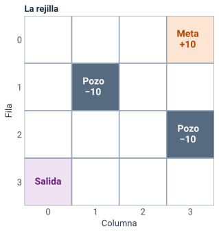
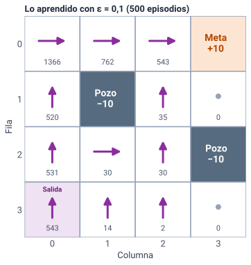
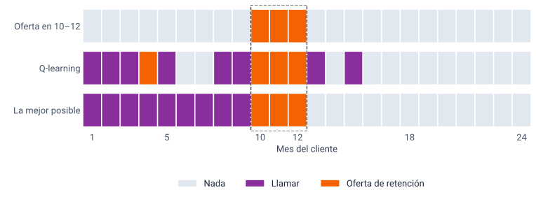
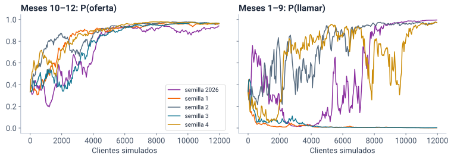

<!--
  Sesión 5 (4 h, viernes 20 de noviembre, 18:00–22:00), con 7 parejas (el máximo que fijó el docente el 14
  de noviembre; «Agenda con 7 parejas» de DISENO_S5.md v2, D1–D12): apertura 5 min · sustentaciones 1 a 4,
  52 · pausa 8 · sustentaciones 5 a 7, 39 · pausa 10 · qué cambia y la rejilla 35 · práctica 20 · Yarumo 20
  · policy gradients 10 · práctica 15 · pregunta de clasificar 6 · cierre 20. El orden de recorte está en
  las notas del divisor del refuerzo. Las diapositivas de código
  corresponden a las celdas del notebook (mismo identificador entre corchetes); las salidas y las
  gráficas salen de ejecutarlo (precalculo/salidas_sesion5.json y recursos/s5/<id>.svg), con Python
  3.13, numpy 2.4.6 y pandas 2.2.3. Las cifras del texto salen de las celdas [cifras] y [semillas].
  Los valores de Yarumo son exactos (no dependen de una semilla). Las fuentes (F-…) son las de
  fuentes/FUENTES.md, prioridad 5.
-->

# Apertura {icono=fa-door-open}

> Hoy se sustenta, se aprende una última forma de aprender y se cierra el curso.

???
18:00. Cinco minutos. Mientras entran, pegar en el chat el orden sorteado y los enlaces de los dos formularios (coevaluación y cierre). Pedir que la primera pareja tenga su pantalla lista.

## Cuatro horas: primero las sustentaciones, después el refuerzo y el cierre

::: tarjetas {columnas=3}
### Sustentaciones
- **18:05** Parejas 1 a 4
- **19:05** Parejas 5 a 7
### Aprender por ensayo y error
- **19:54** Qué cambia y Q-learning
- **20:29** Práctica en Colab
- **20:49** La retención de Yarumo
- **21:09** Gradiente de política y práctica
### Cierre del curso
- **21:40** El antes y el después, la autoevaluación y lo que sigue
:::

Pausas: **8 min a las 18:57** y **10 min a las 19:44**. Cambia el orden que anunció la sesión 4: **las sustentaciones van primero**.

???
Decirlo en voz alta: la S4 anunció primero el refuerzo y después las sustentaciones; el orden cambió para que las sustentaciones, que se califican, no se recorten si el día se atrasa (D1). Si se atrasa, se acortan las prácticas, y lo que falte queda en el notebook. Pedir que todos se queden hasta el cierre de las 21:40: ahí va el formulario del antes y el después. Hitos de reloj: parejas 1 a 4 hasta las 18:57; pausa; parejas 5 a 7 hasta las 19:44; pausa; refuerzo a las 19:54; cierre a las 21:40. Con menos de 7 parejas, cada una que falte suma 13 minutos a las prácticas.

## El orden se sorteó en público y nadie lo eligió

- El miércoles 18 se publicaron la **lista de parejas** en orden alfabético y la **semilla** del sorteo
- Hoy a las **16:30** se corrió el sorteo; cualquiera puede repetirlo con la misma lista y la misma semilla
- Si una pareja tiene **problemas de conexión**, pasa al **final de la fila** y sigue la siguiente
- Si el notebook no abre en vivo, se muestra el **`.ipynb` entregado**, ya ejecutado

???
D3. El orden está en el chat; no va en las diapositivas, porque el repositorio es público. Máximo de espera por conexión: dos minutos, y la pareja pasa al final (la hoja del docente registra el orden efectivo). Un integrante ausente sigue la regla que se publicó el miércoles 18 (pendiente del docente al construir esta sesión: fecha alterna y si se graba esa parte). Por defecto, mostrar el `.ipynb` ejecutado, sin correrlo: la descarga de datos puede tardar casi un minuto.

## Cada pareja tiene una franja de 13 minutos

::: flujo
1. **Exposición** — 6 min, con aviso a los 5. Incluye la ficha de datos y gobierno en pantalla
2. **Preguntas del docente** — 4 min, repartidas entre los integrantes
3. **Coevaluación** — 1 min para que la pareja siguiente envíe su formulario
4. **Cambio de pantalla** — 2 min: comparte la pareja siguiente
:::

El cronómetro corta la exposición a los 6 minutos; **las preguntas no se recortan**.

???
D2. 6 + 4 + 1 + 2 = 13 minutos. El colchón está dentro de las franjas: si una dura 12, el refuerzo empieza antes y gana ese tiempo. La ficha de gobierno se muestra en la exposición porque el criterio 2 de la coevaluación la nombra, y la pareja que evalúa no la ha visto (se avisó el miércoles, D4).

## Tres preguntas iguales para todas las parejas, y una libre

1. **¿De qué celda sale esta cifra?** (una cifra de tu informe o tu exposición)
2. **En tu ficha, ¿quién puede ver las filas con datos personales?**
3. **¿Por qué esa métrica y ese umbral para esa decisión?**
4. Una pregunta libre, sobre otro criterio de la rúbrica

Son los tres criterios de la coevaluación: **se puede auditar**, **el acceso es mínimo** y **la recomendación sirve a quien decide**.

???
D5. Las preguntas se reparten entre los integrantes, de modo que todos respondan alguna: el criterio 6 de la rúbrica pide que todos expliquen. La cifra de la pregunta 1 la elige el docente mientras sustenta la pareja anterior. La libre sale de la guía de preguntas (documento interno de la maestra, `evaluacion/GUIA_preguntas_sustentacion.md`). En vivo solo se anota evidencia en la hoja; los criterios 1 a 5 se califican después, sobre lo entregado.

## Coevalúas a la pareja que sustenta justo antes que tú

- A la **última** pareja la evalúa la **primera**; si alguien pasó al final, cuenta el **orden efectivo**
- Marca los tres criterios con **Sí**, **En parte** o **No**, mientras escuchas las preguntas del docente
- **Envía** en el minuto siguiente, antes de compartir tu pantalla
- La **línea abierta** (lo que más les convenció y lo primero que cambiarían) se puede completar hasta las **22:00**
- Tu **autoevaluación individual** se abre al final de la sesión y cierra el **sábado 21 a las 23:59**

???
D4. Los tres criterios son los de la página del proyecto (módulo 10): (1) se puede auditar: cuando el docente preguntó de dónde sale una cifra, la pareja mostró la celda o la fuente; (2) el acceso es mínimo: en su ficha, nadie que no lo necesite puede ver los datos personales (o, si no hay, el modelo y sus predicciones); (3) la recomendación sirve a quien decide: la métrica, y el umbral si lo hay, se justifican con la decisión. Las tres preguntas fijas dan a quien evalúa la evidencia de cada criterio. Pendiente del docente al construir: confirmar que esta es la redacción acordada en la S3 (el criterio 2 cambió con el proyecto nuevo).

# Sustentaciones {icono=fa-person-chalkboard}

> Seis minutos para exponer y cuatro para mostrar que tu decisión se puede auditar.

???
18:05. Parejas 1 a 4 (52 min), pausa de 8 a las 18:57, parejas 5 a 7 (39 min) y pausa de 10 a las 19:44. Mientras sustenta una pareja, el docente elige la cifra que le pedirá rastrear a la siguiente y anota la evidencia en la hoja. Volver a la diapositiva siguiente entre una pareja y otra.

## Cada franja: 6 + 4 + 1 + 2 minutos {.centro}

::: flujo {.paso}
1. **6 min · Exposición** — el problema, los datos, los modelos, la decisión y la ficha de gobierno
2. **4 min · Preguntas** — la cifra, la ficha, la métrica y una libre; la pareja evaluadora marca
3. **1 min · Coevaluación** — la pareja evaluadora envía su formulario
4. **2 min · Cambio** — la pareja evaluadora comparte su pantalla: sustenta ahora
:::

???
Es la pantalla de espera: proyectarla entre una pareja y otra, y avanzar un paso al empezar cada fase. El visor no tiene un cronómetro que se reinicie por pareja (el de la vista del presentador cuenta desde que se abrió); usar un cronómetro aparte, o la página del cronómetro si se preparó (D12), sin nombres. La pareja evaluadora es la que sustenta a continuación. Aviso a los 5 minutos y corte a los 6. Si una pareja no tiene conexión, pasa al final de la fila, y la cadena de coevaluación sigue el orden efectivo.

## Pausa de 8 minutos {.idea etiqueta="Pausa" icono=fa-mug-hot}

Volvemos a las **19:05** con la pareja 5.

???
18:57. Revisar en la hoja que cada pareja evaluadora haya enviado su formulario. Si el día va atrasado, cada minuto que se pase sale de las prácticas del refuerzo.

## Pausa de 10 minutos {.idea etiqueta="Pausa" icono=fa-mug-hot}

Volvemos a las **19:54**: aprender por ensayo y error.

???
19:44. Pedir que abran el notebook de la S5 durante la pausa (portada del curso → «Abrir en Colab») y ejecuten la primera celda: la práctica es a las 20:29. Las parejas que ya sustentaron se quedan: el cierre tiene el formulario del antes y el después.

# Aprender por ensayo y error {icono=fa-robot}

> Nadie le dice al agente qué era lo correcto: solo le llega una recompensa, a veces mucho después.

???
19:54 con 7 parejas. Hitos: qué cambia y Q-learning en la rejilla, hasta las 20:29 (35 min, con preguntas al grupo: hay tiempo para el termostato y para las dos actualizaciones a mano con calma); práctica de los ejercicios 1 y 2, hasta las 20:49; Yarumo, hasta las 21:09; gradiente de política, hasta las 21:19; práctica del ejercicio 3 y REINFORCE, hasta las 21:34; la pregunta de clasificar, hasta las 21:40.

**Referencia, si fueran más parejas** (agenda de 12 del diseño: franjas de 13 min, pausas de 8 y 6, cierre desde las 21:40):

| Parejas | Terminan | Refuerzo desde | Minutos |
|---|---|---|---|
| 10 | 20:23 | 20:29 | 71 |
| 11 | 20:36 | 20:42 | 58 |
| 12 | 20:49 | 20:55 | 45: sin prácticas en clase |
| 13 | 21:02 | 21:08 | 32: el núcleo |

**Con menos parejas**, cada una que falte suma 13 minutos a las prácticas. **Orden de recorte** si las sustentaciones se atrasan: (1) la práctica del ejercicio 3 y REINFORCE (queda para la casa, −15 min); (2) la práctica de los ejercicios 1 y 2 (−20 min); (3) después, la exposición, en este orden: el gradiente de política queda en su primera diapositiva, la idea; Yarumo se reduce al riesgo con lo inventado, la tabla de políticas, los 20 000 clientes simulados y «No se aprende con 20 000 clientes reales». Las dos actualizaciones a mano y el puente con la nube no se recortan.

## Tres formas de aprender: con la respuesta, sin respuesta y con una recompensa

::: tarjetas
### S2 · supervisado
Cada cliente trae su **respuesta correcta**: si canceló. El modelo aprende a imitarla.
### S3 · agrupamiento
**No hay respuesta**: buscamos grupos de clientes parecidos.
### Hoy · por refuerzo
Un **agente** decide y recibe una **recompensa** que llega **después** y depende de lo que hizo.
:::

???
Abrir con una pregunta al chat: ¿cómo aprendieron a montar en bicicleta, con un manual o cayéndose? Es el aprendizaje por refuerzo (Sutton y Barto, sec. 1.1, la lectura que dejó la S4; F-ML-06). En supervisado hay una respuesta por fila; aquí nadie dice cuál acción era la correcta, solo cuánto se ganó. Ojo con el nombre: «por refuerzo», no «de refuerzo» (glosario).

## El agente actúa y el entorno responde, una y otra vez

::: flujo
1. **Estado** — lo que el agente ve antes de decidir: dónde está, en qué mes va el cliente
2. **Acción** — lo que elige. Su regla para elegir en cada estado es su **política**
3. **Recompensa** — un número que el entorno le devuelve, con el estado nuevo
4. **Episodio** — la partida completa, de la salida al final
:::

???
F-ML-66, sec. 3.1 (pp. 47–48): el agente es el que aprende y decide; el entorno es todo lo demás. En cada paso recibe un estado, elige una acción y, un paso después, recibe una recompensa y un estado nuevo (figura 3.1 del libro). «Política» aquí es la regla del agente; la Azure Policy de la S2 la llamamos «directiva» (glosario). La recompensa dice **qué** se quiere lograr, no **cómo** (p. 54).

## Se busca la mayor suma de recompensas, y lo lejano vale menos

$$ G = R_1 + \gamma R_2 + \gamma^2 R_3 + \dots $$

- **G**, el **retorno**: la suma de recompensas del episodio
- **γ**, el **factor de descuento**, entre 0 y 1: con 0,9, una recompensa que llega un paso después vale el 90 %
- El entorno puede ser **azaroso**: la misma acción no siempre da lo mismo. Por eso se habla de lo que el agente **espera** ganar, el promedio de muchas partidas

???
Ecuación 3.8 de F-ML-66 (sec. 3.3, p. 55); el libro lo llama *discount rate* y el artículo de DQN, *discount factor* (F-ML-69): es el mismo γ. **No confundir con la columna `descuento`** de los datos, que es el de bienvenida: el «factor de descuento» con γ es solo el de la rejilla. Con γ = 0 el agente solo mira la recompensa inmediata; cerca de 1, pesa más el futuro. «Esperar» es el promedio: lo que ganaría en promedio si repitiera la partida muchas veces.

## Sin explorar de vez en cuando, el agente se queda con lo primero que le funcionó

- **Explotar**: elegir la acción que hoy parece mejor
- **Explorar**: probar otra, que quizá sea mejor y todavía no lo sabes
- La **regla ε-codiciosa** (*ε-greedy*): casi siempre explota; con probabilidad **ε**, elige al azar

Como ir siempre al mismo restaurante o, de vez en cuando, probar uno nuevo.

???
F-ML-66, sec. 2.1 (p. 26) y 2.2 (pp. 27–28): explotar maximiza lo de este paso; explorar puede dar más a largo plazo, y no se pueden hacer las dos con una misma acción. El título se comprueba en diez minutos, con la rejilla.

## En un termostato que aprende, ¿qué es cada cosa? {.pregunta}

- **a.** Bajar la calefacción un grado
- **b.** El registro de temperaturas del año pasado
- **c.** −1 por cada queja de frío y −0,1 por cada kWh
- **d.** La casa, con su clima y sus habitantes
- **e.** La temperatura de la casa a las 7 p. m.
- **f.** El programa del termostato, que corre cada hora
- **g.** Si hay alguien en la casa

Usa: agente, entorno, estado, acción, recompensa o **ninguna**. Alguna se repite.

::: respuesta
**a** acción · **b** ninguna: es un dato histórico, no parte del ensayo y error · **c** recompensa · **d** entorno · **e** estado · **f** agente · **g** estado
:::

???
Dos minutos, respuestas en el chat. La b no es una pieza del bucle: serviría para un modelo supervisado o para armar un simulador, que es justo lo que veremos con Yarumo. La g es parte del estado, como la temperatura: el estado es todo lo que el agente ve antes de decidir. La c muestra que la recompensa es una decisión de diseño: si castiga solo las quejas, el termostato gasta energía sin límite.

## La rejilla: salir abajo a la izquierda y llegar a la meta sin caer en un pozo {columnas=1:1}

{alto=430}

|||

- Meta: **+10**. Pozo: **−10**. Las dos terminan el episodio
- Las demás casillas dan **0**: no hay costo por paso
- Cuatro acciones: ↑ → ↓ ←; contra el borde, se queda
- Con γ = 0,9, la meta lejana vale menos: la ruta **corta** vale más

???
Celda [rejilla] del notebook: la función `paso(s, a)` es todo el entorno; devuelve la casilla nueva, la recompensa y si terminó. El camino más corto tiene 6 pasos (tres hacia arriba y tres a la derecha, sin pisar los pozos). Sin costo por paso y con γ = 1, llegar en 6 pasos o en 40 valdría lo mismo, 10, y la tabla no distinguiría la ruta corta (en esta rejilla pequeña el agente la encuentra igual, pero no porque valga más). En el notebook se puede probar con `entrenar_rejilla(gamma=1.0)`.

## Al azar, el agente cae en un pozo más de nueve de cada diez veces

```python [azar]
rng = np.random.default_rng(2026)
for episodio in range(10_000):
    s, fin = INICIO, False
    for t in range(50):
        s, r, fin = paso(s, int(rng.integers(4)))  # una acción al azar
        if fin:
            break
for como, cuantos in final.items():
    print(f"{como}: {cuantos / 10_000:.1%}")
#> pozo: 93.4%
#> meta: 5.9%
#> tope de 50 pasos: 0.7%
```

???
Diez mil episodios con acciones al azar y un tope de 50 pasos. Es el punto de partida: lo que pasa si el agente no aprende nada. La cuenta de cuántos terminan en cada lugar está en la celda completa. Transición: ¿cómo aprende a no caer?

## La tabla Q guarda lo que el agente espera ganar si hace esto aquí

$$ Q(s,a) \leftarrow Q(s,a) + \alpha\,\big[\,\underbrace{r + \gamma \max_{a'} Q(s',a')}_{\text{objetivo}} - Q(s,a)\,\big] $$

- **Objetivo**: la recompensa que recibió más lo mejor que espera ganar desde la casilla nueva, descontado. Si el episodio terminó, ya no hay después
- **α**, la **tasa de aprendizaje**, como en la sesión 4: qué fracción del camino hacia el objetivo avanza

???
Ecuación 6.8 de Sutton y Barto (F-ML-66, sec. 6.5, p. 131). Q-learning es de la tesis de Watkins (1989); Watkins y Dayan (1992) publicaron la demostración de que converge (F-ML-67). Una fila por casilla y una columna por acción: 16 × 4 valores, todos en 0 al empezar. El valor Q es «lo que espera ganar si hace esto aquí, con lo que vale menos lo lejano», no la suma de recompensas de un episodio. En el estado final, el término del máximo vale 0. Es la línea que completan en el ejercicio 1.

## A mano: primero aprende la casilla junto a la meta, después la anterior {columnas=1:1}

```python [a_mano]
alfa, gamma = 0.1, 0.9
q_meta = 0 + alfa * (10 + 0 - 0)
q_antes = 0 + alfa * (0 + gamma * q_meta - 0)
print(f"Q[(0, 2), derecha] = {q_meta:.2f}")
print(f"Q[(0, 1), derecha] = {q_antes:.2f}")
#> Q[(0, 2), derecha] = 1.00
#> Q[(0, 1), derecha] = 0.09
```

|||

Con α = 0,1, γ = 0,9 y la tabla en ceros:

1. Desde (0, 2) va a la derecha, a la meta: **0 + 0,1 · (10 − 0) = 1,0**
2. Más tarde, desde (0, 1) va a la derecha, a (0, 2): **0 + 0,1 · (0 + 0,9 · 1,0 − 0) = 0,09**

???
Hacer la cuenta en voz alta (o en la pizarra compartida) antes de mostrar la celda. Son casillas de la ruta que el agente aprende, por la fila de arriba (se ve en unas diapositivas). Lo importante: (0, 1) nunca tocó la meta y ya «sabe» que ir a la derecha vale algo. Con cada episodio el valor sigue retrocediendo hasta la salida. Esto no se recorta.

## La recompensa viaja hacia atrás {.idea icono=fa-backward}

Una casilla que nunca tocó la meta aprende a valorar el camino porque **desde la casilla siguiente se llega a la meta**. Con los episodios, el valor retrocede hasta la salida.

???
Es la idea central de Q-learning. Preguntar: ¿cuántos episodios harían falta, como mínimo, para que la salida «sepa» algo de la meta? (Al menos uno por casilla del camino, seis, si el agente lo recorriera siempre igual; en la práctica, más.)

## En cada paso: con probabilidad ε explora; si no, la mejor que conoce

```python [entrenar]
def entrenar_rejilla(eps=0.1, episodios=500, alfa=0.1, gamma=0.9,
                     semilla=2026):
    Q = np.zeros((FILAS, COLUMNAS, 4))   # al principio, todo vale 0
    for episodio in range(episodios):
        s = INICIO
        for t in range(50):                  # tope de 50 pasos
            visitas[s] += 1
            if rng.random() < eps:
                a = int(rng.integers(4))     # explora: al azar
            else:
                a = int(np.argmax(Q[s]))     # explota: la mejor
            s2, r, fin = paso(s, a)
```

Si varias acciones empatan, `np.argmax` elige **la primera**: ↑.

???
Celda [entrenar], recortada: faltan las líneas que crean `rng` y `visitas`, la actualización (la del ejercicio 1) y el cierre del episodio. Además del aprendizaje, cuenta cuántas veces pasó el agente por cada casilla (`visitas`). Que `argmax` elija la primera en un empate importa en una pregunta más adelante.

## Con ε = 0,1, aprende la ruta de 6 pasos en 500 episodios

```python [aprende]
Q, visitas = entrenar_rejilla(eps=0.1)
camino = camino_voraz(Q)
print(f"¿Llega? {llega_a_la_meta(Q)}, en {len(camino) - 1} pasos")
print(f"Lo que espera ganar desde la salida: {Q[INICIO].max():.2f}")
print(f"La meta a 6 pasos: 10 · 0.9^5 = {10 * 0.9 ** 5:.2f}")
#> ¿Llega? True, en 6 pasos
#> Lo que espera ganar desde la salida: 5.90
#> La meta a 6 pasos: 10 · 0.9^5 = 5.90
```

La recompensa llega en el sexto paso, y cada paso que la separa de la salida la multiplica por γ: desde la salida vale **10 · 0,9⁵**.

???
`camino_voraz` sigue siempre la mejor acción conocida desde la salida; `llega_a_la_meta` dice si termina en la meta (celda [voraz]). Con 50 semillas, el agente con ε = 0,1 llegó en las 50, con el mismo 5,90 desde la salida (celda [semillas]). Si la ruta fuera de 8 pasos, la salida valdría 10 · 0,9⁷, menos: por eso prefiere la corta. La convergencia de Q-learning está demostrada para la tabla, con todas las casillas y acciones visitadas infinitas veces y α que se achica (F-ML-67); con α fijo no hay garantía: no decir «converge siempre».

## Donde el agente pasó mucho, la flecha es confiable; donde no pasó, no aprendió {columnas=3:2}

{alto=470}

|||

- La flecha: la acción de **mayor valor** en esa casilla
- El número: cuántas veces pasó el agente por ella
- Un punto gris: **nada aprendido**, todas empatan
- Sus valores apuntan a la mejor política **aunque explore**: aprende **fuera de política** (*off-policy*)

???
Pregunta: ¿qué casillas libres tienen menos visitas y qué dicen? (1, 3) y (3, 3) tienen 0 visitas y un punto gris: el agente no aprendió nada allí; con pocas visitas, la flecha no es confiable. La ruta aprendida va por arriba: sube por la columna 0 y sigue por la fila 0. Q-learning es *off-policy* (F-ML-66, sec. 6.5; glosario: «fuera de política»): la tabla apunta al máximo, no a la jugada al azar que a veces hace.

## Práctica en Colab: la actualización de Q y un agente que no explora

::: flujo
1. **Ejecuta** el notebook hasta la celda [flechas] y compara con lo que vimos
2. **Ejercicio 1** — completa `actualiza`; si algo no cuadra, el verificador dice qué parte de la regla revisar
3. **Ejercicio 2** — **predice** antes de correr: ¿llega a la meta un agente con ε = 0? Después cuenta sus casillas y elige la explicación
4. **Si terminas** — prueba `entrenar_rejilla(gamma=1.0)`: ¿cuánto vale ahora la salida?
:::

Veinte minutos. Las dudas, por el chat.

???
20:29 a 20:49. Recorrer las salas o el chat. Las dudas típicas: en el ejercicio 1, olvidar descontar con gamma o no sumar el valor actual (el verificador lo dice); en el ejercicio 2, poner True o False entre comillas. Con γ = 1, la salida vale 10: sin γ, todas las rutas que llegan valen lo mismo. A las 20:47, pasar a la diapositiva siguiente y revelar.

## Con ε = 0, el agente no llega nunca a la meta. ¿Por qué? {.pregunta}

Con la misma semilla, la misma α y los mismos 500 episodios, solo cambia ε.

::: respuesta
Con la tabla en ceros, las acciones **empatan** y `argmax` elige siempre la misma, ↑. Sube hasta la fila 0 y choca contra el borde. Como **nunca recibe una recompensa**, la tabla no cambia: en 500 episodios visitó solo **4 casillas**. Con 50 semillas, **0 de 50** llegan con ε = 0, y **50 de 50** con ε = 0,1.
:::

???
Dos minutos, al final de la práctica: que alguien que hizo el ejercicio 2 lo explique antes de revelar. Las cifras salen de las celdas [cifras] y [semillas]. La lección: sin exploración, el agente se queda con lo primero que conoce. Una empresa que solo repite lo que ya le funcionó tampoco descubre algo mejor; pero en una empresa, explorar cuesta (lo vemos con Yarumo).

## La pregunta de la sesión 1: ¿qué oferta de retención hacer, y cuándo?

::: tarjetas
### Episodio y estado
Un cliente nuevo, durante **24 meses**. El estado es el **mes** del cliente
### Acciones, cada mes
**Nada**, **llamar** o hacer una **oferta de retención**
### Recompensa
Si el cliente sigue, la **factura** del mes; la acción **cuesta**, siga o no
:::

Es un **simulador**: un entorno de mentira, con sus supuestos a la vista.

???
20:49. Veinte minutos para Yarumo. La S1 dejó esta pregunta para hoy. La recompensa es facturación, no ganancia (no restamos el costo del servicio). En Yarumo no se usa γ (equivale a γ = 1), porque el horizonte es de 24 meses. «Oferta de retención», no «descuento»: `descuento` es la columna del de bienvenida.

## El riesgo sale de los datos; el efecto de cada acción es inventado

```python [riesgo]
tabla_riesgo["al_mes"] = 1 - (1 - tabla_riesgo["a_3_meses"]) ** (1 / 3)
print(tabla_riesgo.round(3))
#>                   clientes  a_3_meses  al_mes
#> antiguedad_meses
#> meses 1-9             1535      0.280   0.104
#> meses 10-12            371      0.553   0.235
#> meses 13-24           1502      0.209   0.075
```

::: danger Inventado
**Llamar** reduce el riesgo del mes en una cuarta parte (lo multiplica por 0,75) y cuesta **20 mil** pesos; la **oferta**, en un 60 % (por 0,4), y cuesta **60 mil**.
:::

La factura sí sale de los datos: la mediana de `clientes.csv`, **115 mil** pesos al mes.

???
Celdas [riesgo] y [entorno]. La tasa a 3 meses (julio a septiembre) se pasa a riesgo mensual suponiendo que es pareja en los tres meses: 1 − (1 − p)^(1/3). Hasta el mes 12 se toman los clientes con el descuento de bienvenida, que vence entre los meses 10 y 12 (el 55,3 % que vieron en la S1); del 13 al 24, los que ya no lo tienen. El subconjunto decide la política: sin ese filtro, los riesgos cambian. Otras dos simplificaciones: la antigüedad es la del 30 de junio y la cancelación cae entre julio y septiembre, así que el tramo «10–12» mira en realidad clientes de entre 11 y 15 meses; y el «cliente nuevo» del simulador se arma con tramos de clientes distintos. Además, se supone que el riesgo de los meses 10 a 12 es parejo; los datos no dicen si el pico cae en un solo mes (si fuera así, la mejor política haría la oferta solo en ese mes). Los efectos y costos no están en los datos: no hay ningún experimento que los mida. Decir «inventado» en voz alta.

## Con el cálculo exacto, la oferta solo en los meses 10 a 12 le gana a las otras tres reglas

```python [politicas]
politicas = {
    "No hacer nada": lambda mes: 0,
    "Llamar siempre": lambda mes: 1,
    "Oferta siempre": lambda mes: 2,
    "Oferta solo en los meses 10–12": lambda mes: 2 if 10 <= mes <= 12
                                      else 0,
}
for nombre, politica in politicas.items():
    print(f"{nombre:31} {valor_politica(politica):6.1f} mil por cliente")
#> No hacer nada                    843.5 mil por cliente
#> Llamar siempre                   874.7 mil por cliente
#> Oferta siempre                   733.0 mil por cliente
#> Oferta solo en los meses 10–12   906.4 mil por cliente
```

Lo que deja en promedio un cliente en 24 meses: las facturas cobradas menos lo que cuestan las acciones.

???
`valor_politica` no simula: calcula lo que deja en promedio un cliente, de atrás hacia adelante (celda [entorno]). Por eso estas cifras no dependen de ninguna semilla. Hacer la oferta siempre es lo peor: cuesta 60 mil todos los meses, aunque el riesgo sea bajo. Preguntar antes de revelar la última fila: ¿cuál creen que gana? La mejor política posible, que calculamos porque conocemos el simulador, vale 939,2 mil: llamar en los meses 1 a 9, la oferta en el 10 al 12 y nada después (celda [mejor]).

## Con 20 000 clientes simulados, Q-learning se acerca a la mejor posible

{alto=300}

| Oferta en los meses 10–12 | Q-learning (semilla 2026) | La mejor posible |
|---|---|---|
| **906,4** mil | **928,0** mil | **939,2** mil |

???
Celdas [q_yarumo] y [aprendida]. El agente no ve el riesgo: prueba acciones con clientes simulados. Explora mucho al principio (ε baja en línea recta desde 1 y llega a 0,3 en el cliente 7000) y después se queda en 0,3, y sus pasos α se achican en cada mes y acción, porque cada cliente simulado trae ruido. El valor de lo aprendido se calcula exacto. Con 30 semillas: en promedio 924,5, entre 914,4 y 935,9, y las 30 por encima de la regla de los meses 10 a 12 (celda [semillas]). Acertó los tres meses de la oferta en las 30 semillas; en los meses 1 a 9, en promedio el 62 % de las veces. Ojo con la lectura: la ventaja de la mejor posible sobre la regla (939,2 − 906,4 = 32,8 mil) sale de llamar en los meses 1 a 9: poco cada mes, pero junto suma la mitad de lo que aporta la oferta. El plan aprendido además hace la oferta en el mes 4 y llama en el 13 y el 15: son los meses donde duda.

## La sesión 1 dijo cuándo; la 2, a quién; el refuerzo, qué hacer y cuándo

::: tarjetas
### S1 · cuándo
Entre los meses 10 y 12, al vencer el descuento de bienvenida, cancela el **55,3 %** de quienes lo tenían
### S2 · a quién
El clasificador ordena a los clientes por **riesgo**: a quién llamar primero
### Hoy · qué hacer y cuándo
Una **política** mes a mes, aprendida probando, **bajo los supuestos** del simulador
:::

???
El 55,3 % es la tasa a 3 meses del tramo 10–12 de hoy (celda [riesgo]), la misma de la S1. Juntar las tres: el clasificador dice a quién, la política dice qué y cuándo. En un sistema real, el estado no sería solo el mes: incluiría el riesgo de cada cliente, y la tabla Q se volvería una red, como en DQN.

## El agente acierta lo grande y duda en lo pequeño: cuatro límites {.denso}

1. **El agente redescubre lo que el simulador supone.** El valor está en el método: en la vida real, el simulador se estima con datos y se valida
2. **Solo lo de los meses 10 a 12 resiste el ruido**, y solo si el efecto inventado de la oferta es cierto. En los demás meses, cada mes las acciones valen casi lo mismo, y el agente no distingue entre ellas
3. **«La mejor posible» se calculó porque conocemos el entorno.** El refuerzo sirve cuando no se conoce
4. **Hicieron falta 20 000 clientes simulados**: la diapositiva siguiente dice por qué no con clientes reales

???
D8. En el mes 1, llamar vale 939,2 y no hacer nada, 932,2: 7 mil de diferencia; en el mes 9, menos de 3 mil (celda [cifras], «diferencias_mejor»). En los meses 10 a 12, la oferta le saca a no hacer nada entre 68 y 78 mil. Por eso el agente acierta siempre lo grande y duda en lo pequeño; pero lo pequeño, sumado en nueve meses, son 32,8 mil. Sobre el punto 2: si la oferta redujera el riesgo en un 40 % y no en un 60 %, la mejor política no la haría en ningún mes; hace falta que lo reduzca al menos un 43 % (celda [cifras], «sensibilidad_oferta»): lo de los meses 10 a 12 es sólido frente al ruido del aprendizaje, no frente a los supuestos. Del punto 3, la pregunta que suele salir: «si tengo el simulador, ¿para qué aprender?». Porque el cálculo exacto necesita las probabilidades, y en la vida real nadie las tiene; Q-learning solo necesita poder probar.

## No se aprende con 20 000 clientes reales {.idea icono=fa-user-shield}

Explorar con clientes de verdad tiene consecuencias: se aprende con un **simulador** validado o con **datos de campañas pasadas**. Y si una política decide sola, alguien la **aprueba** y cada decisión queda **registrada**: quién, cuándo, qué acción y por qué.

???
No se recorta: es el puente con la nube. F-ML-76 (Dulac-Arnold et al., 2021, sec. 2.1): en sistemas reales, las acciones de exploración rara vez están libres de consecuencias (*«these exploratory actions are rarely without consequence»*). La fuente admite cierta experimentación en línea en algunos sistemas (por ejemplo, de recomendación); el «no con clientes reales» sin salvaguardas es criterio del curso. La fuente respalda lo técnico; lo ético y lo legal es criterio del curso: experimentar con personas pide salvaguardas, y los datos de clientes siguen la Ley 1581 (S3). Quién aprueba: los roles y el privilegio mínimo de la S2; qué se registra: los registros de la S4 («si no queda registrado, no pasó»). Preguntar: en Yarumo, ¿quién debería aprobar esta política? (La gerente de experiencia del cliente, con el oficial de protección de datos.)

## Gradiente de política (*policy gradients*): sube lo que salió mejor que lo usual

- La política es directamente una **probabilidad** por acción, como la salida **softmax** de la red de dígitos de la sesión 4
- Después de cada episodio, **sube** la probabilidad de lo que salió **mejor** que un **valor de referencia** y **baja** la de lo que salió peor
- No estima cuánto vale cada acción: ajusta **directamente** cómo elegir

$$ \theta \leftarrow \theta + \alpha\,(G - b)\,\nabla \ln \pi(a \mid s, \theta) $$

**θ**: las preferencias · **G**: lo que ganó desde ese paso · **b**: el valor de referencia · **π**: la probabilidad de elegir la acción **a**

???
21:09. Diez minutos con la diapositiva siguiente. Es REINFORCE (Williams, 1992, F-ML-68), en la forma de Sutton y Barto, ecuaciones 13.8 y 13.11 (F-ML-66, sec. 13.3 y 13.4), escritas allí con ∇π/π, que es lo mismo que ∇ ln π (el pseudocódigo de la p. 328 usa ln). θ son las preferencias de la política; G, lo que ganó desde ese paso; b, el valor de referencia, que no puede depender de la acción elegida. El valor de referencia no cambia hacia dónde se mueve la política en promedio, pero puede reducir mucho el ruido (sec. 13.4, p. 329). No decir «línea base» aquí: esa es la del proyecto. Si hay que recortar, esta es la única diapositiva de *policy gradients* que se queda.

## Las cinco semillas coinciden en el tramo de riesgo; en los meses 1 a 9, no

{alto=380}

Con 40 semillas, la oferta en los meses 10 a 12 sale en **las 40**. En los meses 1 a 9, la acción más probable al final fue llamar en 23, nada en 14 y la oferta en 3.

???
Celda [reinforce_semillas], con cinco semillas, y [semillas] con cuarenta. En el tramo de riesgo la ventaja de la oferta es grande y todas la aprenden; en los primeros meses, la diferencia entre las acciones es pequeña frente al ruido de cada cliente simulado, y las semillas no coinciden: con estas cinco, llamar en tres y nada en dos. Estos métodos pueden tener **varianza alta** (F-ML-66, p. 329). No prometer qué hace una semilla en particular. Con α = 0,005 y 12 000 clientes simulados por semilla; con α = 0,02 y 6000, como en el prototipo del diseño, la oferta en 10–12 fallaba en 18 de 100 semillas (auditoría de código). En el notebook es para correr y mirar.

## DQN, AlphaGo e InstructGPT usaron refuerzo, cada uno a su manera

::: tarjetas
### DQN · Atari (2015)
Q-learning con una red convolucional (*deep Q-network*): con los píxeles y el puntaje, y el mismo método en 49 juegos, un nivel **comparable** al de un probador profesional
### AlphaGo (2016)
Combinó aprendizaje **supervisado** con partidas de expertos, **refuerzo** jugando contra sí mismo y **búsqueda**
### InstructGPT (2022)
Ajustado con **PPO** (optimización de política proximal), un método de gradiente de política, con una recompensa aprendida de **preferencias humanas**
:::

???
F-ML-69: DQN superó a los métodos previos en 43 de los 49 juegos y superó el 75 % del puntaje humano en 29; «comparable», no «superior» en todos; aprendió con un emulador del juego. F-ML-70: AlphaGo no aprendió solo jugando contra sí mismo (eso fue AlphaGo Zero, otro artículo, según Sutton y Barto, sec. 16.6.2; ese artículo no se verificó); venció al campeón europeo 5 a 0. F-ML-71: PPO está en la sección 3.5 del artículo, no en el resumen; allí la recompensa la da un modelo entrenado con comparaciones de personas, y el «episodio» es una sola respuesta. F-ML-72: PPO es «una nueva familia de métodos de gradiente de política»; su ε es el ancho de un recorte, no el de la regla ε-codiciosa.

## ¿Por qué no calcular la mejor política directamente? {.pregunta}

Con Yarumo la calculamos de atrás hacia adelante y valía 939,2 mil. ¿Para qué entonces Q-learning o el gradiente de política?

::: respuesta
Porque el cálculo exacto necesita **conocer el entorno**: el riesgo de cada mes con cada acción. En la vida real nadie lo tiene; el agente solo necesita **poder probar**, en un simulador o con datos de campañas pasadas.
:::

???
Un minuto. Es el punto 3 de las cuatro cosas honestas, dicho por el grupo. También responde por qué en Atari o en Go hace falta refuerzo: nadie puede escribir la mejor jugada para cada posición.

## Práctica en Colab: tu política de retención y el gradiente de política

::: flujo
1. **Ejercicio 3** — escribe tu política, mes a mes, y calcula su valor exacto
2. **Compara** — con la oferta en los meses 10 a 12 y con la mejor posible
3. **REINFORCE** — corre las cinco semillas y mira en qué tramos coinciden; prueba otra semilla
:::

Lo que no termines queda para la casa: todo corre en segundos, sin GPU.

???
21:19 a 21:34. scikit-learn no trae aprendizaje por refuerzo por decisión de diseño (F-ML-73); Gymnasium figura en la lista de paquetes de Colab (F-ML-75), pero no lo probamos ni lo usamos. En la réplica, el notebook del estudiante corre en unos 8 segundos; REINFORCE es lo más lento. Pedir en el chat el valor de la política de cada quien: ¿alguien le ganó a la regla de los meses 10 a 12? Para ganarle hace falta llamar en los primeros meses.

## ¿Supervisado, no supervisado o por refuerzo? {.pregunta}

- **a.** Un programa cambia cada hora el precio de un parqueadero y aprende de cuántos carros llegan y cuánto se recauda
- **b.** Con 10 000 radiografías que un especialista ya marcó, un modelo aprende a señalar las sospechosas
- **c.** Un programa de ajedrez aprende jugando miles de partidas contra sí mismo: +1 si gana y −1 si pierde, al final

Un tipo puede repetirse y otro, no aparecer.

::: respuesta
**a** por refuerzo: actúa y la recompensa llega después · **b** supervisado: cada radiografía trae su respuesta · **c** por refuerzo: la recompensa llega al final de cada partida. Ninguna es **no supervisada**: en todas hay una respuesta o una recompensa
:::

???
21:34. Seis minutos: un minuto para pensar, respuestas en el chat (las tres letras con su tipo) y la discusión. No siguen el orden en que se enseñaron, y como un tipo se repite, la última no sale por descarte. En la a, la recompensa es lo que se recauda; si el programa solo predijera cuántos carros llegan con datos del año pasado, sería supervisado. En la c, eso es lo que hizo AlphaGo Zero; AlphaGo partió además de partidas humanas.

# Cierre del curso {icono=fa-flag-checkered}

> Cinco sesiones después: ¿qué cambió?

???
21:40. Veinte minutos: 8 para el formulario del antes y el después, 5 para la autoevaluación del proyecto y 7 para lo que sigue, las preguntas y el agradecimiento.

## El antes y el después: ocho preguntas en ocho minutos

- **Cuatro** son del diagnóstico de la sesión 1; **cuatro** son nuevas, de las sesiones 3 a 5
- Se responde **sola o solo**, en el formulario, sin buscar en internet
- Al final vemos las respuestas y el cambio del grupo

???
D11. Las cuatro de la S1 son la 3, la 4, la 5 y la 7 del diagnóstico: las que no se comentaron de nuevo en clase (la 1, la 2 y la 8 se retomaron en la S1, la 6 en la S3 y la 1 otra vez en la S4). Van con las opciones en otro orden. Pegar el enlace del formulario en el chat (pendiente del docente: plataforma o Google; mejor la plataforma, para no sacar datos de personas). Si los resultados de la S1 se guardaron por persona, cada quien ve su cambio; si no, se compara el grupo. Proyectar las ocho preguntas una a una, unos 50 segundos cada una, sin comentar.

## Agrupas clientes con K-Means por factura y edad, sin escalar. ¿Qué pasa? {.pregunta etiqueta="Cierre · 1 de 8"}

La factura está en pesos; la edad, en años.

- **A.** Nada: K-Means escala las columnas por su cuenta
- **B.** La factura decide casi sola los grupos
- **C.** La edad pesa más, porque cambia más entre clientes
- **D.** Da un error: las columnas tienen unidades distintas

???
Nueva (S3). Respuesta: B. Parecido es distancia: una diferencia de miles de pesos pesa mucho más que una de años, y por eso se escala. La A es la trampa: K-Means no escala nada. La factura va de 51 900 a 286 600 pesos y la edad, de 18 a 87 años (celda [cifras], «rangos»): decirlo al revelar.

## ¿Qué modelo de servicio usa Yarumo en este caso? {.pregunta etiqueta="Cierre · 2 de 8"}

Yarumo alquila una máquina virtual en la nube. Su equipo elige el sistema operativo, instala la base de datos y les aplica los parches.

- **A.** PaaS
- **B.** Nube privada
- **C.** SaaS
- **D.** IaaS

???
Pregunta 4 del diagnóstico de la S1, con el mismo contenido (la máquina virtual pasa del título al enunciado) y las opciones en otro orden. Respuesta: D. La B confunde modelo de servicio con modelo de implementación.

## En Q-learning, ¿por qué el agente elige a veces una acción al azar? {.pregunta etiqueta="Cierre · 3 de 8"}

- **A.** Para que el resultado no dependa de la semilla
- **B.** Para no sobreajustarse, como con el *dropout*
- **C.** Para probar acciones que todavía no ha ensayado
- **D.** Porque la tabla Q no admite dos valores iguales

???
Nueva (refuerzo). Respuesta: C, explorar. Es la regla ε-codiciosa: con ε = 0, el agente de la rejilla no llegó nunca. La B mezcla dos ideas de la S4: el *dropout* frena el sobreajuste de una red, no explora.

## ¿Qué dos características de la nube describe este caso? {.pregunta etiqueta="Cierre · 4 de 8"}

Una tienda en línea pasa de dos a veinte servidores la noche del *Black Friday*, vuelve a dos el lunes y paga solo las horas que usó.

- **A.** Elasticidad rápida y servicio medido
- **B.** Alta disponibilidad y SaaS
- **C.** Autoservicio bajo demanda y acceso amplio por la red
- **D.** Agrupación de recursos y nube híbrida

???
Pregunta 7 del diagnóstico de la S1, con las opciones en otro orden. Respuesta: A. Dos de las cinco características esenciales del NIST.

## Desde la época 5, la pérdida de validación sube. ¿Qué haces? {.pregunta etiqueta="Cierre · 5 de 8"}

Entrenas una red grande; la pérdida de entrenamiento sigue bajando.

- **A.** Entrenar más épocas: todavía no termina de aprender
- **B.** Subir la tasa de aprendizaje para avanzar más rápido
- **C.** Agregar más neuronas: la red se queda corta para esto
- **D.** Parar y volver a los pesos de la mejor época

???
Nueva (S4). Respuesta: D. La red está memorizando: es la parada temprana con `restore_best_weights=True`. El *dropout* también ayudaría, pero no está entre las opciones.

## ¿Cuál de estas frases es conocimiento, y no solo un dato o información? {.pregunta etiqueta="Cierre · 6 de 8"}

- **A.** «C00002 · Mes a mes · 6 meses · Sí»
- **B.** «Los clientes mes a mes cancelan más: conviene ofrecerles permanencia»
- **C.** «El 23,6 % de los clientes canceló en el trimestre, casi uno de cada cuatro»
- **D.** «La tabla tiene 8000 filas: una por cliente activo el 30 de junio»

???
Pregunta 3 del diagnóstico de la S1, con las opciones en otro orden. Respuesta: B: una relación entendida que orienta una decisión (F-ML-65).

## Sin la clave compartida ni el acceso anónimo, ¿puede la analista leer `clientes.csv`? {.pregunta etiqueta="Cierre · 7 de 8"}

Desactivaste las dos en la cuenta de almacenamiento.

- **A.** Sí, con su identidad de Entra ID y un rol de datos sobre el contenedor
- **B.** Sí, con el rol Propietario de la suscripción, que lo administra todo
- **C.** Sí, con el rol Lector de la suscripción, que deja ver todos los recursos
- **D.** No: sin la clave compartida, nadie puede leer el archivo

???
Nueva (nube de la S4). Respuesta: A. Propietario y Lector son roles del plano de control: sin la clave, ni el Propietario de la suscripción lee los *blobs* sin un rol de datos (F-AZ-19g, F-AZ-42). La D es la trampa: Entra ID sigue funcionando.

## ¿Qué tipo de aprendizaje usa este programa? {.pregunta etiqueta="Cierre · 8 de 8"}

Con los clientes del año pasado, de los que ya se sabe quién canceló, se entrena un programa que estima quién cancelará este trimestre.

- **A.** Por refuerzo
- **B.** No supervisado
- **C.** Supervisado
- **D.** Ninguno: eso es estadística

???
Pregunta 5 del diagnóstico de la S1, con las opciones en otro orden. Respuesta: C: hay una etiqueta. Después de hoy, la A resulta más tentadora: no hay agente que actúe ni recompensa que llegue después.

## Las respuestas, y lo que cambió desde la sesión 1 {.denso}

| Pregunta | Respuesta | Dónde lo vimos |
|---|---|---|
| 1 · K-Means sin escalar | **B** · la factura decide sola | S3 |
| 2 · La máquina virtual | **D** · IaaS | S1 (diagnóstico, 4) |
| 3 · La acción al azar | **C** · para explorar | S5 |
| 4 · *Black Friday* | **A** · elasticidad y servicio medido | S1 (diagnóstico, 7) |
| 5 · La validación sube | **D** · parada temprana | S4 |
| 6 · Conocimiento | **B** · una relación que orienta una decisión | S1 (diagnóstico, 3) |
| 7 · Sin clave compartida | **A** · Entra ID y un rol de datos | S4 |
| 8 · Con etiquetas del año pasado | **C** · supervisado | S1 (diagnóstico, 5) |

???
Solo después de cerrar el formulario. Comparar en voz alta las cuatro de la S1 con lo que el grupo respondió entonces (resultados de la encuesta de la S1); en las nuevas no hay antes. Comentar la que más falle el grupo. Ojo: en la S1, las preguntas 2, 4, 6 y 8 de hoy tenían las letras C, D, D y B, porque las opciones cambiaron de orden.

## Tu autoevaluación del proyecto: individual, hasta el sábado 21 a las 23:59

- **Qué es:** el nivel que te das en los **seis criterios** de la rúbrica y qué hizo cada integrante de la pareja
- **Dónde:** el formulario de la plataforma, que se abre al terminar la sesión
- **Hasta cuándo:** el **sábado 21 de noviembre a las 23:59**
- La coevaluación de hoy y la calificación del docente son las otras dos miradas

???
Cinco minutos, pero sin llenarla ahora: basta explicar el enlace. Es la Etapa 3 de los dos syllabus (autoevaluación, coevaluación y heteroevaluación). Pendiente del docente: el enlace y el peso de cada mirada en la nota. La página del proyecto todavía no dice el cierre de la autoevaluación (pedido a la maestra).

## Lo que te llevas hoy {.cierre}

- Una **sustentación auditable**: cada cifra sale de una celda y cada acceso tiene un dueño
- En el aprendizaje por refuerzo, el agente **actúa** y aprende de una **recompensa que llega después**
- Q-learning: la recompensa **viaja hacia atrás**; sin **explorar**, el agente se queda en lo primero que conoce
- Un simulador enseña el método, **no** dice la verdad sobre los clientes: lo de los meses 10 a 12 depende de supuestos inventados
- Si una política decide sola, alguien la **aprueba** y cada decisión queda **registrada**

???
Leer las cinco y preguntar cuál les costó más. Cerrar con el lema de hoy.

## Lo que sigue, y gracias

- **Termina** el notebook de la sesión 5: los ejercicios 1 a 3 y REINFORCE
- Llena tu **autoevaluación** hasta el **sábado 21 a las 23:59**
- Completa la línea abierta de la **coevaluación**, si te faltó, hasta las **22:00** de hoy
- Las **notas**, en la fecha que dé el docente

**Gracias por estas cinco sesiones.**

???
Siete minutos con las preguntas finales. Pendiente del docente: cuándo salen las notas. Para quien quiera seguir: el libro de Sutton y Barto completo es de acceso libre (enlazarlo, no copiar capítulos: su licencia no permite obras derivadas, F-ML-66), y Gymnasium tiene entornos de práctica como FrozenLake y CliffWalking (F-ML-74). Recordar que borren los recursos de Azure que hayan creado para practicar.

## Fuentes de esta sesión {.denso .arriba}

- Sutton, R. S. y Barto, A. G. (2018). *Reinforcement learning: An introduction* (2.ª ed.). MIT Press. http://incompleteideas.net/book/RLbook2020.pdf
- Watkins, C. J. C. H. y Dayan, P. (1992). Q-learning. *Machine Learning, 8*(3–4), 279–292.
- Williams, R. J. (1992). Simple statistical gradient-following algorithms for connectionist reinforcement learning. *Machine Learning, 8*(3–4), 229–256.
- Dulac-Arnold, G. et al. (2021). Challenges of real-world reinforcement learning: Definitions, benchmarks and analysis. *Machine Learning, 110*(9), 2419–2468.

|||

- Mnih, V. et al. (2015). Human-level control through deep reinforcement learning. *Nature, 518*(7540), 529–533.
- Silver, D. et al. (2016). Mastering the game of Go with deep neural networks and tree search. *Nature, 529*(7587), 484–489.
- Ouyang, L. et al. (2022). *Training language models to follow instructions with human feedback* (arXiv:2203.02155).
- Schulman, J. et al. (2017). *Proximal policy optimization algorithms* (arXiv:1707.06347).
- scikit-learn developers. (s. f.). *Frequently asked questions* (versión 1.6.1).

???
Referencias completas, con DOI, URL y fecha de consulta (14 de noviembre de 2026), en el banco de fuentes del curso: F-ML-66 a F-ML-76. El libro de Sutton y Barto tiene licencia Creative Commons Atribución-NoComercial-SinDerivadas: se enlaza, no se reproducen sus capítulos. Las páginas de Sutton y Barto que se citan en las notas son las impresas del PDF de 2020 (página del PDF − 22), sin comparar con la edición impresa de 2018.
